# 01 - Campus LAN (Layer 2 switching)

[Main README](../README.md) | [Next: 02-firewall-base](../02-firewall-base/README.md)

Redundant campus switching at the Casablanca HQ: two core switches (DSW1/DSW2) and four access switches, with VLAN segmentation, VTP, Rapid-PVST root placement per VLAN, LACP EtherChannels and hardened SSH management.

## Hub LAN switching

### Access switches
on **ASW1**:
```bash
# STP mode = Rapid PVST+
spanning-tree mode rapid-pvst

# Access ports in VLAN 10
interface range e0/0-1
  switchport mode access
  switchport access vlan 10

# Trunk ports + allowed & native VLAN + duplex
interface range e0/2-3
  switchport trunk encapsulation dot1q
  switchport mode trunk
  switchport trunk allowed vlan 10
  switchport trunk native vlan 99
  duplex full

# STP settings for access ports
interface range e0/0-1
  spanning-tree portfast
  spanning-tree bpduguard enable
  spanning-tree bpdufilter enable

# (Edge + point-to-point) for access ports & point-to-point for trunk ports
interface range e0/0-3
  spanning-tree link-type point-to-point
```

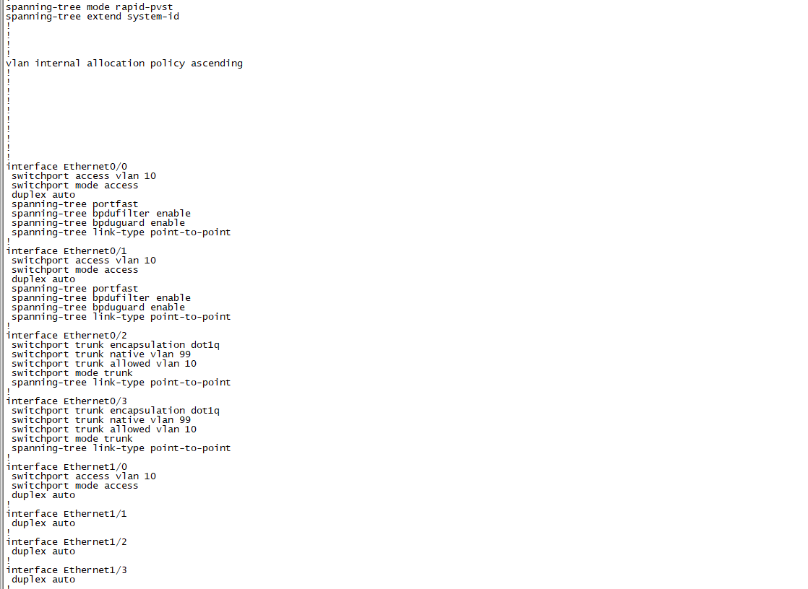


on **ASW2**:
```bash
# STP mode = Rapid PVST+
spanning-tree mode rapid-pvst

# Access ports in VLAN 20
interface range e0/0-1
  switchport mode access
  switchport access vlan 20

# Trunk ports + allowed & native VLAN + duplex
interface range e0/2-3
  switchport trunk encapsulation dot1q
  switchport mode trunk
  switchport trunk allowed vlan 20
  switchport trunk native vlan 99
  duplex full

# STP settings for access ports
interface range e0/0-1
  spanning-tree portfast
  spanning-tree bpduguard enable
  spanning-tree bpdufilter enable

# (Edge + point-to-point) for end hosts
interface range e0/0-3
  spanning-tree link-type point-to-point
```

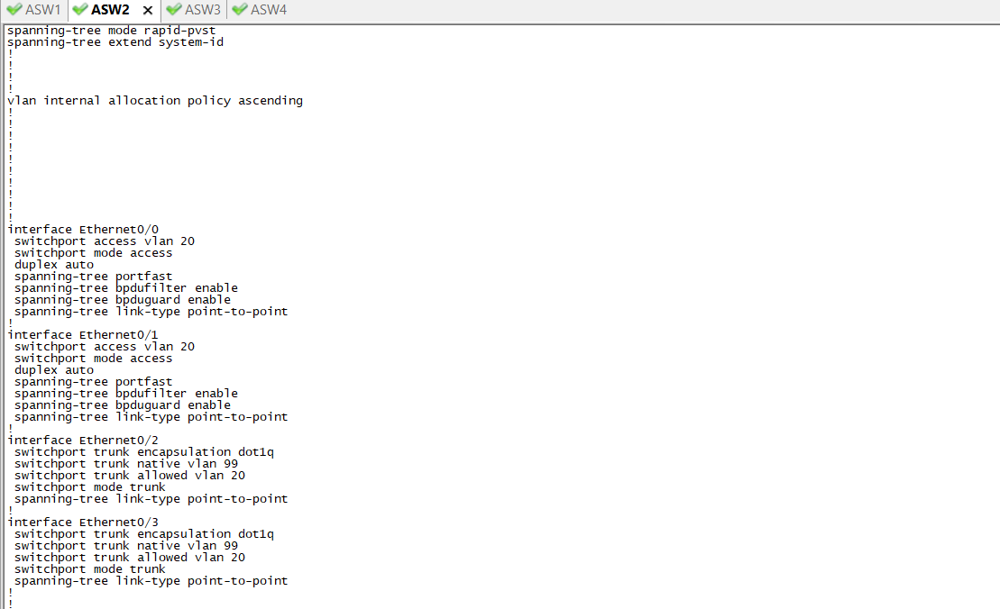


On **ASW3**:
```bash
# STP mode = Rapid PVST+
spanning-tree mode rapid-pvst

# Access ports in VLAN 30
interface range e0/0-1
  switchport mode access
  switchport access vlan 30

# Trunk ports + allowed & native VLAN + duplex
interface range e0/2-3
  switchport trunk encapsulation dot1q
  switchport mode trunk
  switchport trunk allowed vlan 30
  switchport trunk native vlan 99
  duplex full

# STP settings for access ports
interface range e0/0-1
  spanning-tree portfast
  spanning-tree bpduguard enable
  spanning-tree bpdufilter enable

# (Edge + point-to-point) for end hosts
interface range e0/0-3
  spanning-tree link-type point-to-point
```

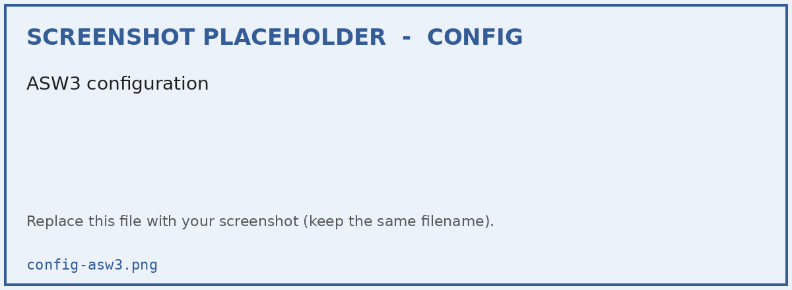


on ASW4:
```bash
# STP mode = Rapid PVST+
spanning-tree mode rapid-pvst

# Access port in VLAN 40
interface range e0
  switchport mode access
  switchport access vlan 40

# Trunk ports + allowed & native VLAN + duplex
interface range e0/2-3
  switchport trunk encapsulation dot1q
  switchport mode trunk
  switchport trunk allowed vlan 40
  switchport trunk native vlan 99
  duplex full

# STP settings for the access port
interface range e0/0
  spanning-tree portfast
  spanning-tree bpduguard enable
  spanning-tree bpdufilter enable

# (Edge + point-to-point) for the access port & point-to-point for trunk ports
interface range e0/0, e0/2-3
  spanning-tree link-type point-to-point
```

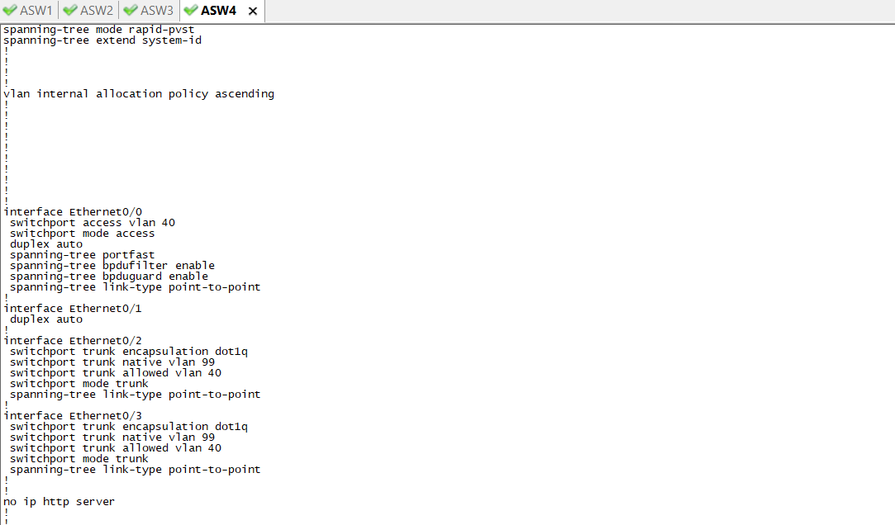

### Core switches
On **DSW1**:
```bash
# STP mode = Rapid PVST+
spanning-tree mode rapid-pvst

# Downlink trunk ports with ASWs
interface range g0/0-2,g2/2
  switchport trunk encapsulation dot1q
  switchport mode trunk
  switchport trunk native vlan 99

# VLAN 10 allowed - link with ASW1
interface g0/0
  switchport trunk allowed vlan 10

# VLAN 20 allowed - link with ASW2
interface g0/1
  switchport trunk allowed vlan 20

# VLAN 30 allowed - link with ASW3
interface g0/2
  switchport trunk allowed vlan 30

# VLAN 40 allowed - link with ASW4
interface g2/2
  switchport trunk allowed vlan 40
  exit

# VTP domain = CBI-LAN
vtp domain cbi.local

# VLANs names
vlan 10
  name HR
vlan 20
  name SALES
vlan 30
  name IT
vlan 40
  name CONTROL
  exit

# Etherchannel load balancing = src & dst IP
port-channel load-balance src-dst-ip

# Etherchannel group
int po10
  switchport trunk encapsulation dot1q
  switchport mode trunk
  switchport trunk native vlan 99
  switchport trunk allowed vlan 10,20,30,40

# LACP group interfaces
interface range g2/0-1, g1/2-3
  channel-group 10 mode active
  switchport trunk encapsulation dot1q

# Uplink trunk ports
interface range g1/0-1
  switchport trunk encapsulation dot1q
  switchport mode trunk
  switchport trunk allowed vlan 10,20,30,40
  switchport trunk native vlan 99
  exit

# STP primary - VLANs 10 & 20 / STP secondary - VLANs 30 & 40
spanning-tree vlan 10 root primary
spanning-tree vlan 20 root primary
spanning-tree vlan 30 root secondary
spanning-tree vlan 40 root secondary
```


On **DSW2**:
```bash
# STP mode = Rapid PVST+
spanning-tree mode rapid-pvst

# Downlink trunk ports with ASWs
interface range g0/0-2,g2/2
  switchport trunk encapsulation dot1q
  switchport mode trunk
  switchport trunk native vlan 99

# VLAN 10 allowed - Trunk link with ASW1
interface g0/0
  switchport trunk allowed vlan 10

# VLAN 20 allowed - Trunk link with ASW2
interface g0/1
  switchport trunk allowed vlan 20

# VLAN 30 allowed - Trunk link with ASW3
interface g0/2
  switchport trunk allowed vlan 30

# VLAN 40 allowed - Trunk link with ASW4
interface g2/2
  switchport trunk allowed vlan 40
  exit

# Etherchannel load balancing = src & dst IP
port-channel load-balance src-dst-ip

# Etherchannel group
int po10
  switchport trunk encapsulation dot1q
  switchport mode trunk
  switchport trunk native vlan 99
  switchport trunk allowed vlan 10,20,30,40

# LACP group interfaces
interface range g2/0-1, g1/2-3
  channel-group 10 mode active
  switchport trunk encapsulation dot1q

# Uplink trunk ports with FWs
interface range g1/0-1
  switchport trunk encapsulation dot1q
  switchport mode trunk
  switchport trunk allowed vlan 10,20,30,40
  switchport trunk native vlan 99
  exit

# STP primary - VLANs 30 & 40 / STP secondary - VLANs 10 & 20
spanning-tree vlan 10 root secondary
spanning-tree vlan 20 root secondary
spanning-tree vlan 30 root primary
spanning-tree vlan 40 root primary
```

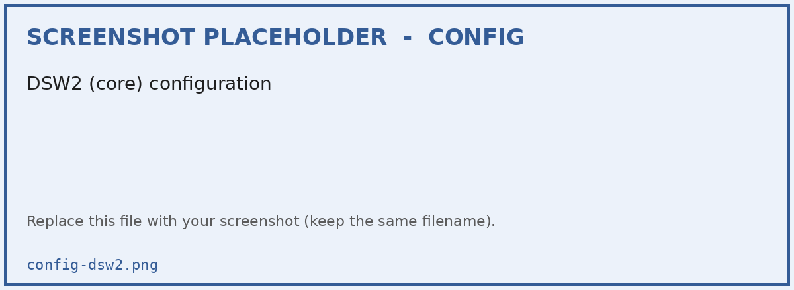


### Concept
<!-- TODO(verify): VTP domain name - the command uses cbi.local but the text and the Mgmt-Switch note say CBI-LAN -->
STP config:
- STP mode is Rapid PVST+ for all switches.
- portfast + bpduguard + bpdufilter enabled on all access ports of ASWs.
- STP link-type is configured as point-to-point on all ports of all ASWs, which becomes:
	- point-to-point + edge on access ports (*portfast enabled*).
	- point-to-point on trunk ports (*connections between switches*).
- DSW1 is the primary root bridge on VLANs 10 & 20, and the secondary on VLANs 30 & 40.
- DSW2 is the primary root bridge on VLANs 30 & 40, and the secondary on VLANs 10 & 20.

Switches interfaces config:
- On ASWs, Ports connected to endhosts are access ports in their corresponding VLAN.
- On ASWs, ports connected to DSWs are trunk ports.
- Only one corresponding VLAN is allowed on the trunk links between ASWs and DSWs
- Native VLAN on all trunk links is VLAN 99 (*configured on both sides of the link*).
- The used trunking(*tagging*) protocol is 802.1q for all trunk links.
- Ports in the links between DSWs are configured in the trunk l2 etherchannel group 10.
- The DSWs uplinks (*connected to firewalls*) are configured as trunk interfaces.
- The DSWs trunk uplinks allow VLANs 10,20,30,40 (*VLAN 99 as native*).

VLANs config:
- VLAN10 - HR (*ASW1*), VLAN20 - Sales (*ASW2*) , VLAN30 - IT (*ASW3*), VLAN40 - CONTROL(*ASW4*)
- All VLANs are created and named in DSW1, then the VLANs database converges to all other internal LAN switches via VTP. Any later change will be synced as well.

VTP config:
- All internal LAN switches are left as VTP servers.
- A VTP domain cbi.local is configured on DSW1, then VLANs general config is edited only from DSW1, the other switches join the domain automatically and sync their databases.

Etherchannel config:
- L2 Etherchannel with LACP active mode is configured on the links between both DSWs.
- The group's interface is configured as trunk (*all group interfaces will automatically be trunk*)
- Allowed VLANs are 10,20,30,40 on the group links (*configured directly on the group's interface*).
- Native VLANs is 99 on the group links (*also configured directly*).

## Duplex commands

In the Hub site :
```bash
# On access switches
en
conf t
interface range e0/2-3
  duplex full

# On Mgmt switch
en
conf t
interface range e0/0-1
  duplex full
```

## Switch management (SSH)

### DSW1 & DSW2
For **DSW1**:
```bash
# configure mgmt interface
interface g0/3
  description OOB-Management-Link
  no switchport
  ip address 192.168.10.11 255.255.255.0
  no shutdown
  exit

# Set hostname & domain name
hostname DSW1
ip domain-name cbi.local

crypto key generate rsa
# [Choose 2048 as the key size]

# Force ssh version 2
ip ssh version 2

# Create a local admin account with a secure password
username abdelilah privilege 15 secret <SWITCH_ADMIN_PASSWORD>

# Configure VTY lines
line vty 0 4
  login local
  transport input ssh
```

- Then run the same on **DSW2**, only change the IP address of **G0/3** to ``192.168.10.12`` and the hostname to ``DSW2``.

### Mgmt-Switch & DMZ-Switch
Make sure the Mgmt-Switch is unplugged from the core switches and run:
```bash
# Mgmt-Switch
vtp mode transparent

# DMZ-Switch
vtp mode transparent
```
- This way, both the **DMZ switch** and the **Mgmt switch** won't join the VTP domain "**CBI-LAN**" that has already been created on core switches.
- After this, you can plug the switches back as they were.

Then run the following to configure remote access to the **DMZ switch**:
```bash
# Configure SVI 1 for management
interface vlan 1
  ip address 192.168.10.2 255.255.255.0
  no shutdown
  exit
```
- We don't need a default gateway here as both the **mgmt host** and the **DMZ switch** are on the same subnet..

Then, configure SSH on the **DMZ-Switch**:
```bash
# Set hostname & domain name
hostname DMZ-Switch
ip domain-name cbi.local

crypto key generate rsa
# Choose 2048 as the key size

# force ssh version 2
ip ssh version 2

# Create a local admin account with a secure password
username abdelilah privilege 15 secret <SWITCH_ADMIN_PASSWORD>

# Configure VTY lines
line vty 0 4
  login local
  transport input ssh
```

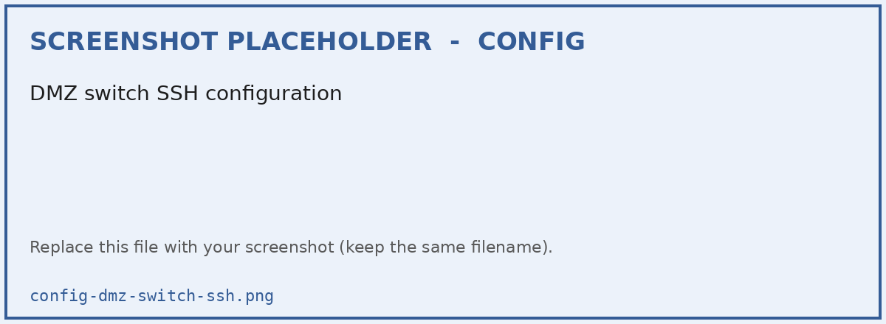


### Concept
- The **management subnet** IP scope is ``192.168.10.0/24``
- The management interfaces for both **l3 switches** are configured as routed interfaces and are assigned an IP address in the management subnet.
- For the **DMZ switch**(*l2 switch*), VLAN1 is configured as the management VLAN and its SVI is assigned an IP address in the management subnet
	- The **Mgmt switch** therefore doesn't need any special VLAN config as VLAN1 is the default native VLAN on all switches.
- The **hostname** & **domain name** are crucial in forming the SSH keys name The name for the keys will be: ``<HOSTNAME>.<DOMAIN-NAME>``
- The **RSA keys** are used for **SSH**, and the used key size is ``2048`` which is considered secure.
- On your **mgmt host**'s terminal, to connect remotely through **SSH**:
	- Use ``ssh <ADMIN-NAME>@<MGMT-IP>``  to connect to core switches
	- Use ``ssh -c aes256-cbc <ADMIN-NAME>@<MGMT-IP>``  to connect to the DMZ switch
		- The **mgmt host** is Windows 10, and it automatically blocks the old **CBC** encryption algorithms. While the old **l2 switches** used in the lab still rely on these old ciphers, so by using the command above, we're **explicitly** telling the Windows host to allow those ciphers for this specific connection.
- **SSH v2** uses **AES** or **ChaCha20** encryption by default, while **SSHv1** uses **3DES** or **IDEA** by default, that's why we're forcing the switches to use the 2cd version of SSH.

## Verification and tests

Each test lists where to run it, the command and the expected result, followed by a screenshot placeholder. Replace the placeholder images in `img/` with your own screenshots (same filename) and adjust any test to what you actually ran.

### Test 1 - VLANs propagated by VTP

- **Run on:** DSW2 and ASW1
- **Command / action:** `show vlan brief`
- **Expected result:** VLANs 10, 20, 30 and 40 are present on every switch although they were only created on the VTP server.

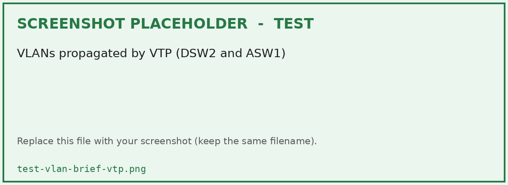

### Test 2 - VTP status

- **Run on:** DSW2
- **Command / action:** `show vtp status`
- **Expected result:** Domain name, mode and revision match across the switches.

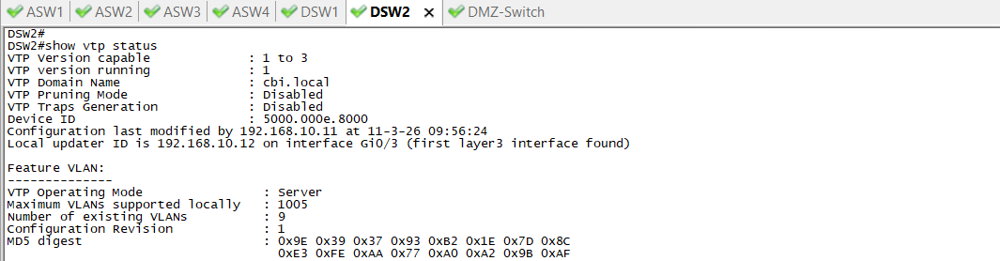

### Test 3 - Trunks

- **Run on:** DSW1
- **Command / action:** `show interfaces trunk`
- **Expected result:** Trunk ports up, native VLAN 99, allowed VLANs as configured.

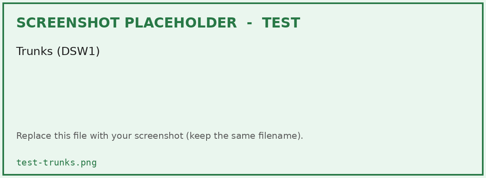

### Test 4 - EtherChannel (LACP)

- **Run on:** DSW1
- **Command / action:** `show etherchannel summary`
- **Expected result:** Port-channels in use `(SU)` with member ports bundled `(P)`.

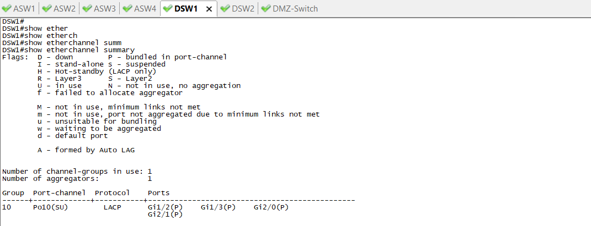

### Test 5 - Spanning-tree roots

- **Run on:** DSW1 and DSW2
- **Command / action:** `show spanning-tree root`
- **Expected result:** DSW1 is root for VLANs 10 and 20, DSW2 for VLANs 30 and 40.

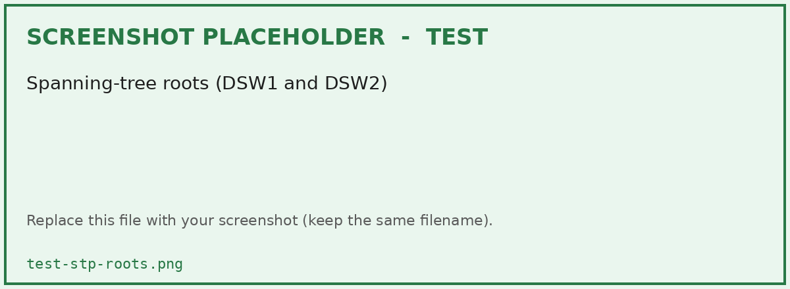

### Test 6 - SSH management

- **Run on:** Management host
- **Command / action:** `ssh abdelilah@<DSW1-mgmt-IP>` and `ssh -c aes256-cbc abdelilah@<DMZ-switch-IP>`
- **Expected result:** SSH login succeeds; telnet is not accepted.

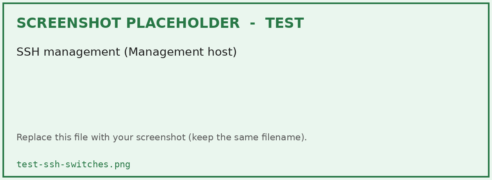
