# 02 - Firewall base: DNS/NTP, LAN ports, VLANs, DHCP and management

[Previous: 01-campus-lan](../01-campus-lan/README.md) | [Main README](../README.md) | [Next: 03-ha-sdwan](../03-ha-sdwan/README.md)

Base configuration of the FortiGate firewalls before HA: DNS and NTP, the redundant LAN interface towards the core switches, the VLAN interfaces with DHCP servers, and out-of-band management access.

## DNS and NTP on the firewalls

### Hub + Branch Firewalls

#### DNS config (hub primary FW + spokes FWs)

From the lefthand panel, Go to **Network** > **DNS**, and set the primary & secondary DNS to `8.8.8.8`, `1.1.1.1` (*it was by default set to Fortiguard servers IPs, but connectivity to those servers is impossible with the free trial license*).

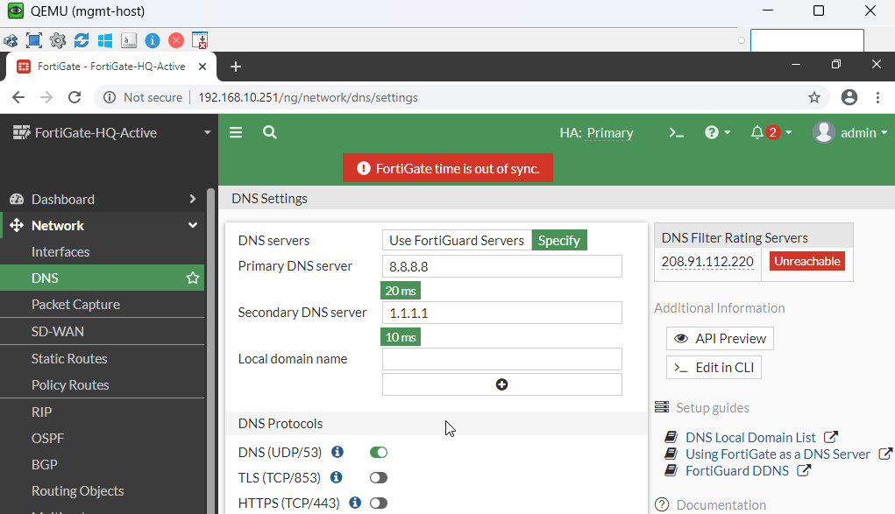

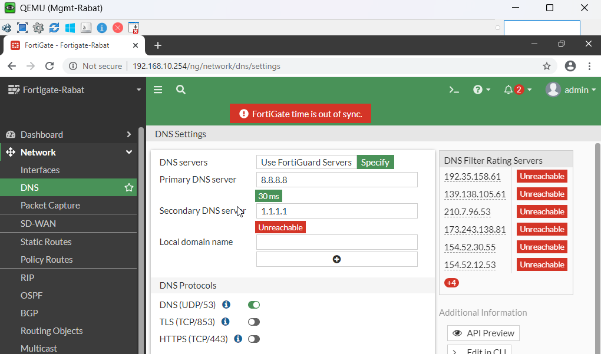


##### NTP config (hub primary FW + spokes FWs)

The FW's time zone is set to **Casablanca** for the hub's primary and all branches. The hub's primary FW is configured as an NTP server, listening on the **MGMT interface** (*`port6`*). While each branch firewall is configured as an NTP server listening on its own **LAN interface**.

<!-- TODO(verify): the hub NTP server listens on port6 (MGMT) but the DC is pointed at the VLAN40 interface IP 10.1.40.254; check the NTP server interface list on the hub FW -->

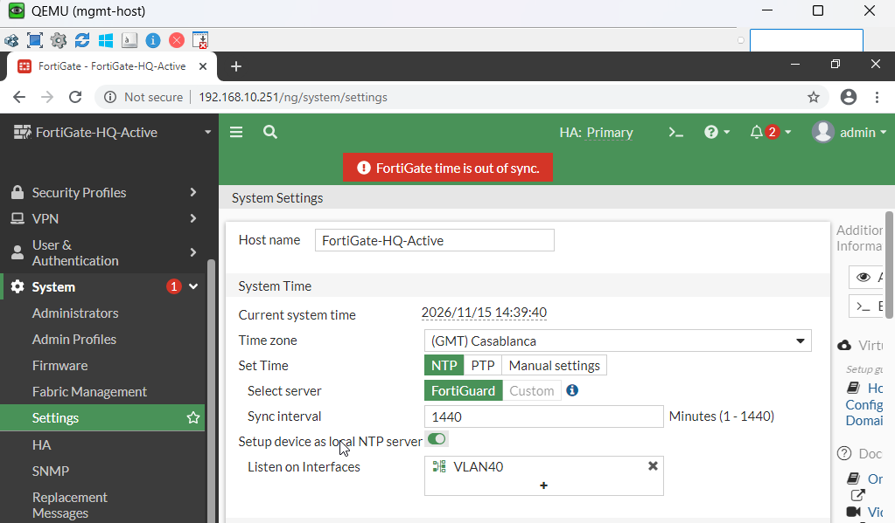


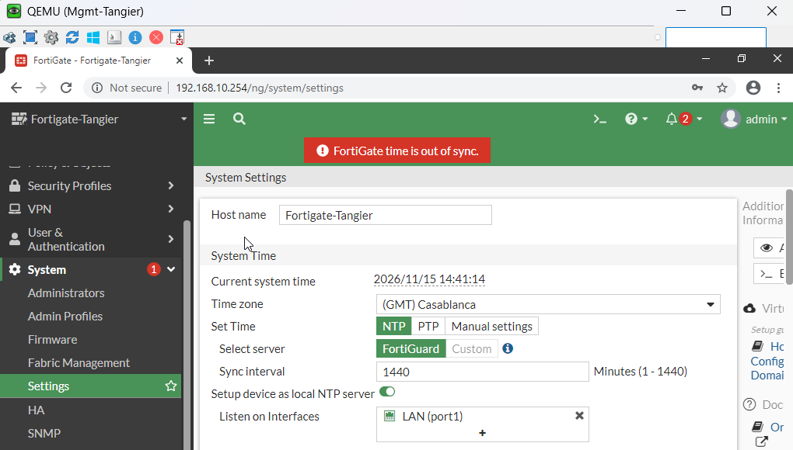

## Firewall LAN ports, VLANs and DHCP

### Hub Firewall

The whole config is done on the **Primary Firewall**(*active*). the Secondary FW syncs via HA.

#### Redundant interface config

* Both LAN ports(*connected to DSWs*) are bundled into one redundant interface.
* Only one interface is active (*the one listed first as a member*), the other interface is a standby.

  * If the active dies, the standby interface becomes active and traffic instantly switches to it.
  * If the dead interface comes back online, the earlier will still be the active interface and the later will play the standby role until the current active interface dies.
* The redundant interface doesn't have an IP address (`0.0.0.0 0.0.0.0`).
* No administrative access is configured on the redundant interface.
* The redundant interface is placed in a LAN zone.

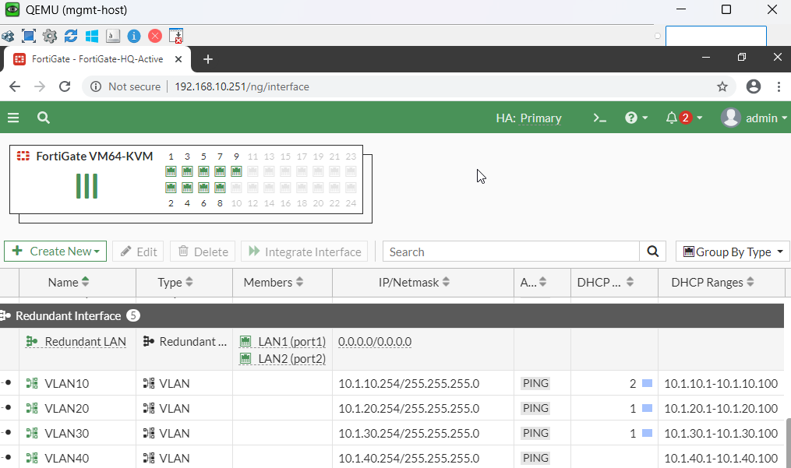


##### VLANs & DHCP config

* 4 VLAN interfaces are configured with the IP addresses `10.1.10.254` & `10.1.20.254` & `10.1.30.254` & `10.1.40.254` for VLANs 10, 20, 30, 40.
* The VLAN interfaces are assigned to the LAN redundant interface created earlier.
* The `ping` is the only  administrative access that's allowed  on the VLAN interfaces
* DHCP is configured with the range `10.1.x.1 - 10.1.x.100` on each VLAN interface (*e.g. `10.1.10.1 - 10.1.10.100` on VLAN10*). Gateway is **Same as Interface IP**. DNS is specified as the DC's IP; `10.1.40.101` from VLAN 40 (CONTROL) (*See >* [*Active Directory config*](../06-active-directory/README.md#dc-name--ip--dns--gw--policy--ie-security)).


### Branch Firewalls

* `port1` of each branch firewall is placed in a LAN zone, and configured as a DHCP server for the LAN subnet. The DHCP range on each branch firewall is `10.x.0.1 - 10.x.0.100`
* In the DHCP settings, Gateway is the LAN Interface's IP, and DNS is the system's DNS.
* The `ping` is the only  administrative access that's allowed  on the LAN interface.
* The LAN interface is configured with the last IP in each branch network, that is; `10.x.0.254`

---

*To set up endhosts to pick DHCP settings from DHCP server, see >* [*Get DHCP settings - Endhosts*](#end-host-dhcp-settings)

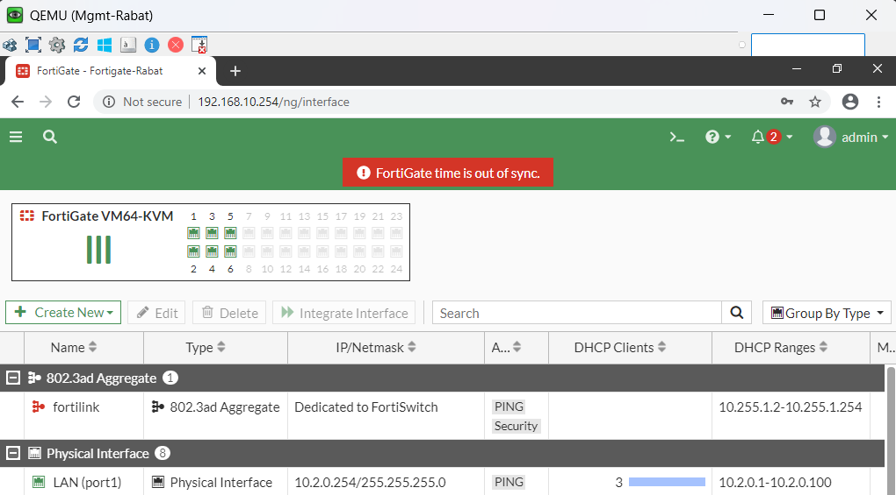

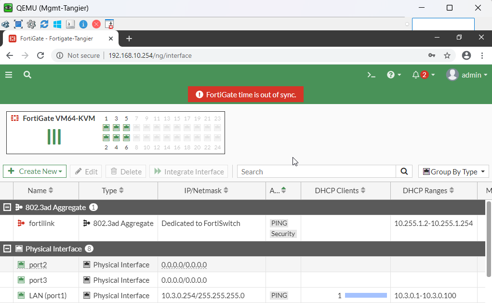

## End-host DHCP settings

For Windows hosts, just accept joining the requested network once you turn the device on

For the VPCs, to test whether DHCP is working or not, run:

```bash
ip dhcp
```

* This will trigger a **DHCP Discover** message, which will lead to completing a **DORA process**, and eventually get a dynamic IP address by DHCP.

Then, to see the assigned IPs on the VPCs, run:

```
show ip
```

The previous command on VPCs was just to test if DHCP is working properly. To configure those devices to trigger this **DHCP Discover** message automatically every time they boot up:

* **Turn off** your VPC and go to the left sidebar on EVE-NG, click on **Startup configs**
* Choose the target VPC node, a text box will show up on the right, type `dhcp` and click **Save**
* **Toggle off** the button next to your VPC's name and close the window.
* **Right-click** your VPC and choose **Edit**. Scroll down to the **Startup configuration** section, you should now see `Exported` as the selected item (*Before, it was `None`*).
* Now, **turn on** your VPC and join its CLI, you'll notice that a **DORA process** will run automatically.
* If it doesn't pick up DHCP setting automatically, manually run `ip dhcp` to get it.

---

*To set up DHCP servers, see >* [*FW's LAN ports config (VLANs & DHCP)*](#firewall-lan-ports-vlans-and-dhcp)

## Firewall management access

### Hub Firewalls config

Run from the **CLI**:

```bash
# On the primary FW
config system interface
 edit port6
   set mode static
   set ip 192.168.10.254 255.255.255.0
   set allowaccess ping https ssh http
   next
end
```

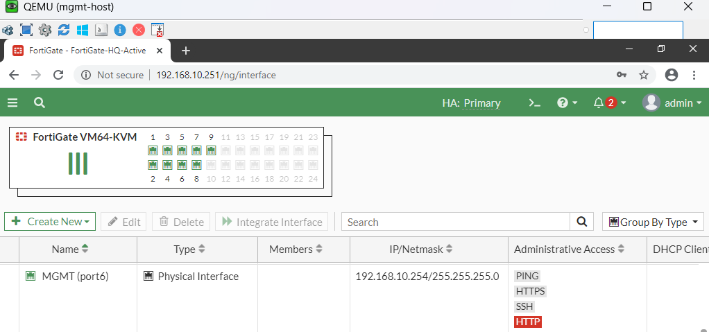

> **Note:** `192.168.10.254` is the temporary management address used before HA is configured. Once the cluster is formed each unit gets its own management IP (`192.168.10.251` on the primary, `192.168.10.252` on the secondary), see [FW's HA & SD-WAN & zones & default route config](../03-ha-sdwan/README.md#ha-cluster-sd-wan-zone-and-default-route).

* ou don't have to configure ``port6`` for the secondary FW's GUI access. After you configure HA on both firewalls, you'll be able to set up a separate management IP for each member of the HA cluster (*see >* [*FW's HA & SD-WAN & zones & default route config*](../03-ha-sdwan/README.md#ha-cluster-sd-wan-zone-and-default-route)).
* But, you still have to connect ``port6`` of the secondary FW the switch leading to the mgmt host.

### Branch Firewalls config

Run from the **CLI**:

```bash
# On all branch FWs
config system interface
 edit port6
   set mode static
   set ip 192.168.10.254/24
   set allowaccess ping https ssh http
   next
end
```

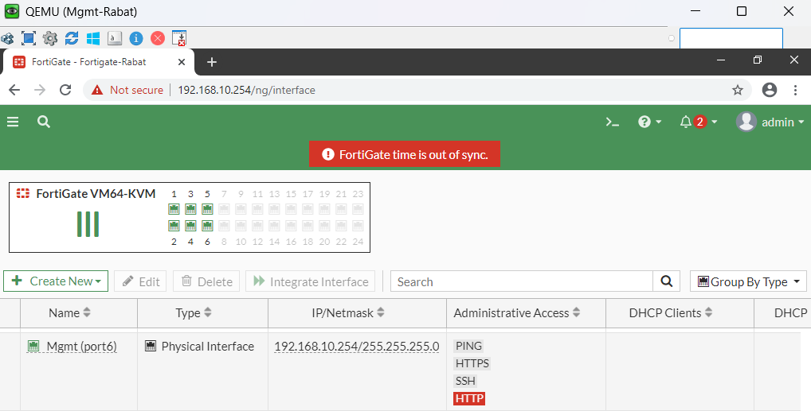

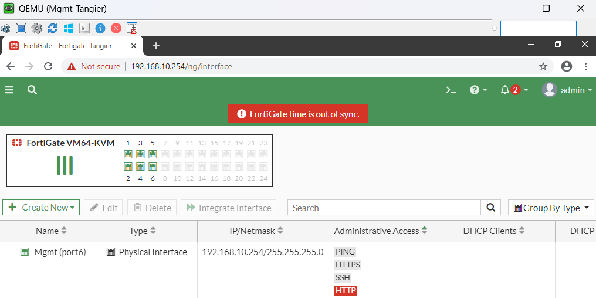

### Concept

For the hub. A management host (*Windows*) is placed on the MGMT zone and given an IP of `192.168.10.60`. The host gets access to the GUI through the management IP configured on `port6` of each unit (`192.168.10.251` on the primary and `192.168.10.252` on the secondary once HA is configured; `192.168.10.254` is the temporary address used before that). The management host is connected to the **Mgmt-Switch** which is connected to `port6` of both firewalls from the other side.

For each branch. A management host (*Windows*) is connected directly to `port6` of the branch firewall. `Port6` of each spoke firewall is given an IP of `192.168.10.254`, while the managament host in each spoke is configured with the IP `192.168.10.60` on its ethernet interface.

## Verification and tests

### Test 1 - DHCP on a VLAN (VPC)

* **On:** HR2 (VPCS)
* **Command:** `ip dhcp` then `show ip`
* **Result:** Address in 10.1.10.0/24, gateway 10.1.10.254, DNS handed out.

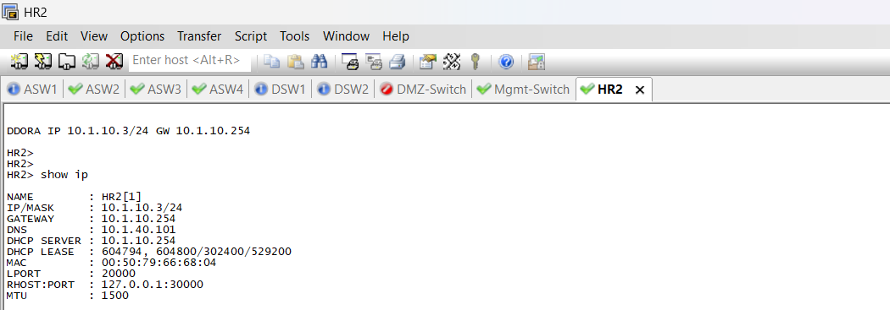

### Test 2 - DHCP on a VLAN (Windows)

* **On:** Sales1
* **Command:** `ipconfig /all`
* **Result:** Address in 10.1.20.0/24 with the DHCP-provided gateway and DNS.

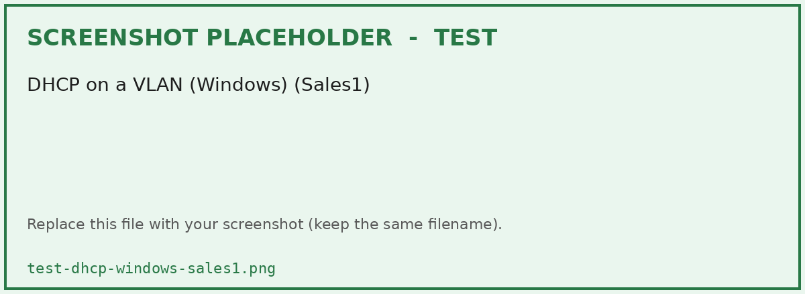

### Test 3 - DHCP at Rabat

* **On:** Rabat end host
* **Command:** `ipconfig /all`
* **Result:** Address in 10.2.0.0/24, gateway 10.2.0.254.

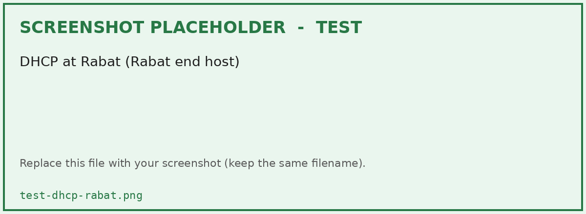

### Test 4 - DHCP at Tangier

* **On:** Tangier end host
* **Command:** `ipconfig /all`
* **Result:** Address in 10.3.0.0/24, gateway 10.3.0.254.

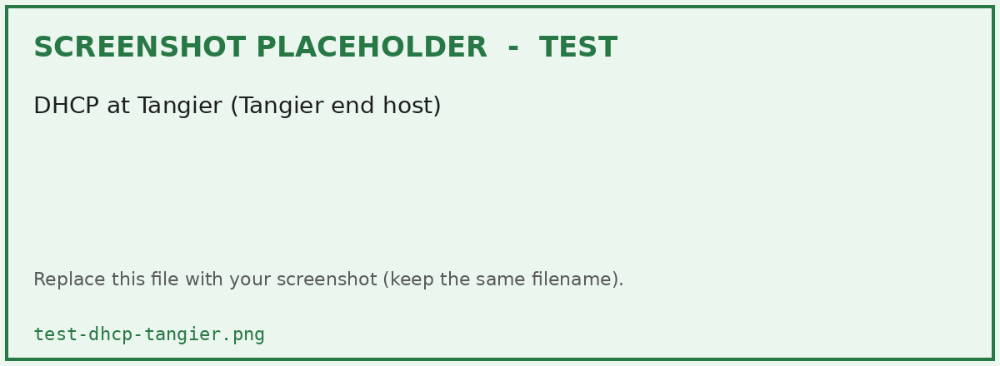

### Test 5 - Redundant interface failover

* **On:** HR1.
* **Command:** `ping 10.1.10.254 -t` while disabling the active member port
* **Result:** Brief loss at most; the standby member takes over.

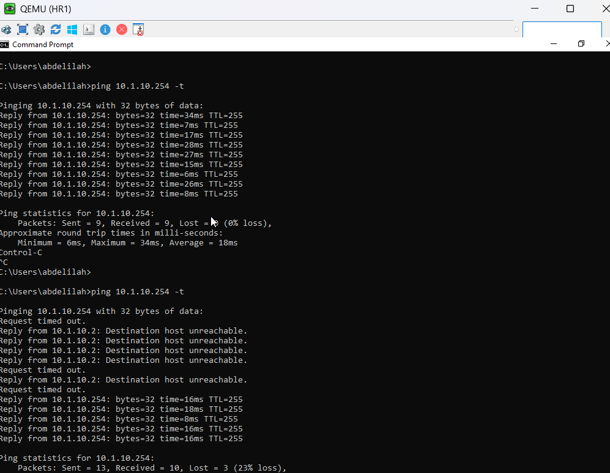

### Test 6 - Management GUI access

* **On:** Management host
* **Action:** Browse to `https://192.168.10.251`
* **Result:** FortiGate login page reachable from the management network.

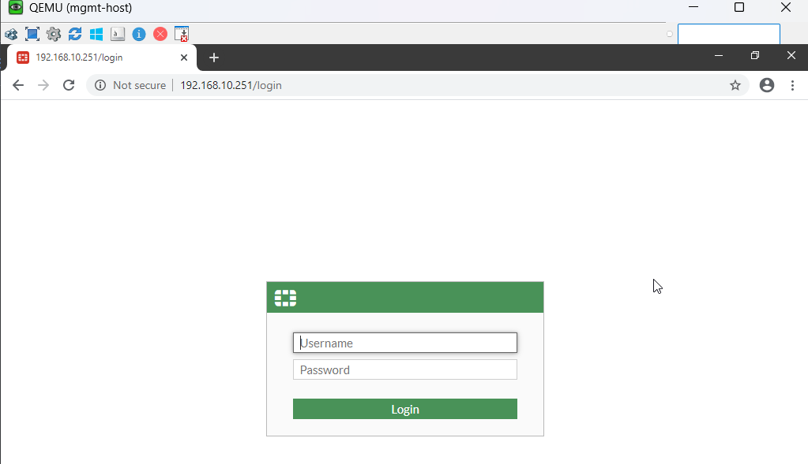

## References

* [Redundant interface config](https://youtu.be/6oaE4Y2QCgs)
* [VLANS & DHCP config / inter-VLAN routing & VLAN s to WAN policies config](https://youtu.be/j_lZI_m6sgU)

