# 03 - High availability, dual-ISP SD-WAN and internet access

[Previous: 02-firewall-base](../02-firewall-base/README.md) | [Main README](../README.md) | [Next: 04-bgp-underlay](../04-bgp-underlay/README.md)

The hub firewalls form an active-passive HA cluster. WAN1/WAN2 are grouped in an SD-WAN zone with a performance SLA, a default route and an outbound policy. This phase also covers giving the EVE-NG lab real internet access.

## HA cluster, SD-WAN zone and default route

### Hub Firewall
#### Config
Follow what is on the [video](https://youtu.be/EJ7HTXDL7E4?si=EpuKjwRdetV5Zumg) but apply the following **custom changes**:
- For the **LAN ports** config, see [FW's LAN ports config (VLANs & DHCP)](../02-firewall-base/README.md#firewall-lan-ports-vlans-and-dhcp)
- **Ports numbers** are different from the video, customize them from the topology.
- Add a **DMZ zone** and put the DMZ interface in it.
- Specify the IP address of the ISP router on the other end as the **Gateway** when configuring each **SD-WAN member** (*this is done for both ports labeled as WAN1 & WAN2*)
- You don't need routing here. To set up routing. See > ([Routing config (BGP)](../04-bgp-underlay/README.md#bgp-configuration)).
- Connect each ISP router to an **internet cloud** and configure **NAT** on the routers (*Make sure the IP address of each ISP router in pnet1's subnet is different than the other, inside NAT is applied to the ISP router interfaces connected to the Hub firewall and those connected to the branch firewalls of the same ISP and outside NAT is applied to the interface connected to the internet cloud (cloud1 which corresponds to pnet1 which is configured to provide internet)*).
	- See > [Internet access in cloud EVE-NG](#internet-access-for-eve-ng)
	<!-- TODO(add): the NAT commands for the ISP routers lived in a separate note (NAT config) that is not part of this repo yet -->
- Don't configure the policy as in the video, a **VLANs to SD-WAN** policy has to be configured to allow internet access for the VLANs endhosts. The policy is set up with the following settings:
	- **Name**: ``VLANs-to-SDzone``
	- **Incoming Interface** (*multiple*): ``VLAN10`` & ``VLAN20`` & ``VLAN30`` & ``VLAN40``
	- **Outgoing Interface** (*zone*): ``SD-ZONE``
	- **Source** (*multiple IP objects*): VLAN10,20,30,40's subnet IP objects.
	- **Destination**: ``all``
	- **Service**: ``ALL`` / **Schedule**: ``always`` / **Action**: ``ACCEPT`` / **NAT**: *enabled*
- This policy will be edited later on in [Internet access from DMZ](../07-dmz-webserver/README.md#internet-access-from-dmz).

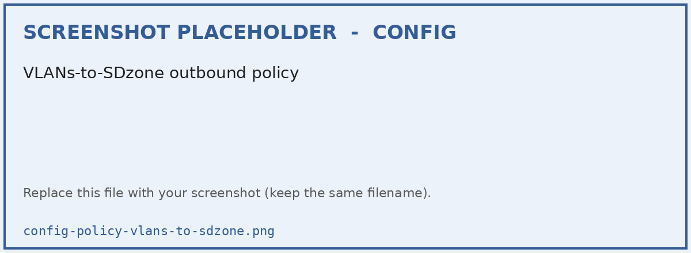


#### Config details
Before you set up HA, you have to configure ``port6`` of the **primary FW** with a static IP for prior management (*see > [Management config - Firewalls](../02-firewall-base/README.md#firewall-management-access)*).

Then, the **HA cluster** is configured on the primary firewall from the GUI as the following:
- Choose the ``Active-Passive`` mode.
- Use ``HA-GROUP`` as the name of the **HA group** (*same Group name & Password*) with the 2 HA interfaces labeled as ``heartbeat-1``(*port7*) & ``heartbeat-2``(*port8*).
- Use the **password** ``<HA_PASSWORD>``
- Give the Primary-FW a **priority** of ``200`` (*higher than the one we'll give to the secondary*).
- Don't reserve any port for management.
- Enable ``Session pickup``.

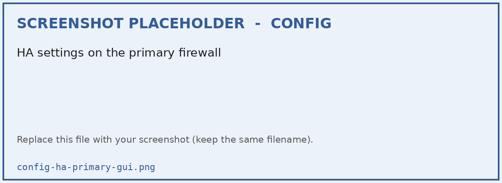


<!-- TODO(verify): the GUI step uses the group name HA-GROUP but this CLI uses `ha`; both units must use the same group name -->
Then, from the secondary FW's CLI, run the next commands to configure HA:
```bash
config sys ha
  set group-name ha
  set priority 100
  set mode a-p
  set password <HA_PASSWORD>
  set hbdev port7 0
  set hbdev port8 0
  set session-pickup enable
  end
```

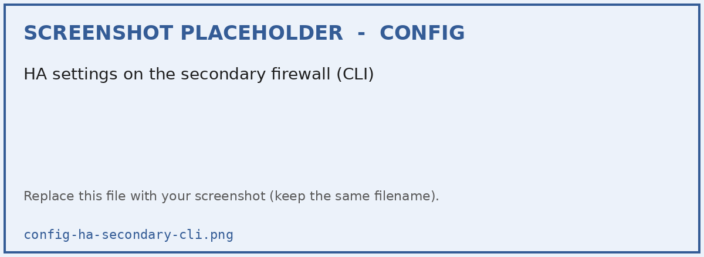


After this, you have to configure a mgmt IP for each FW in the HA cluster.

From each firewall's CLI, run:
```bash
# On the primary FW
config system interface
  edit port6
    set management-ip 192.168.10.251/24
    end

# On the secondary FW
config system interface
  edit port6
    set management-ip 192.168.10.252/24
    end
```

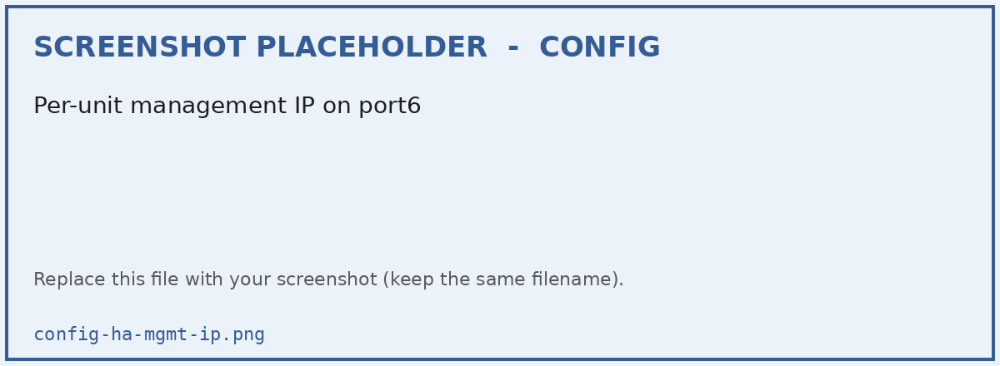

- These are the IPs that will be used later on to access the firewalls GUIs.

After configuring the HA cluster, all later configs are done only on the **Primary-FW**. The **Secondary-FW** automatically syncs its config to match it.

An **SD-WAN zone** called ``SD-ZONE`` is created, **WAN1**(*port5*) & **WAN2**(*port4*) are set up as the **SD-WAN members** in this zone (*WAN1's cost is ``0`` while WAN2's cost is ``1``*), the **gateway** is specified as the IP address of the **ISP router's interface** on the other end of each WAN port (*In the video, it was dynamic since there were built-in DHCPs on the interfaces of the routers).

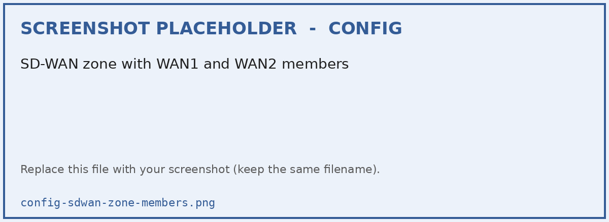


A **static default route** is configured on the firewall pointing to the SD-WAN zone as the outgoing interface

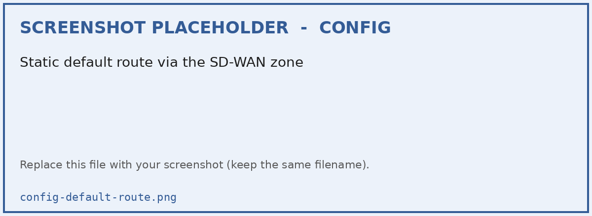


A performance SLA called ``SlaCheck`` is configured, **SLA target** is enabled with the default thresholds of latency, jitter, and packet loss (*you might wanna increase the thresholds a little bit since it's a lab environment*). The probe mode is **Active** and the protocol used for health check is **ping**. The target server is ``8.8.8.8`` on the internet. **Participants** are the physical WAN interfaces set up as SD-WAN members (*WAN1 & WAN2 ports*).

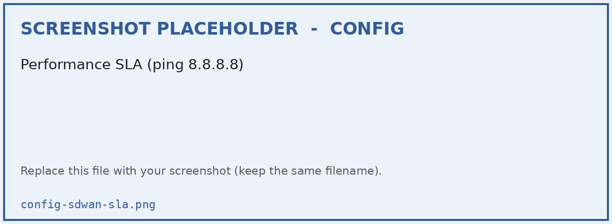


An **SD-WAN rule** called ``SD-Rule`` is configured to match all type of traffic coming from the local LAN and going to any dst IP on the internet (*from Local-LAN subnet to any dst IP*). The chosen strategy is **Lowest cost(SLA)** which load balances traffic between SD-WAN members that succeeds the SLA evaluation.  ``WAN1`` is prefered over ``WAN2`` in **Interface preferance**. **Zone preference** is the ``SD-ZONE`` created earlier and the **SLA target** is ``SlaCheck`` created earlier.

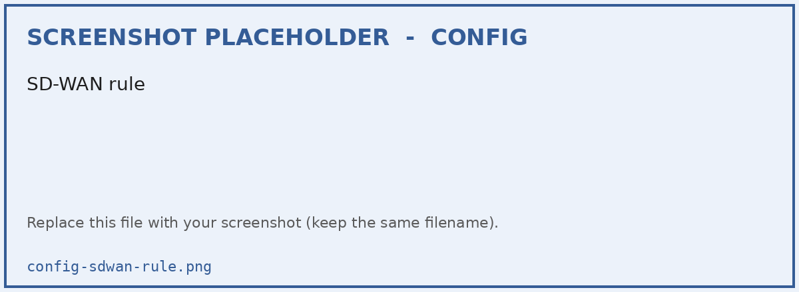

- Both WAN1 & WAN2 are configured with static IPs(*manually configured gateway*) which means they both have an AD of 10 by default(*If one was getting an IP & gateway through DHCP, its default AD will be 5*).
- And let's assume that both ``WAN1`` & ``WAN2`` are healthy based on the configured **SLA health check**
	- If their ADs were different, only the interface with a lowest AD will have an active route.
	- If any of them isn't healthy, its default static route route will be removed from the active routing table and it won't even enter the selection pool (*since ``Update static route`` was toggled on when configuring the SLA performance rule*).
- When both ``WAN1`` and ``WAN2`` meet the **SLA requirements** (*SLA thresholds*), traffic will only use ``WAN1`` (*because it has a lower cost*).
- If only ``WAN2`` meets the **SLA requirements**, traffic will only use ``WAN2``, even though it has a higher cost.
- If neither interface meets the requirements, ``WAN1`` will be used.
- If both interfaces have the **same cost** and both meet the **SLA requirements**, the first port chosen in **Interface preference** will be used.
---
### Branch Firewalls
Almost the exact same config is done on each branch firewall, with some exception:
- No HA config, since there is only one firewall in each branch.
- The SD-WAN zone name is set to ``SD-ZONE``. SD-WAN members, performance SLA, and the SD-WAN rule are set up the same way as in the hub.
- For the LAN part's config, see [Branch Firewalls](../02-firewall-base/README.md#branch-firewalls)
- No DMZ config, since there is no DMZ zone in branches.
- No internet config through clouds on branch ISPs, they'll have a path to the internet after configuring BGP (*[Routing config (BGP)](../04-bgp-underlay/README.md#bgp-configuration)*).
- No NAT config on branch ISPs. Instead, ``ip nat inside`` have to be run on both hub ISPs' interfaces that are connected to branch ISPs (*f1/0 - f2/0*)
- Only one **LAN to SD-WAN** policy is configured to allow internet access for the LAN endhosts. The policy is set up with the following settings:
	- **Name**: ``LAN-to-SDzone``
	- **Incoming Interface** (*zone*): ``LAN(port1)``
	- **Outgoing Interface** (*zone*): ``SD-zone``
	- **Source** (*IP object*): LAN zone's subnet IP object.
	- **Destination**: ``all``
	- **Service**: ``ALL`` / **Schedule**: ``always`` / **Action**: ``ACCEPT`` / **NAT**: *enabled*

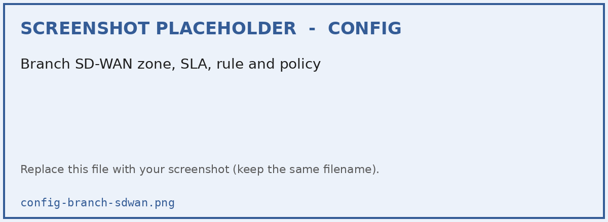

## Internet access for EVE-NG

If you're not root, run from EVE-NG's CLI:
```bash
sudo -i
```
- To make sure you're running the following commands as root, so that you don't get a    "**Permission denied**" error.

Then access the **interfaces** file by running:
```bash
nano /etc/network/interfaces
```

 For ``pnet1``, change mode from manual to **static**, and set up the **address** & **netmask**

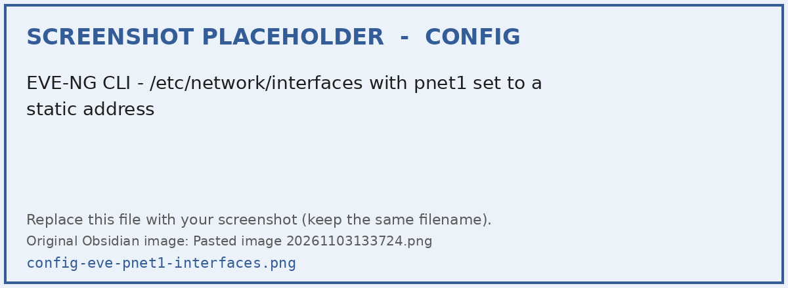

- Save and exit.
- This sets an IP address for EVE-NG's pnet1 logical interface.
- The IP address is your choice, but make sure you use an IP address scope that wasn't used in your EVE-NG lab.

For changes to take effect, run:
```bash
systemctl restart networking
```

To check that the IP address was properly assigned to your pnet1 interface, run
```
ip address
```
- check the **pnet1** section, it should show the configured IP address there.

To open the **sysctl.conf** file, run:
```bash
nano /etc/sysctl.conf
```
- Scroll down to ``#net.ipv4.ip_forward=1``, uncomment this line.
- Save and exit.
	- This enables IPv4 forwarding on the Ubuntu VM where EVE-NG is installed.

To read the modified file "``sysctl.conf``" by **sysctl**, run:
```bash
sysctl -p /etc/sysctl.conf
```
- You should get this as an output: ``net.ipv4.ip_forward=1``

To create the outbound NAT Iptables rule, run:
```bash
iptables -t nat -A POSTROUTING -s 192.168.36.0/24 -o pnet0 -j MASQUERADE
```
- This tells the Ubuntu VM(*where EVE-NG is installed*) to forward through the **pnet0** interfaces any traffic that is coming from the ``192.168.36.0/24`` subnet and going to any destination.
- Change ``-A`` with ``-D`` If you want to delete the rule.

To check your Iptables config, run:
```bash
iptables -L -nv -t nat
```

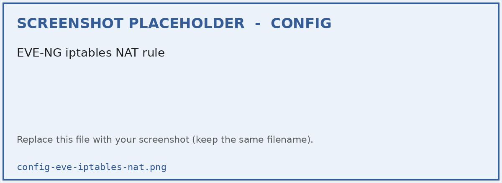

- You rule will be listed under the **POSTROUTING** chain.

To save the current Iptables rule & create a new file:
```bash
iptables-save > /etc/iptables.conf
```

Then access another file by running:
```bash
nano /etc/rc.local
```
- To restore the saved Iptables, scroll down and right before the line `exit 0`, paste the following line of code: `iptables-restore </etc/iptables.conf`
	- If the file is empty, just paste the it directly.
- Save and exit.

Then, Go to the EVE-NG VM(*e.g. windows, Kali...*) that you want to provide internet access and:
- Connect it to a network node of the the type **cloud1** (*because cloud1 in the GUI is exactly pnet1 in the CLI and it's pnet1 that we configured earlier*).
- Configure it with an IP address in the same range of EVE-NG's **pnet1** interface (the address you set earlier)
- Create a default route on it, pointing to **pnet1**'s IP address (set earlier) as the next hop.
- Set up a DNS server on it, this is optional but you'll mostly need it.
**Note! If the target node is an Ubuntu or Kali VM, you'll need to configure these stuff in the CLI, because if you do so in the GUI, it's most probable that you'll loose everything once you reboot.**

If you have multiple hosts that you want to provide internet access to, do as in the [video](https://youtu.be/3ZdG-yAJx_0?si=D-mYc233jLQ7soT7) (*or simply connect them to a switch then the switch to a network-node(cloud1)*).

### Note!
 **You have to re-run the iptables NAT (MASQUERADE) command above every time you reboot your EVE-NG VM instance in the cloud. Because, for some reasons, it gets wiped automatically on reboot.**

### Concept (optional read)
- In the cloud, there is a **real server**(*hardware*) on which an **Ubuntu server VM** is running, within that Ubuntu VM, **EVE-NG** is installed. That is exactly the **EVE-NG instance** you access through the cloud.
- The Ubuntu VM has a logical **network interface card**(*NIC card*), this is often associated with an interaface called ``eth0``. This logical interface is assigned the **internal IP address** given by **GCP** to your **EVE-NG instance**, it's the IP address of your VM within the **GCP network**. While the **external IP address** you get each time you turn on your VM is The GCP **edge device**'s interface IP address, and it changes frequently.
- EVE-NG needs a way to share the connection so the lab topologies can interact with it, that's why it creates a virtual bridge called **pnet0** and it connects **eth0** to it so that it seems like it logically assigns **eth0**'s IP address to **pnet0**. Everything destined or going from **eth0** now goes through **pnet0**.
- EVE-NG in fact creates many other virtual bridges (*pnet1, pnet2...*) for other purposes. Here, we used **pnet1**, we gave it an **IP address** and then configured a **NAT rule** on the **Ubuntu VM**(*the one on which EVE-NG is installed*), this rule allows the VM to forward anything entering from **pnet1**(*which is any traffic that belongs to pnet1's IP address scope*) through **pnet0**, eventually through **eth0** which sends it up to the **hardware server** which then sends it to other devices on the **Google cloud network**, up to the **edge device** which ultimately sends it to the destination IP on the internet (*it doesn't send it directly, well you know how routing works*).
- Then, by assigning our **node** (*the one we want to provide internet to*) an **IP address** in the same scope as **pnet1** and configuring a **default route** that point's to **pnet1's IP address**, we assure that traffic going to the **internet** finds its way (*DNS is optional if your task requires resolving domain names in while you're on the internet*)

## Verification and tests

Each test lists where to run it, the command and the expected result, followed by a screenshot placeholder. Replace the placeholder images in `img/` with your own screenshots (same filename) and adjust any test to what you actually ran.

### Test 1 - HA cluster status

- **Run on:** Primary and secondary FortiGate
- **Command / action:** `get system ha status`
- **Expected result:** Both units listed, one Primary and one Secondary, configuration in sync.

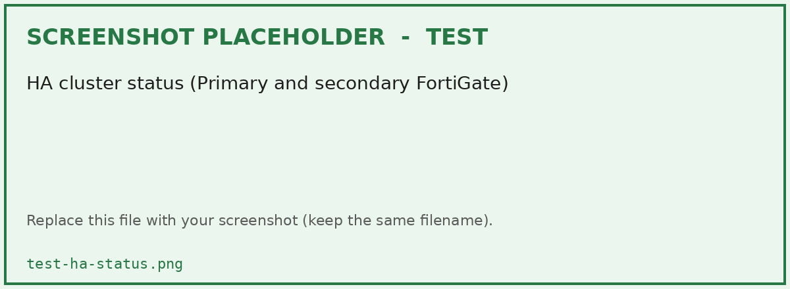

### Test 2 - HA failover

- **Run on:** VLAN host plus primary FortiGate
- **Command / action:** `ping 8.8.8.8 -t` while powering off the primary
- **Expected result:** The secondary becomes primary; only a few packets are lost.

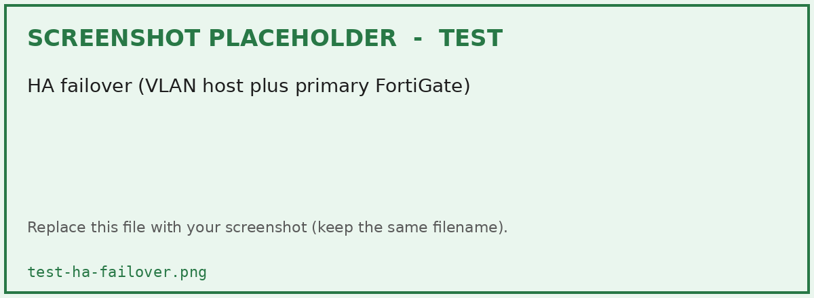

### Test 3 - SD-WAN health check

- **Run on:** Primary FortiGate
- **Command / action:** `diagnose sys sdwan health-check` (or Network > SD-WAN > Performance SLAs)
- **Expected result:** WAN1 and WAN2 both alive with latency/jitter/loss values.

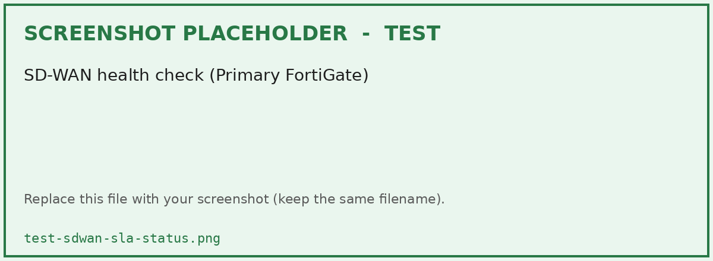

### Test 4 - Internet from a VLAN

- **Run on:** HR1
- **Command / action:** `ping 8.8.8.8`
- **Expected result:** Replies received through the SD-WAN zone.

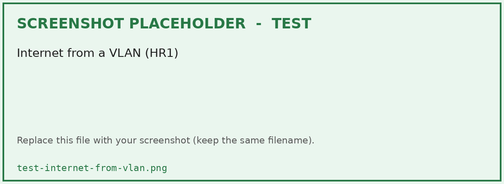

### Test 5 - DNS from the firewall

- **Run on:** Primary FortiGate
- **Command / action:** `execute ping www.google.com`
- **Expected result:** Name resolves and replies are received.

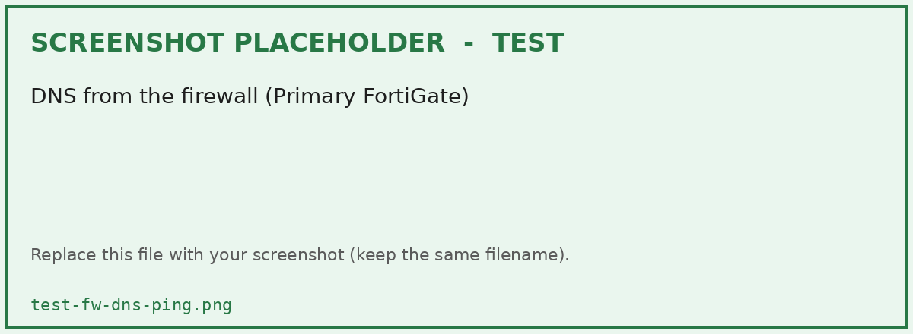

### Test 6 - WAN1 failover

- **Run on:** HR1 plus ISP link
- **Command / action:** `ping 8.8.8.8 -t` while disconnecting the WAN1 link
- **Expected result:** Traffic moves to WAN2; the SD-WAN monitor shows WAN1 dead.

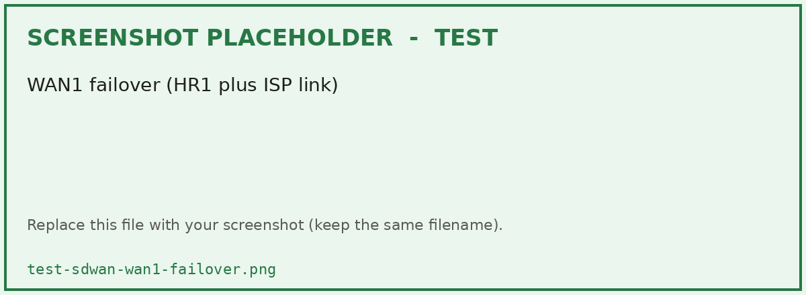

### Test 7 - ISP router internet

- **Run on:** ISP1-casa
- **Command / action:** `ping 8.8.8.8`
- **Expected result:** Replies received through the EVE-NG NAT cloud.

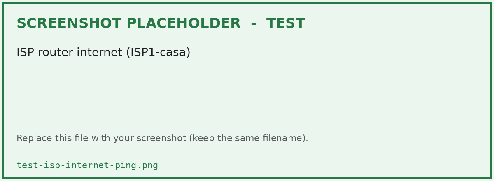

## References

- [YouTube - original HA / SD-WAN walkthrough](https://youtu.be/EJ7HTXDL7E4)
- [Fortinet documentation on SLA lowest cost strategy](https://docs.fortinet.com/document/fortigate/8.0.0/administration-guide/342836/lowest-cost-sla-strategy)
- [Devin Adams configuring Fortigate HA cluster](https://youtu.be/ph7t0qJXLHg)
- [YouTube - internet access for EVE-NG labs](https://youtu.be/3ZdG-yAJx_0)
