# 05 - IPsec VPN over SD-WAN

[Previous: 04-bgp-underlay](../04-bgp-underlay/README.md) | [Main README](../README.md) | [Next: 06-active-directory](../06-active-directory/README.md)

Each branch builds two IPsec tunnels to the hub (one per ISP path). The tunnels are SD-WAN members with latency SLAs, steered by SD-WAN rules, with a blackhole route that fails closed when no tunnel is up. Includes three troubleshooting write-ups.

## VPN configuration

### Hub Firewall config

#### SD-WAN zones & members
- Create 1 SD-WAN zone for VPN, name it "``SD-VPN``"

- Create 4 VPN interfaces as SD-WAN members, 2 for each branch:
	- **member1** : **Interface(``+VPN``)**
		- **Name**: ``VPN1-Rabat``
		- **Remote IP**: ``196.200.11.1``  (*Fortigate-Rabat's WAN1(port5) IP*)
		- **Out_interface**: ``WAN1(port5)``
		- **Pre-shared key**: ``<IPSEC_PSK>``
		- **SD-WAN zone**: ``SD-VPN``
		- *Leave the rest as default*.
	- **member2** : **Interface(``+VPN``)**
		- **Name**: ``VPN2-Rabat``
		- **Remote IP**: ``213.150.21.1``  (*Fortigate-Rabat's WAN2(port4) IP*)
		- **Out_interface**: ``WAN2(port4)``
		- **Pre-shared key**: ``<IPSEC_PSK>``
		- **SD-WAN zone**: ``SD-VPN``
		- *Leave the rest as default*.
	- **member3** : **Interface(``+VPN``)**
		- **Name**: ``VPN1-Tangier``
		- **Remote IP**: ``196.200.12.1``  (*Fortigate-Tangier's WAN1(port5) IP*)
		- **Out_interface**: ``WAN1(port5)``
		- **Pre-shared key**: ``<IPSEC_PSK>``
		- **SD-WAN zone**: ``SD-VPN``
		- *Leave the rest as default*.
	- **member4** : **Interface(``+VPN``)**
		- **Name**: ``VPN2-Tangier``
		- **Remote IP**: ``213.150.22.1``  (*Fortigate-Tangier's WAN2(port4) IP*)
		- **Out_interface**: ``WAN2(port4)``
		- **Pre-shared key**: ``<IPSEC_PSK>``
		- **SD-WAN zone**: ``SD-VPN``
		- *Leave the rest as default*.

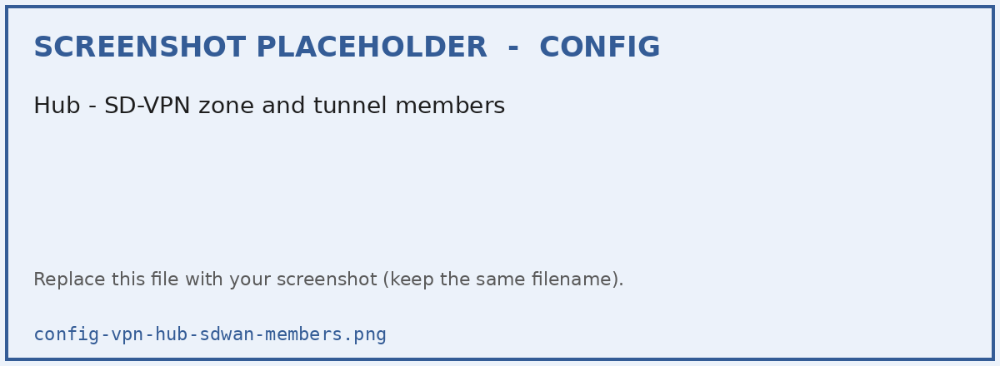


##### VPN Tunnels
- From the left side bar, under **VPN** > **IPsec Tunnels**, edit the 4 VPN tunnels:
	- Convert to a **custom tunnel**.
	- Edit **phase2**'s selector options:
		- **Local address**: ``10.1.0.0/16`` (*subnet*)
			- Set the same local address for **all tunnels**. Pointing to **Local-LAN**.
			- Enable ``Auto-negotiate`` from the dropdown "**Advanced(+)**".
		- **Remote address**: ``10.x.0.0/24`` (subnet)
			- ``10.2.0.0/24`` for **VPN1-Rabat** & **VPN2-Rabat**.
			- ``10.3.0.0/24 for`` **VPN1-Tangier** & **VPN2-Tangier**.
			- Enable ``Auto-negotiate`` from the dropdown "**Advanced(+)**".

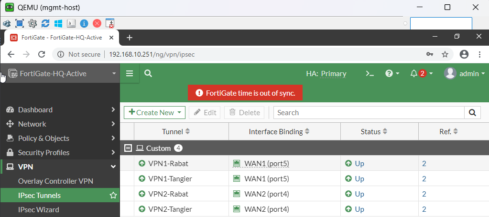


##### Policies
Make sure that **multiple interfaces** **per policy** is enabled on the firewall.

- Create the following policy:
	- **Name**: ``Inbound-VPN``
	- **Incoming interface**: ``SD-VPN`` (*SD-WAN zone*)
	- **Outgoing interface**: *Choose the following interfaces*;
		- ``VLAN-10``
		- ``VLAN-20``
		- ``VLAN-30``
		- ``VLAN-40``
	- **Source IP**: *Choose the following addresses names*;
		- ``Rabat-LAN`` (*10.2.0.0/24*)
		- ``Tangier-LAN`` (*10.3.0.0/24*)
	- **Destination IP**: ``Local-LAN`` (*10.1.0.0/16*)
	- **Service**: ``ALL``
	- **NAT**: *disabled*

- Clone reverse the policy above, edit the reversed policy:
	- Set the **Name** to ``Outbound-VPN``
	- *Enable the policy*.

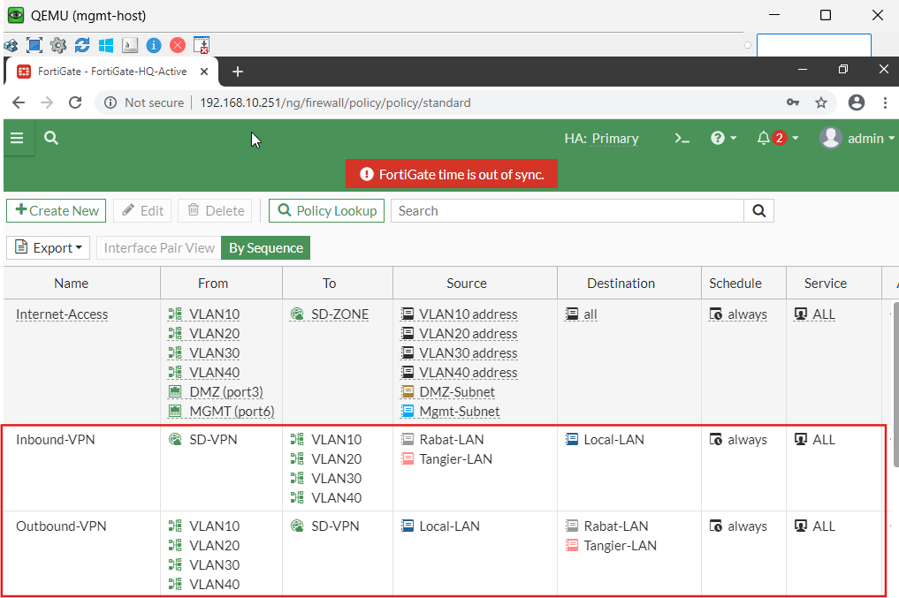


##### Static Routes
- Create 1 static route, use a summarized subnet for both branches:
		- **Destination**(*subnet*): ``10.0.0.0/8`` (*Rabat-LAN & Tangier-LAN*)
		- **Interface**: ``SD-VPN`` (*SD-WAN zone*)

- Create 1 static route, use a summarized subnet for both branches:
	- **Destination**(*subnet*): ``10.0.0.0/8`` (*Rabat-LAN & Tangier-LAN*)
	<!-- TODO(verify): the blackhole destination was written as 10.1.0.0/8; changed to 10.0.0.0/8 so it covers both branch LANs -->
	- **Interface**: ``Blackhole``
	- **AD**: ``250``

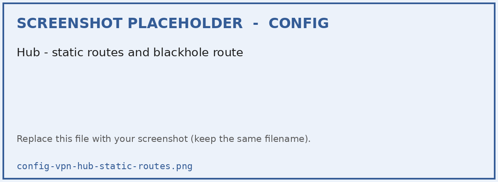


##### SD-WAN rules & SLAs
- Create 2 performance SLAs, one for the VPN tunnels of each branch:
	- **SLA1**:
		- **Name**: ``SlaVpnRabat``
		- **Probe mode**: ``Active`` / **Protocol**: ``Ping``
		- **Server**: ``10.2.0.254``
		- **Participants**(*specify*): ``VPN1-Rabat`` & ``VPN2-Rabat``
		- **SLA Target**: *disabled* / **Update static route**: *enabled*
	- **SLA2**:
		- **Name**: ``SlaVpnTangier``
		- **Probe mode**: ``Active`` / **Protocol**: ``Ping``
		- **Server**: ``10.3.0.254``
		- **Participants**(*specify*): ``VPN1-Tangier`` & ``VPN2-Tangier``
		- **SLA Target**: *disabled* / **Update static route**: *enabled*

- To configure a source IP for both SLAs pings to the target server, go to the VPN SD-WAN zone (*``SD-VPN``*), choose **>_ Edit in CLI** from the right side section, and run:
```bash
end
config members
  edit 3
    set source 10.1.10.254
    next
  edit 4
    set source 10.1.10.254
    next
  edit 5
    set source 10.1.10.254
	next
  edit 6
    set source 10.1.10.254
	next
  end
end
```
- Then close the CLI's window and click ``OK`` to save settings.
- ``3``, ``4``, ``5``, and ``6`` are the SD-WAN members' **indexes**.
	- You can see those indexes by running ``show`` after the ``config members`` command
	- The indexes assigned to the **VPN SD-WAN members** in the lab are:
		- ``3`` for **VPN1-Rabat**
		- ``4`` for **VPN2-Rabat**
		- ``5`` for **VPN1-Tangier**
		- ``6`` for **VPN2-Tangier**
	- ``1`` & ``2`` were assigned to the typical SD-WAN members, **WAN1** & **WAN2**.
	- The 1st configured SD-WAN member (*e.g. WAN1 port*) gets ``1``, the 2cd gets ``2`` and so on.
- ``10.1.10.254`` (*VLAN10 Interface's IP*) was chosen as src, other VLANs interface's IP can be used.
	- You can use differenct source IPs for different **VPN SD-WAN members**.

<!-- TODO(verify): zone preference was written as SD-VPN-Rabat / SD-VPN-Tangier but only one zone (SD-VPN) is created; changed to SD-VPN -->
- Create 2 SD-WAN rules, one for traffic going to each branch:
	- **SD-WAN rule1**:
		- **Name**: ``VPN-Rabat-rule``
		- **Source address**: ``Local-LAN`` (*10.1.0.0/16*)
		- **Destination address**: ``Rabat-LAN`` (*10.2.0.0/24*)
		- **Strategy**: ``Best Quality``
		- **Interface preference**: ``VPN1-Rabat`` then ``VPN2-Rabat``
		- **Zone preference**: ``SD-VPN``
		- **Measured SLA**: ``SlaVpnRabat``
		- **Quality Criteria**: ``Latency``
	- **SD-WAN rule2**:
		- **Name**: ``VPN-Tangier-rule``
		- **Source address**: ``Local-LAN`` (*10.1.0.0/16*)
		- **Destination address**: ``Tangier-LAN`` (*10.3.0.0/24*)
		- **Strategy**: ``Best Quality``
		- **Interface preference**: ``VPN1-Tangier`` then ``VPN2-Tangier``
		- **Zone preference**: ``SD-VPN``
		- **Measured SLA**: ``SlaVpnTangier``
		- **Quality Criteria**: ``Latency``

- **Make sure that both VPN SD-WAN rules are placed above the general LAN to SD-WAN rule**

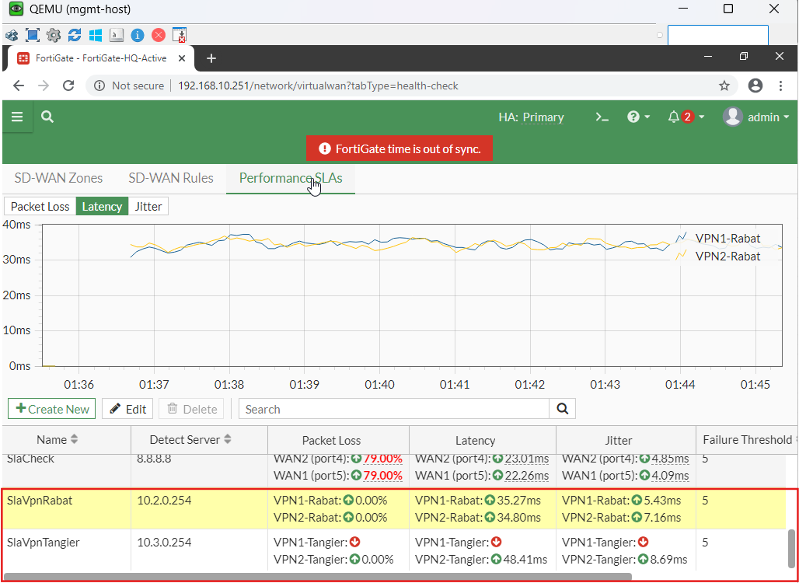

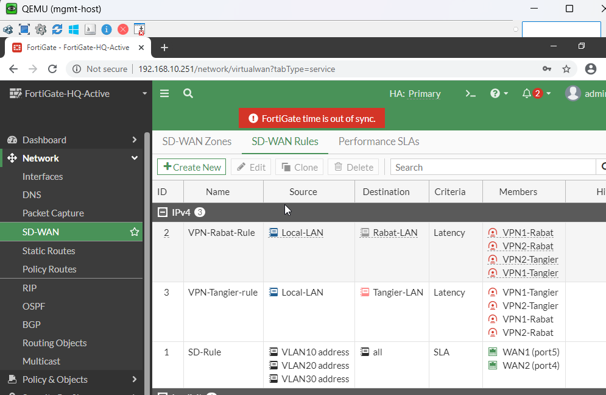


##### VPN Tunnels IPs
- From the left side bar, under **Network** > **Interfaces** > **WAN1(port5)** or **WAN2(port4)**, assign an **IP address** and a **Remote IP/Netmask** to each VPN tunnel interface separately:
	- **VPN1-Rabat**:
		- **IP**: ``1.1.1.1``
		- **Remote IP/Netmask**: ``2.2.2.1/32`` (*Fortigate-Rabat's ``VPN1-hub`` interface IP*)
	- **VPN2-Rabat**:
		- **IP**: ``1.1.1.2``
		- **Remote IP/Netmask**: ``2.2.2.2/32`` (*Fortigate-Rabat's ``VPN2-Hub`` interface IP*)
	- **VPN1-Tangier**:
		- **IP**: ``1.1.1.3``
		- **Remote IP/Netmask**: ``3.3.3.1/32`` (*Fortigate-Tangier's ``VPN1-hub`` interface IP*)
	- **VPN2-Tangier**:
		- **IP**: ``1.1.1.4``
		- **Remote IP/Netmask**: ``3.3.3.2/32`` (*Fortigate-Tangier's ``VPN2-Hub`` interface IP*)
---

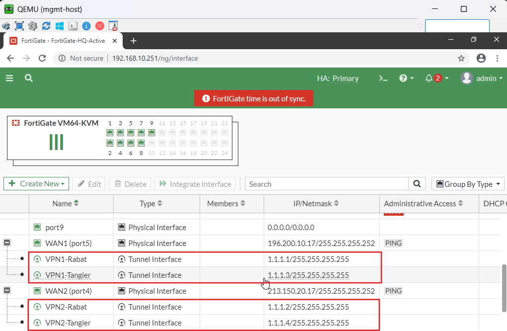

### Branch Firewalls config

#### SD-WAN zones & members
- Create a **VPN SD-WAN zone** pointing to the hub on each firewall, set its **Name** to ``SD-VPN-Hub``

- Create 2 **VPN SD-WAN members** for the ``SD-VPN-Hub`` **zone** on each firewall:
	- **member1** : **Interface(``+VPN``)**
		- **Name**: ``VPN1-hub``
		- **Remote IP**: ``196.200.10.17``  (*Hub FW's WAN1(port5) IP*)
		- **Out_interface**: ``WAN1(port5)``
		- **Pre-shared key**: ``<IPSEC_PSK>``
		- **SD-WAN zone**: ``SD-VPN-Hub``
		- *Leave the rest as default*.
	- **member2** : **Interface(``+VPN``)**
		- **Name**: ``VPN2-Hub``
		- **Remote IP**: ``213.150.20.17``  (*Hub FW''s WAN2(port4) IP*)
		- **Out_interface**: ``WAN2(port4)``
		- **Pre-shared key**: ``<IPSEC_PSK>``
		- **SD-WAN zone**: ``SD-VPN-Hub``
		- *Leave the rest as default*.

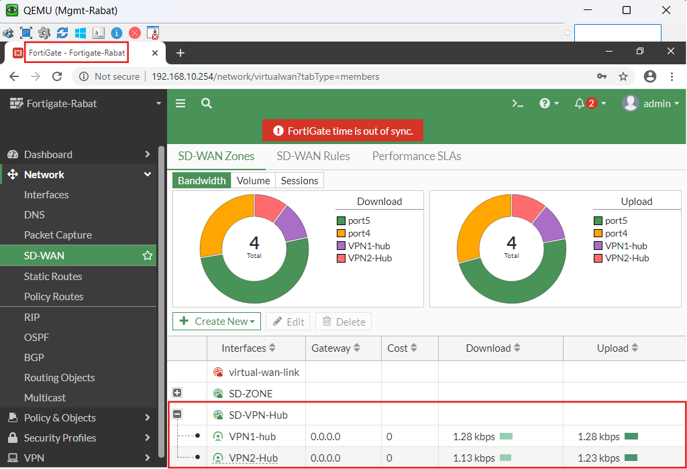

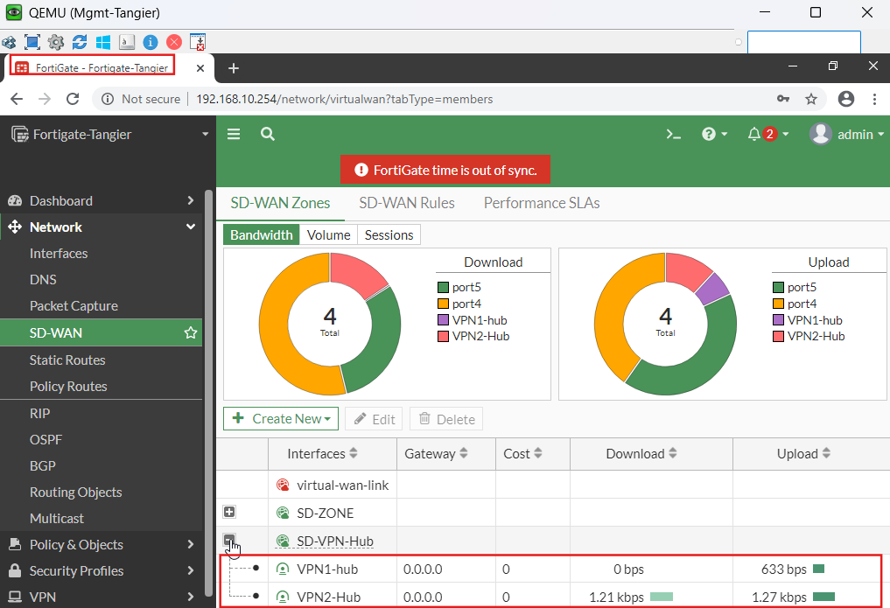

##### VPN Tunnels
- From the left side bar, under **VPN** > **IPsec Tunnels**, edit the 2 VPN tunnels on each firewall:
	- Convert to a **custom tunnel**.
	- Edit **phase2**'s selector options:
		- **Local address**: ``10.x.0.0/24`` (*subnet*)
			- ``10.2.0.0/24`` for **Fortigate-Rabat**.
			- ``10.3.0.0/24`` for **Fortigate-Tangier**.
			- Enable ``Auto-negotiate`` from the dropdown "**Advanced(+)**".
		- **Remote address**: ``10.1.0.0/16`` (subnet)
			- Set the same Remote address for **all tunnels** as the **Hub-LAN**.
			- Enable ``Auto-negotiate`` from the dropdown "**Advanced(+)**".

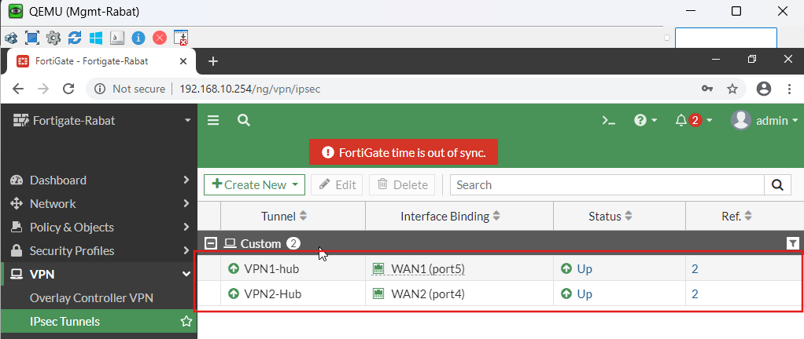

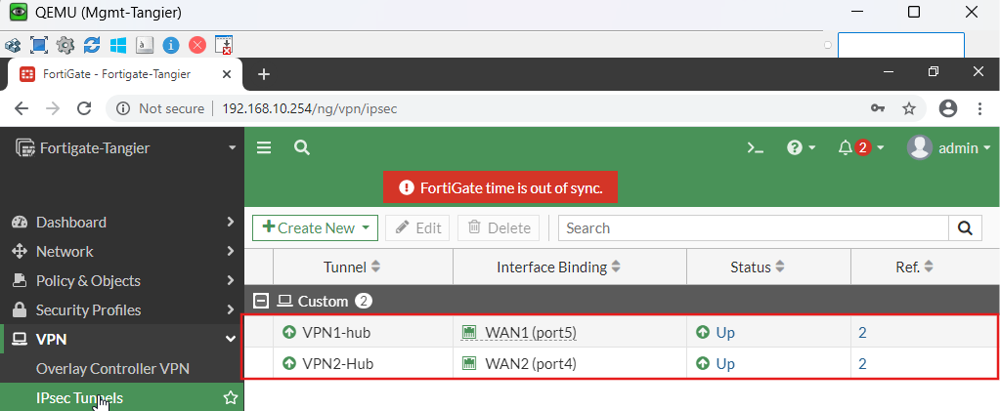

##### Policies
Make sure that **multiple interfaces** **per policy** is enabled on all firewalls.

- Create the following policy on each firewall:
	- **Name**: ``Inbound-VPN``
	- **Incoming interface**: ``SD-VPN-Hub`` (*the VPN SD-WAN zone*)
	- **Outgoing interface**: ``LAN(port1)`` (*the LAN port*)
	- **Source IP**: ``Hub-LAN`` (*10.1.0.0/16*)
	- **Destination IP**: ``Local-LAN`` (*10.2.0.0/24 or 10.3.0.0/24*)
	- **Service**: ``ALL``
	- **NAT**: *disabled*

- Clone reverse the policy above, edit the reversed policy on each firewall:
	- Set the **Name** to ``Outbound-VPN``
	- *Enable the policy*.

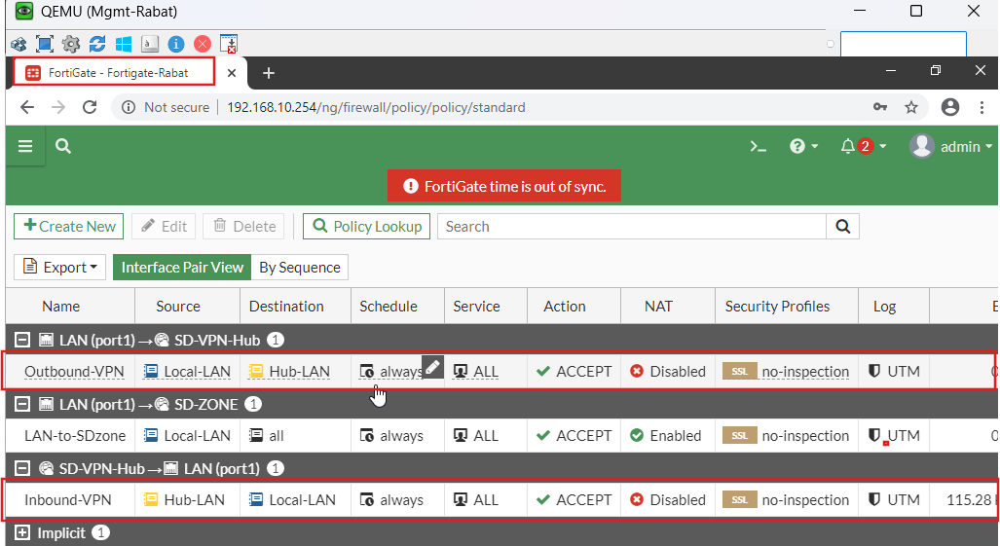

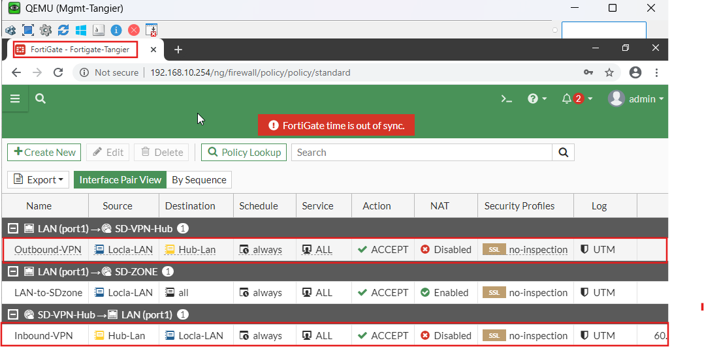

##### Static Routes
- Create 2 routes on each firewall, hub's subnet as dst. One route is valid, the other is blackhole.
	- **Static Route out of the VPN SD-WAN zone**:
		- **Destination**(*subnet*): ``10.1.0.0/16`` (*Hub LAN*)
		- **Interface**: ``SD-VPN-Hub`` (*the VPN SD-WAN zone*)
	- **Static Route out of the Blackhole interface**:
		- **Destination**(*subnet*): ``10.1.0.0/16``
		- **Interface**: ``Blackhole``
		- **AD**: ``250``

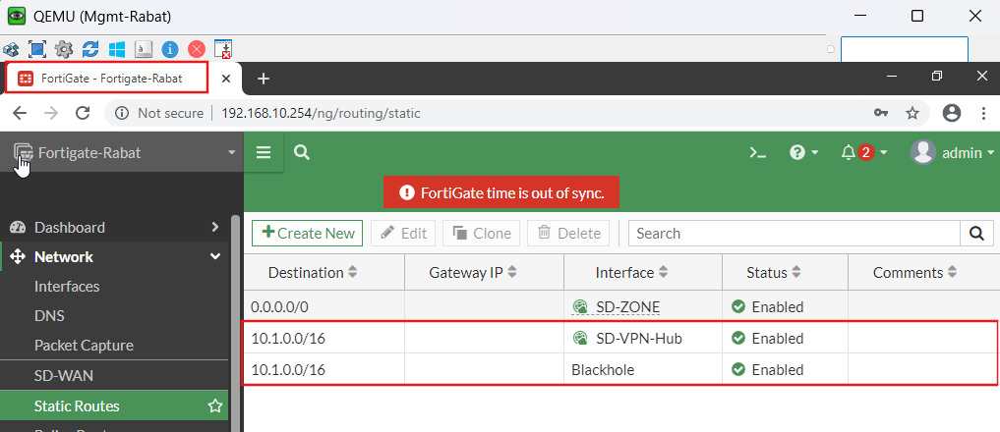

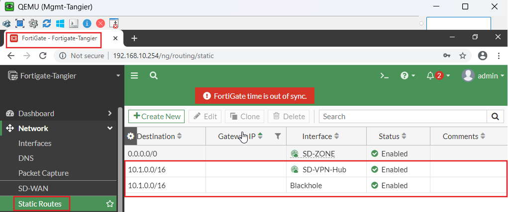

##### SD-WAN rules & SLAs
- Create 1 **performance SLA** for **VPN** on each branch firewall:
	- **Name**: ``SlaVpnHub``
	- **Probe mode**: ``Active`` / **Protocol**: ``Ping``
	- **Server**: ``10.1.10.254``
	- **Participants**(*specify*): ``VPN1-hub`` & ``VPN2-Hub``
	- **SLA Target**: *disabled* / **Update static route**: *enabled*

- On each firewall, to configure a source IP for ``SlaVpnHub`` to the target server, go to the ``SD-VPN-Hub`` zone and choose **>_ Edit in CLI** from the right side section, and run:
```bash
end
config members
  edit 3
    set source 10.<X>.0.254
    next
  edit 4
    set source 10.<X>.0.254
    next
  end
end
```
- Then close the CLI's window and click ``OK`` to save settings.
- Do this for both **VPN SD-WAN members** on each firewall.
- ``10.<X>.0.254`` (*the lAN Interface's IP on each firewall, e.g. ``10.2.0.254`` on Fortigate-Rabat*) was chosen as the **source IP** for the SLA pings.
- See > [SD-WAN rules & SLAs](#sd-wan-rules--slas) for more details.

- Create an **SD-WAN rule** on each firewall for traffic going to the hub though the **VPN tunnels**:
	- **Name**: ``VPN-Hub-rule``
	- **Source address**: ``Local-LAN`` (*10.2.0.0/24 or 10.3.0.0/24*)
	- **Destination address**: ``Hub-LAN`` (*10.1.0.0/16*)
	- **Strategy**: ``Best Quality``
	- **Interface preference**: ``VPN1-Hub`` then ``VPN2-Hub``
	- **Zone preference**: ``SD-VPN-Hub``
	- **Measured SLA**: ``SlaVpnHub``
	- **Quality Criteria**: ``Latency``

- On each firewall, **Make sure the VPN SD-WAN rule is placed above the general LAN to SD-WAN rule**

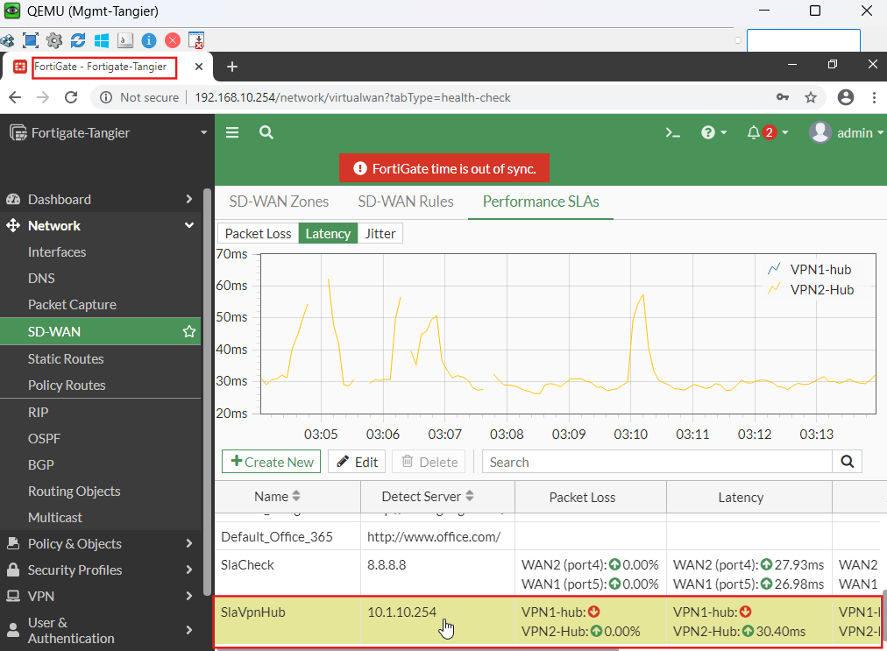

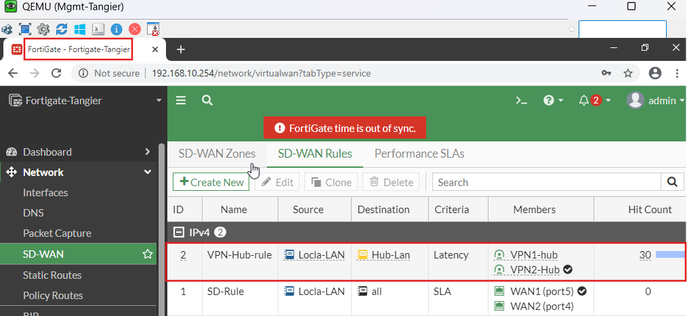

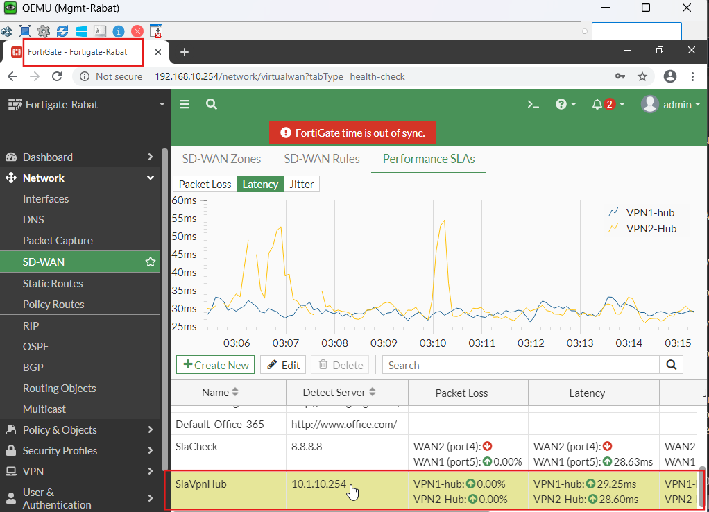

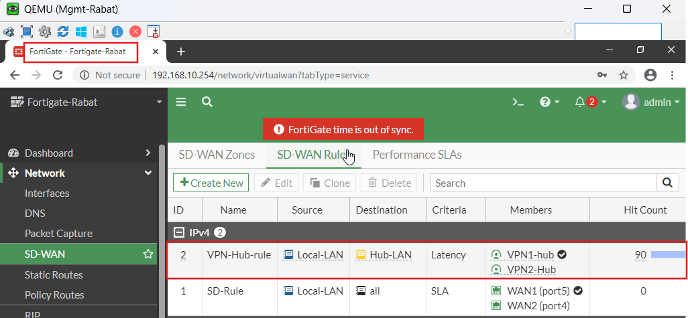

##### VPN Tunnels IPs
- On each firewall, from the left side bar, under **Network** > **Interfaces** > **WAN1(port5)** or **WAN2(port4)**, assign an **IP address** and a **Remote IP/Netmask** to both VPN tunnel interfaces:
	- **Fortigate-Rabat**:
		- **Interface**: ``VPN1-hub``
			- **IP**: ``2.2.2.1``
			- **Remote IP/Netmask**: ``1.1.1.1/32`` (*Hub FW's ``VPN1-Rabat`` tunnel interface IP*)
		- **Interface**: ``VPN2-Hub``
			- **IP**: ``2.2.2.2``
			- **Remote IP/Netmask**: ``1.1.1.2/32`` (*Hub FW's ``VPN2-Rabat`` tunnel interface IP*)
	- **Fortigate-Tangier**:
		- **Interface**: ``VPN1-hub``
			- **IP**: ``3.3.3.1``
			- **Remote IP/Netmask**: ``1.1.1.3/32`` (*Hub FW's ``VPN1-Tangier`` tunnel interface IP*)
		- **Interface**: ``VPN2-Hub``
			- **IP**: ``3.3.3.2``
			- **Remote IP/Netmask**: ``1.1.1.4/32`` (*Hub FW's ``VPN2-Tangier`` tunnel interface IP*)
---

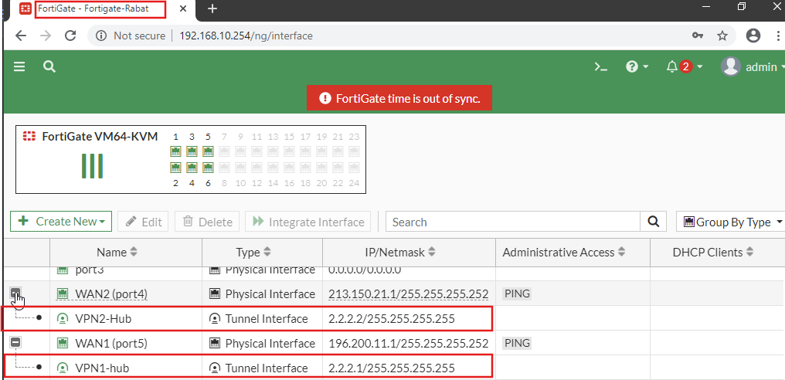

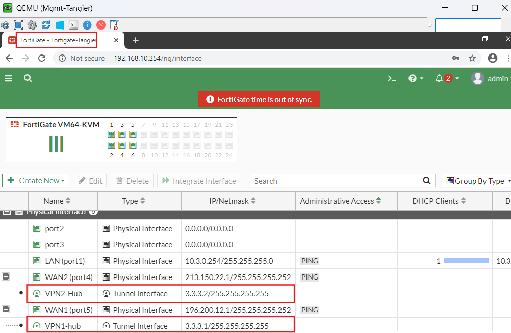

### Concept
The enterprise overlay architecture establishes a redundant **Hub-and-Spoke IPsec VPN topology integrated with FortiOS SD-WAN** across the two branch offices (*Rabat and Tangier*).

#### Underlay Reachability via BGP
The establishment of the IPsec overlay relies on the underlay routing learned via **eBGP/iBGP** across **ISP1** (*AS 64200*) and **ISP2** (*AS 64300*):
- **Branch Firewalls** learn routes to reach the **Hub firewall**'s public WAN IPs (`196.200.10.17` on WAN1 and `213.150.20.17` on WAN2).
- **The Hub Firewall** learns routes to reach each **branch firewall**'s public WAN IPs (`196.200.1x.1` on WAN1 and `213.150.2x.1` on WAN2).
#### IPsec Tunnels & Phase 2 Selectors
Each branch firewall builds **two route-based IPsec tunnels** to the Hub (*one over ISP1/WAN1 and one over ISP2/WAN2*), totaling ``4`` tunnels on the **Hub** and ``2`` tunnels per **Spoke**:
- **Phase 2 Encryption Domains:** Traffic selectors explicitly bind the summarized **Hub network** (*`10.1.0.0/16`*) to each **branch**’s **local** **subnet** (*`10.2.0.0/24`, `10.3.0.0/24`).
- **Dedicated Point-to-Point Overlay IPs:** Each tunnel interface is assigned a unique `/32` point-to-point transit IP (*Hub: `1.1.1.x` $\leftrightarrow$ Spokes: `2.2.2.x`–`3.3.3.x`*). This prevents **source-IP fallback ambiguity** during ICMP TTL expirations.
#### SD-WAN Zone Grouping & Health-Check SLAs
- **Zone Segregation:** Tunnels are organized into a dedicated **branch SD-WAN zone** on the **Hub** (*`SD-VPN`*) and a **unified Hub zone** on each **spoke** (`SD-VPN-Hub`).
- **Performance SLAs:** Active ICMP probes constantly monitor tunnel **latency** by pinging internal gateway interfaces (*`10.1.10.254` at HQ and `10.x.0.254` at Spokes*) using explicitly defined **source IPs**.
- **Dynamic Path Selection (Best Quality):** SD-WAN steering rules evaluate the **dual tunnels** per branch and for the hub in real time, dynamically forwarding corporate traffic over the primary ISP1 tunnel and automatically switching to the secondary ISP2 tunnel if **latency** degrades.
#### Routing & Blackhole Protection
- **Zone-Based Static Routes:** Traffic destined for **remote subnets** is directed into the respective SD-WAN VPN zone.
- **Blackhole Fallback Routes:** A fallback route with Administrative Distance `250` points the destination subnets to a `Blackhole` interface. If both **IPsec tunnels** to a site go down and the **SD-WAN SLA** withdraws the primary static routes, corporate traffic is safely dropped locally rather than leaking unencrypted out the default internet route.
#### Firewall Policies & Stateful Inspection
Bidirectional communication is governed by `Inbound-VPN` and `Outbound-VPN` policies:
- **No NAT Applied:** Corporate traffic flows with original source and destination RFC 1918 IPs intact (*for sure, it's encapsulated with the public IPs of the firewall*).
- **Direct Interface Mapping:** On the Hub, policies reference the individual **VLAN sub-interfaces** directly to ensure seamless forward policy evaluation (*This was an issue I troubleshot*).

## Troubleshooting VPN issues

### Specify VLANs in VPN Policies
According to [FW's LAN ports config (VLANs & DHCP)](../02-firewall-base/README.md#firewall-lan-ports-vlans-and-dhcp), My VLAN subinterfaces on the hub were assigned to a redundant interface that groups the 2 physical ports connected to the LAN switches. Then, this redundant interface was placed into the LAN zone.

Before, I set up the LAN zone as the **Incoming Interface** for the Inbound-VPN policy and as the **Outgoing Interface** for the Outbound-VPN policy. When I tested the ping from a spoke firewall's LAN port to a VLAN sub-interface in the hub FW (*VPN traffic test*), the ping failed.

Here is what I did to debug the issue:
```bash
# Run on the hub FW:
diagnose debug reset
diagnose debug flow filter saddr 10.2.0.254
diagnose debug flow filter daddr 10.1.10.254
diagnose debug flow show function-name enable
diagnose debug flow trace start 10
diagnose debug enable

# Then, run on the spoke FW:
execute ping-options source 10.2.0.254
execute ping 10.1.10.254
```
- Since I was pinging the IP ``10.1.10.254`` (*IP the VLAN10 interface on the hub FW*) from Fortigate-Rabat's LAN port (*with IP ``10.2.0.254``*), the spoke FW used its VPN static route that points to the hub's LAN (*``10.1.0.0/16``*) (*see > [Static Routes](#static-routes-1)*) to send traffic through one of its tunnel interfaces.
- This means that the actual source and dst (*after the de-encapsulation on the hub FW*) of the packets are ``10.2.0.254`` and ``10.1.10.254``. And that's why they were used in the debug commands. These are the IPs that the hub FW evaluates against its internal policies.

Upon executing the ping from Fortigate-Rabat, I went to the hub FW and run the same debug commands again, and I got a bunch of logs, the most important one turned out to be this one:
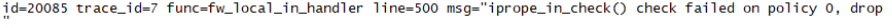

- This line means that my VPN traffic (*sent by my ping*) was handed over by the FW's kernel to the Local-In engine (`iprope_in_check()`), and since there was no explicit Local-In permit rule that allows this type of traffic, the packet was dropped by the implicit default drop ``msg="iprope_in_check() check failed on policy 0, drop"``
- Incoming and outgoing Packets are 1st evaluated against the FW policies, then if there is no match, they're handed over to the Local-In engine by the FW's kernel. This means that my ping packets didn't match any of the FW policies which caused them to be handed over to the Local-In engine to later be dropped by the implicit default drop

This means that I had an issue in the Inbound and Outbound VPN on my hub FW. When I further investigated the issue, I figured out that this comes down to an unusual behavior on FortiOS. In a Fortigate firewall, If you place a parent interface (*e.g. my redundant LAN port*) in a zone (*e.g. my LAN zone*), the child interfaces (*e.g. my VLAN interfaces*) created on top of that parent do not automatically inherit zone membership. Which means the VLAN interfaces themselves were not considered part of the LAN zone, and since the inbound/outbound VPN policies were referencing the LAN zone in their outgoing/incoming interfaces, my ping traffic (*destined to ``10.1.10.254``, an IP in VLAN10*) was not a match, because the IP belongs to the VLAN10 interface which is not considered (*as I mentioned earlier*) part of the LAN zone.

The fix was easy, I just had to use the VLAN interfaces themselves (*VLAN10, 20, 30*) as the outgoing/incoming interfaces in the inbound/outbound VPN policies. (see > [Policies](#policies))

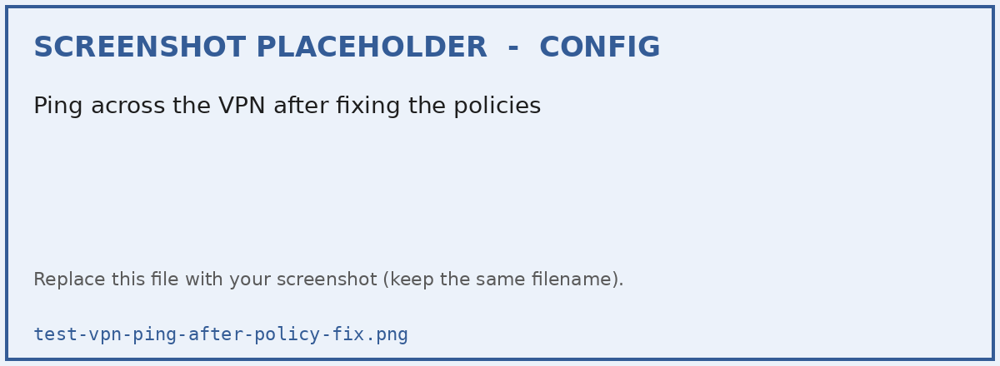

#### Move the VPN SD-WAN rule to the top
Before I start configuring VPN IPsec, I had internet reachability on all firewalls. An SD-WAN genral rule that matches traffic from any src to any dst was set up for internet access, with WAN1 & WAN2 physical ports as the SD-WAN members.

The VPN IPsec config came with its own SD-WAN rule as well, this rule was set to match traffic going from the Local-LAN (*e.g. ``10.1.0.0/16``*) to a remote site's subnet (*e.g. ``10.2.0.0/24``*). Since this rule was created after the general SD-WAN rule, it was placed under the latter.

So, when I ping from an IP in the Local-LAN to an IP in that remote site's subnet, the ping packets match that general SD-WAN rule 1st, and the FW sends them out of the physical WAN ports instead of the VPN tunnel interfaces built on top of them.

This comes down to how FortiOS handles traffic that is meant to be sent out of an SD-WAN zone. The issue was the following; When I ping, the FW checks its routing table first, finds that the destination IP address has a static route that points to the VPN SD-WAN zone as the outgoing interface, since the outgoing interface is an SD-WAN zone, the FW has to pick an SD-WAN member to send traffic out of it, so it goes to inspect the existing SD-WAN rules to do this, it does this from top to bottom, and since the general SD-WAN rule is on top, it matches the traffic 1st (*src is any & dst is any, so it'll match all type of traffic*), so traffic is sent unencrypted and without encapsulation out of an SD-WAN member in this zone, so it gets dropped in the middle since the ISP routers don't know how to reach the private IPs in each site. And even if they do, it will be dropped by the remote site's firewall since it won't match any policy over there.

The fix was easy, move the VPN SD-WAN rule on top of the general SD-WAN rule. This way, both internet traffic and remote site traffic will find their way.

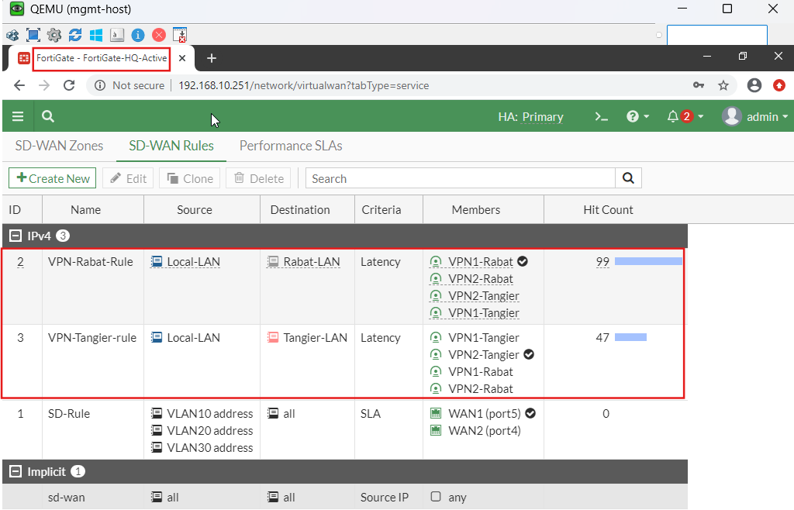

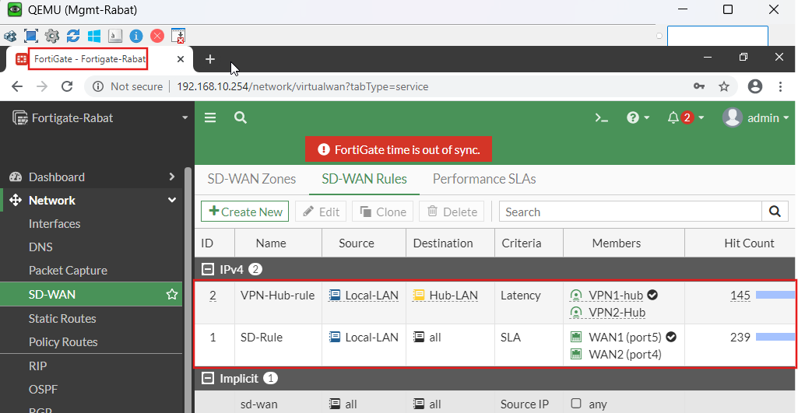

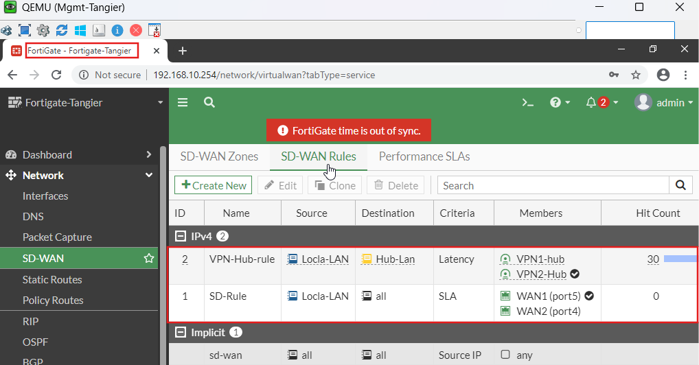

#### Specify IPs for the VPN tunnel interfaces to fix the tracert issue
When testing end-to-end routing between the Hub and a branch (*Rabat*), running a `traceroute` from a host in Rabat's LAN (`10.2.0.1`) to a host in the Hub's VLAN 10 (`10.1.10.1`) returned an unexpected intermediate hop:
```
1  10.2.0.254     (FortiGate-Rabat LAN gateway)
2  172.16.10.254   (FortiGate-HQ DMZ gateway interface!)
3  10.1.10.1      (Destination host in Hub VLAN 10)
```

Data traffic was never actually flowing through the DMZ switch or the DMZ network (`172.16.10.0/24`). Instead, this was a diagnostic reporting artifact caused by how `traceroute` operates alongside **unnumbered route-based IPsec tunnel interfaces** in FortiOS.

A `traceroute` works by sending successive probe packets toward the destination with an increasing **Time to Live (TTL)** value:
1. **Hop 1 Discovery (TTL = 1):** The sender (`10.2.0.1`) transmits a packet with `TTL = 1`. `Fortigate-Rabat` decrements the TTL to `0`, drops the packet, and responds with an **ICMP Time Exceeded** message from its local LAN interface (`10.2.0.254`).
2. **Underlay ISP Encapsulation:** For the next probe (`TTL = 2`), `Fortigate-Rabat` decrements the inner TTL to `1`, encrypts the entire packet inside an IPsec ESP wrapper with a brand-new outer TTL (e.g., `64`), and routes it across the ISP routers. The ISP routers only decrement the outer wrapper's TTL and never see the inner payload, so they're invisible to the `traceroute`.
3. **Hop 2 Processing on the Hub (TTL = 0):** The Hub firewall (`Fortigate-HQ-Active`) receives the ESP packet on its WAN port, decrypts the payload, and recovers the original packet with an inner `TTL = 1`. When it attempts to route this packet toward VLAN 10, it decrements the inner TTL to `0`. Since the packet expired, the Hub must generate an **ICMP Time Exceeded** packet back to `10.2.0.1`. However, route-based IPsec virtual tunnel interfaces (*`VPN1-Rabat`, `VPN2-Rabat`*) are **unnumbered by default** (*they had no Layer 3 IP address assigned*). Because the ingress tunnel interface had no local IP to put as the source address on the ICMP error packet, the FortiOS kernel fell back to its internal selection algorithm: it grabbed the **lowest interface index with an active, routable IPv4 address**, which happened to be `port3` (*the DMZ gateway `172.16.10.254`*), probably because it was the first port assigned an IP address in the firewall, anyways, the essence that it had the lowest index so it was picked.

The fix is easy, assign a ``/32`` IP addresses to the IPsec tunnel interfaces on the hub, which it uses as the source IP on the ICMP error packet that it sends back to ``10.2.0.1``. The same has to be done on the branch firewalls, their tunnel interfaces have to be assigned a unique IP (*this IP must IP out of the range of the local and remote IPs that make up the tunnel*).

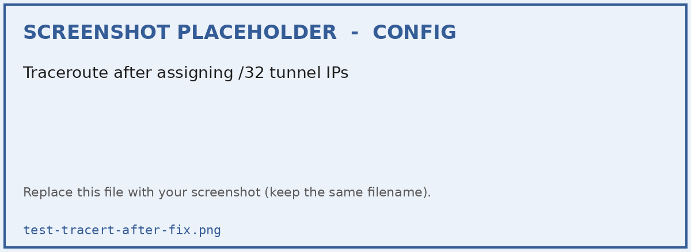

## Verification and tests

Each test lists where to run it, the command and the expected result, followed by a screenshot placeholder. Replace the placeholder images in `img/` with your own screenshots (same filename) and adjust any test to what you actually ran.

### Test 1 - Tunnels up on the hub

- **Run on:** Hub FortiGate
- **Command / action:** `get vpn ipsec tunnel summary` (or Dashboard > IPsec monitor)
- **Expected result:** All four tunnels (2 per branch) are up.

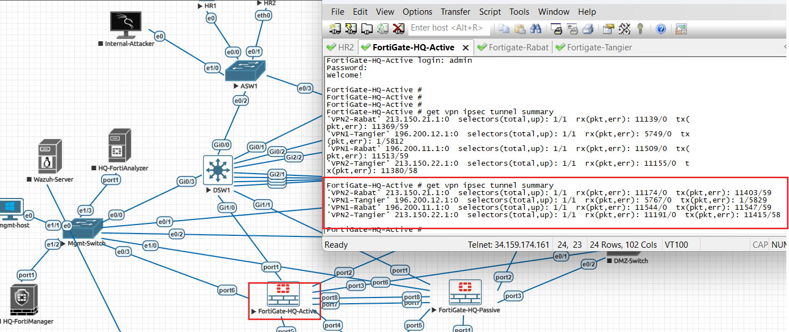

### Test 2 - Tunnels up at Rabat

- **Run on:** Rabat FortiGate
- **Command / action:** `get vpn ipsec tunnel summary`
- **Expected result:** Both tunnels up.

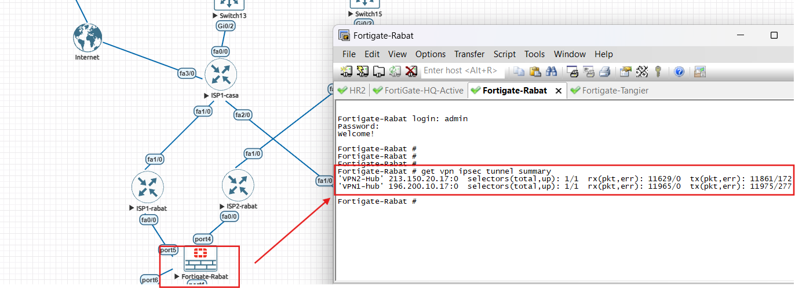

### Test 3 - Tunnels up at Tangier

- **Run on:** Tangier FortiGate
- **Command / action:** `get vpn ipsec tunnel summary`
- **Expected result:** Both tunnels up.

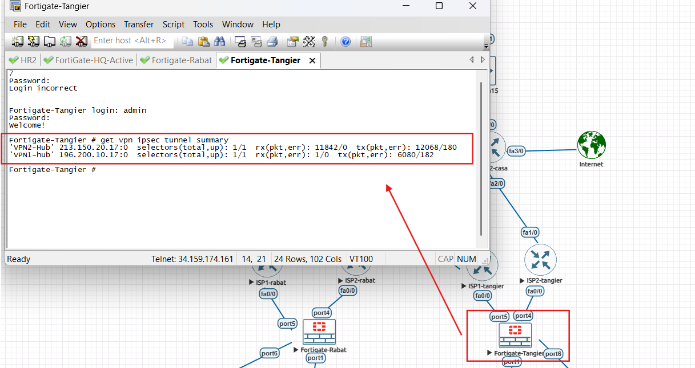

### Test 4 - Rabat to HQ

- **Run on:** Rabat end host
- **Command / action:** `ping 10.1.10.3`
- **Expected result:** Replies received.

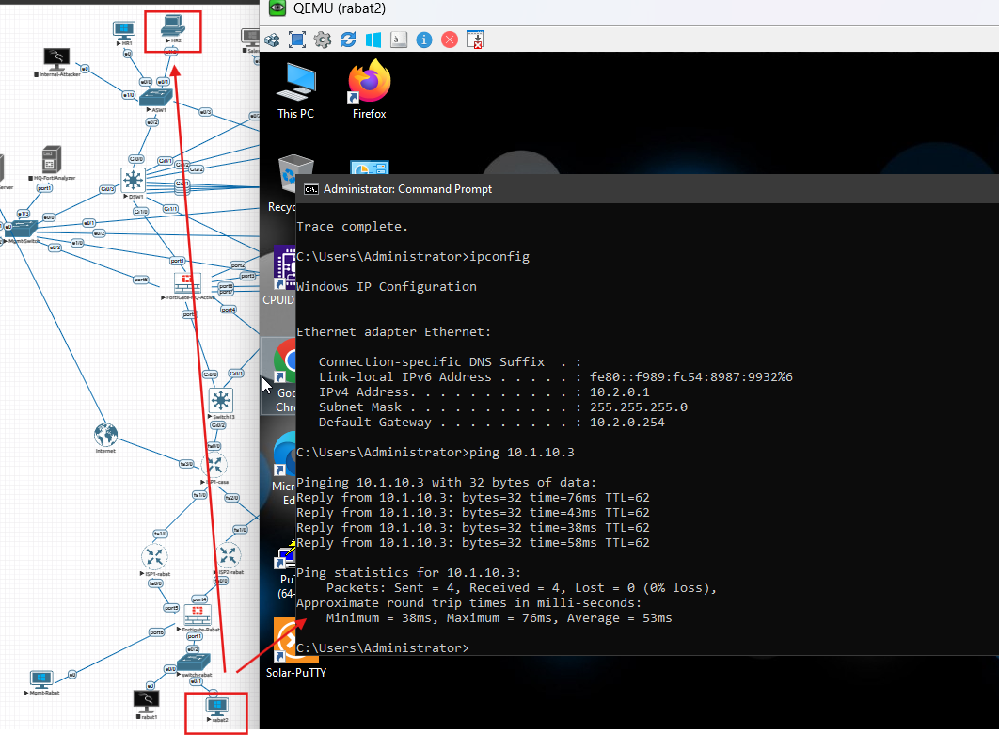

### Test 5 - Tangier to HQ

- **Run on:** Tangier end host
- **Command / action:** `ping 10.1.10.3`
- **Expected result:** Replies received.


### Test 6 - HQ to branches

- **Run on:** HQ end host
- **Command / action:** `ping 10.2.0.1` and `ping 10.3.0.2`
- **Expected result:** Replies received.


### Test 7 - Path through the tunnel

- **Run on:** Rabat end host
- **Command / action:** `tracert 10.1.10.3`
- **Expected result:** The hop after the branch gateway is a tunnel IP, not an ISP address.

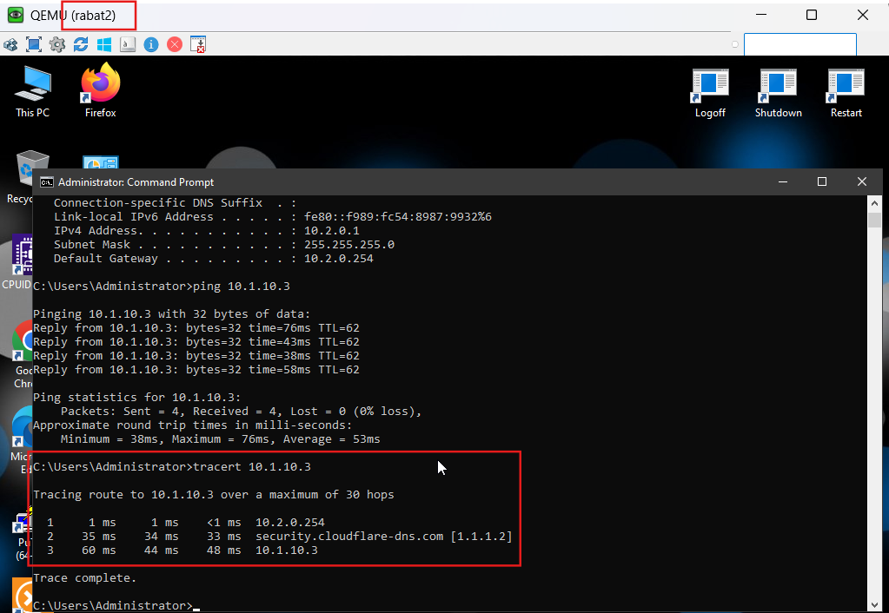

### Test 8 - VPN SLA status

- **Run on:** Rabat FortiGate
- **Command / action:** `diagnose sys sdwan health-check`
- **Expected result:** Both tunnel members alive.

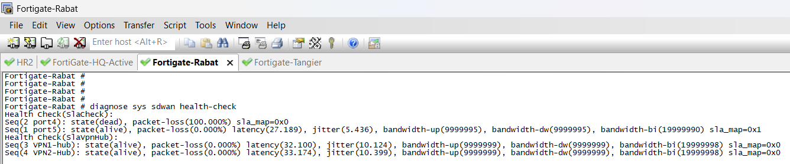

### Test 9 - Failover between tunnels

- **Run on:** Rabat end host plus ISP1-rabat link
- **Command / action:** `ping 10.1.10.3 -t` while disconnecting the ISP1 link
- **Expected result:** Traffic moves to the second tunnel with brief loss.

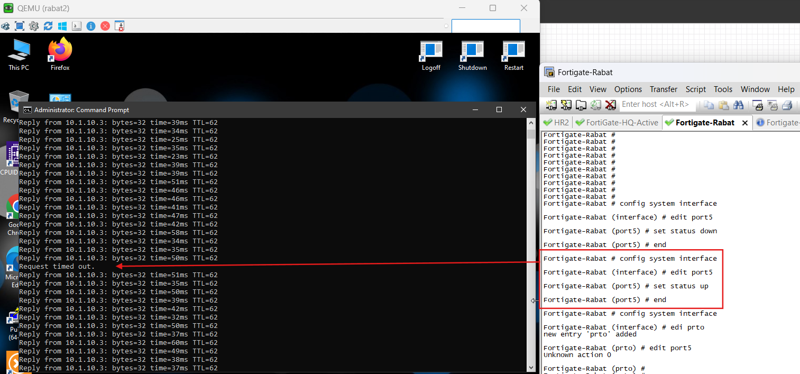

## References

- [YT - Original config video](https://youtu.be/mIxKCBprgjs)
- [Fortinet Community - The tutorial that fixed 2 of my issues](https://community.fortinet.com/fortigate-3/technical-tip-configure-ipsec-vpn-with-sd-wan-106707)
- [Fortinet Community - The guide that introduced the SD-WAN rule placement and the Tunnel interfaces IPs solutions](https://community.fortinet.com/fortigate-3/technical-tip-configure-ipsec-vpn-with-sd-wan-106707)
