# 06 - Active Directory, DNS and firewall integration

[Previous: 05-ipsec-vpn-sdwan](../05-ipsec-vpn-sdwan/README.md) | [Main README](../README.md) | [Next: 07-dmz-webserver](../07-dmz-webserver/README.md)

The domain controller for `cbi.local` in VLAN 40, its DNS zones, domain-joined end hosts, and the LDAP integration that lets the FortiGate use AD groups.

## Active Directory

### DC name + IP + DNS + GW + policy + IE security
The Windows Server name is set to DC. it is given a static IP address of ``10.1.40.101`` in the VLAN40 subnet. Its primary & secondary DNS is manually set to ``8.8.8.8``, ``1.1.1.1``. The gateway is set to the hub FW's VLAN40 interface  IP ``10.1.40.254``. The firewall policies on the Windows Server are disabled (*for later pings/DNS testing*). **IE Enhanced Security Configuration** is also disabled (*for web browsing from the DC itself if needed*).

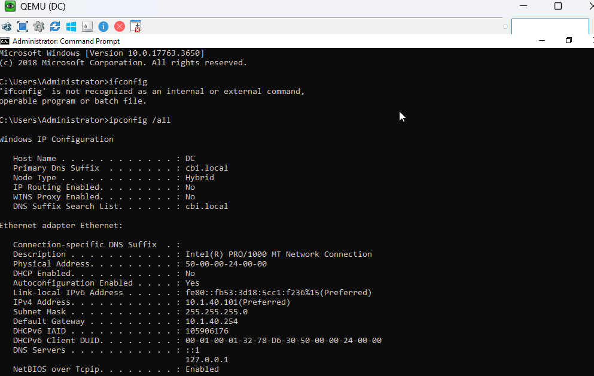

#### DC time zone + NTP client
The DC's time zone is set to **Casablanca**. Then, its NTP settings are configured to point to the hub FW VLAN40's interface IP (*``10.1.40.254``*) as the NTP server (*see > [NTP config (hub primary FW + spokes FWs)](../02-firewall-base/README.md#ntp-config-hub-primary-fw--spokes-fws)*). This way, the DC syncs its time with the FW, and the endhosts in each VLAN sync their time with the DC (*after they join the domain*).

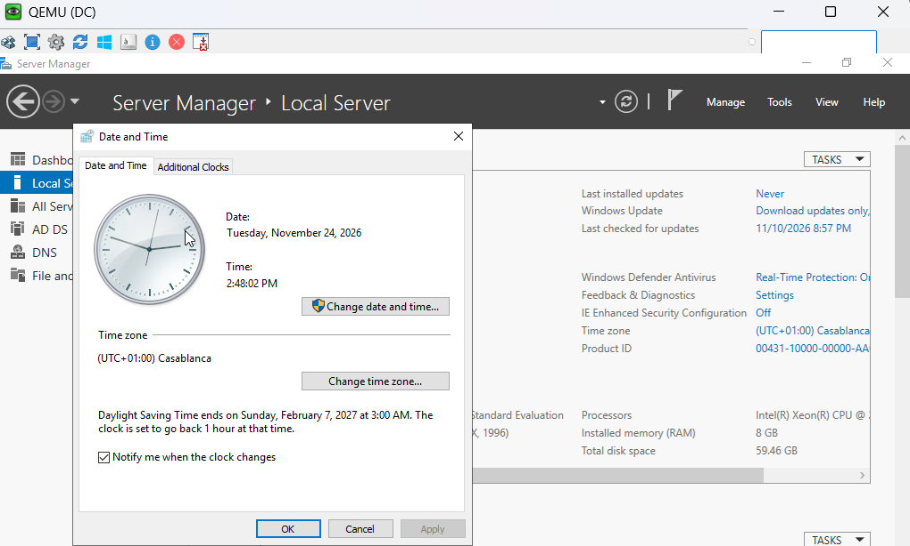

##### Domain controller, domain, OUs, groups, users
The Windows Server (*named and referenced as DC*) is promoted to **domain controller**. The domain name is set to ``cbi.local``. 3 **organizational units** are set up within that domain, one for each VLAN (Sales, IT, HR). Within each one, a **group** with the same name of the **OU** is created. And 1 **user account** is created from within each **OU** (*mehdi in the Sales OU. abdelilah in the HR OU. houssam in the IT OU*). Then each **user** is added to the corresponding **group**.

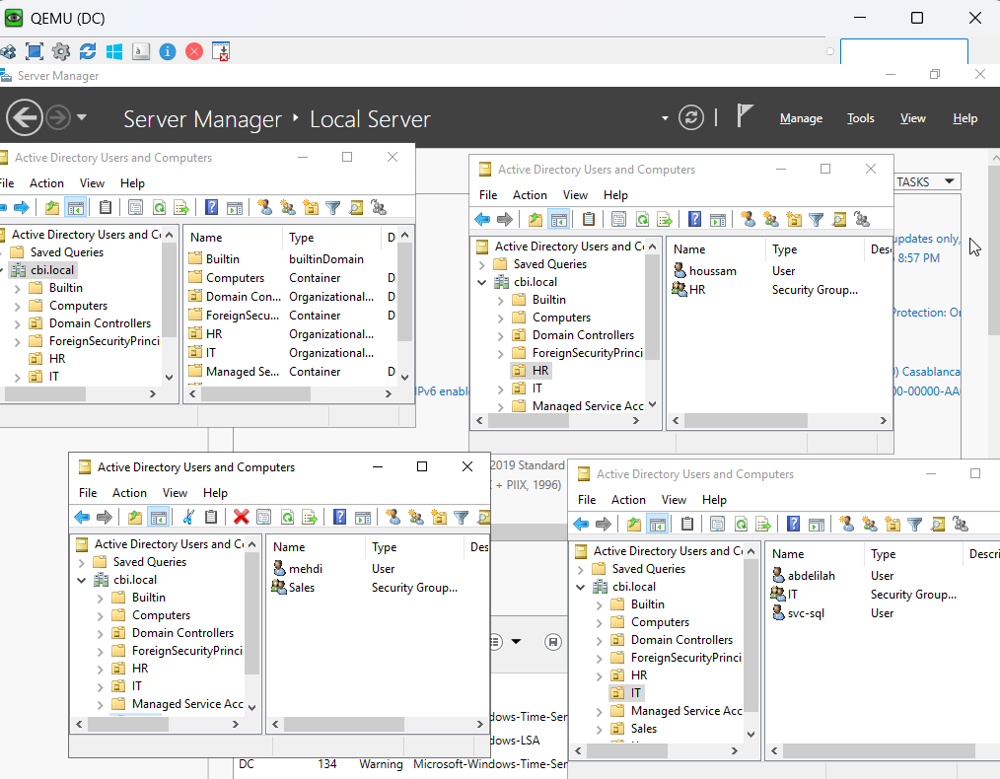

##### End-hosts names + Domain join
The Windows end-host in each VLAN (*VLANs 10,20,30*) has its name set to match its label in the lab (*HR1, Sales1, IT1 from VLANS 10,20,30*). The endhosts are joined into the domain ``cbi.local``. Setting up a name and configuring DHCP settings (*icnluding specifying the DNS as the DC's IP*) for the FW's interface of VLANs that these endhosts belong to (see > [VLANs & DHCP config](../02-firewall-base/README.md#vlans--dhcp-config)) have to be done before joining any of them to the domain.

---

**For DNS config on the DC, see:**

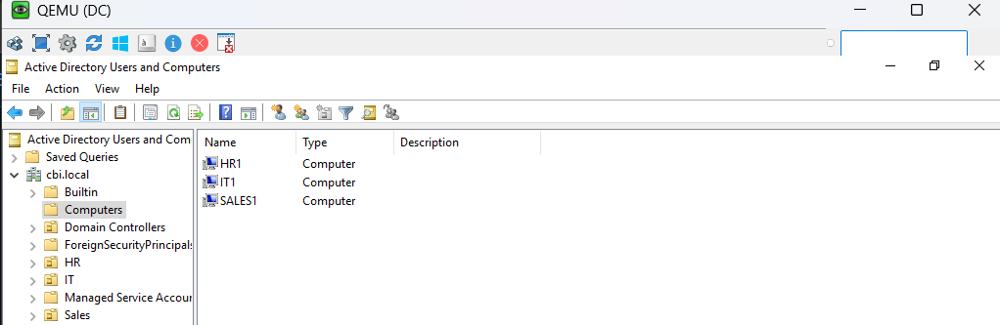

##### [DC as DNS server config](#dns-server-on-the-dc)

## DNS server on the DC

### DNS server pre-config & default Forward Lookup Zone
Once the Windows Server in VLAN40 is promoted to domain controller (*see > [Active Directory config](#domain-controller-domain-ous-groups-users)*), it serves by default as a centralized DNS server for the joined end-hosts (*ofc, the endhosts DNS server IP should be set to the DC's IP in VLAN40. See > [VLANs & DHCP config](../02-firewall-base/README.md#vlans--dhcp-config)*). Once a device joins the domain, a **DNS A record** gets generated dynamically in the default **Forward Lookup Zone**. If for example, the Windows device named ``Sales1`` joins the domain, and an AD user used it to log in, a new entry will be created as a **DNS A record** where the domain name column is populated with FQDN: ``Sales1.cbi.local``, and the corresponding IP column gets the IP of that device (*e.g. ``10.1.20.1``, in case it's on Sales VLAN*).

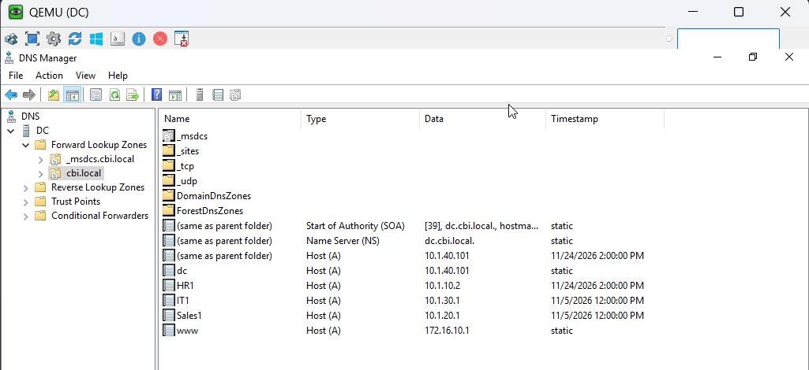

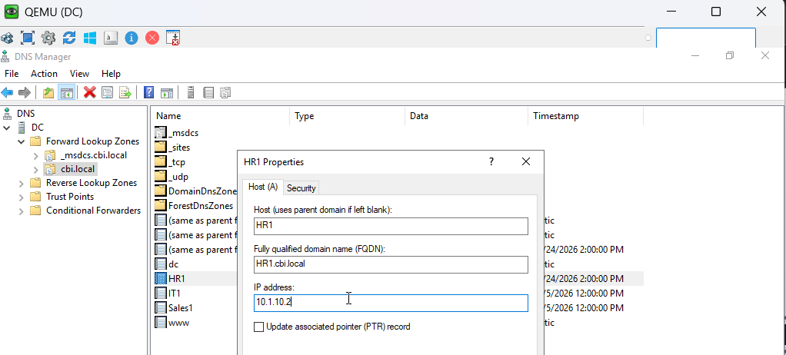

#### A records vs PTR records
As explained, the **Forward Lookup zone** allows the DC to extract the IP address from the domain name. In contrast, a **Reverse Lookup Zone** enables it to get the domain name from an IP address. The reverse zone doesn't exist by default and has to be created. In the lab, the reverse zone was configured with the following settings:
-  **Zone type**: ``Primary Zone``. *Option* "***store the zone in active directory (available only if DNS server is a writable domain controller)***" *enabled*
	- If you need to add, edit, or delete records (*or allow domain PCs to register themselves automatically*), it must be done in a Primary Zone. A secondary zone is read-only.
	- The enabled option allows the zone to be stored in the AD's database (*``ntds.dit``*). Instead of a local text file, the DNS zone becomes an Active Directory object.
		- If you add a second DC later on. AD syncs all DNS records between all DCs securely.
		- The option is available only if the DNS server (*where the zone is created*) is part of a domain controller (*which is the case here*), and not just a standalone DNS server.
- **Active Directory Zone Replication Scope**: ``To all DNS servers running on domain controllers in this domain: cbi.local``
	- The **domain option** is chosen here since we only had one domain; ``cbi.local``. The **forest option** would have been chosen if we had multiple domains in multiple trees. And the 3rd option (*for windows 2000 compatibility*) would have been chosen if we had a legacy DC running on top of a Windows Server 2000 machine.
- An **IPv4 addresses** lookup zone (*it's obvious*).
- **Reverse Lookup Zone name**: *Network ID*:  ``10.1``
	- When setting a reverse zone name, The 0s (*the host bits in an IP address*) are omitted, and only the network part of the address is used. Since the whole LAN subnet is ``10.1.0.0/16``, the Network ID 10.1 was used. This creates the next zone; ``1.10.in-addr.arpa``

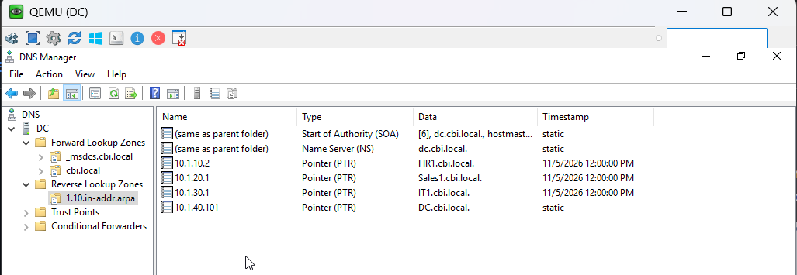

After creating the **Reverse Lookup Zone**. You have to go back to the **Forward Lookup Zone**, and for each existing **A record**, double click it, then uncheck & check the option "*update PTR record*". This way, a corresponding **PTR record** will be dynamically generated for each **A record**.

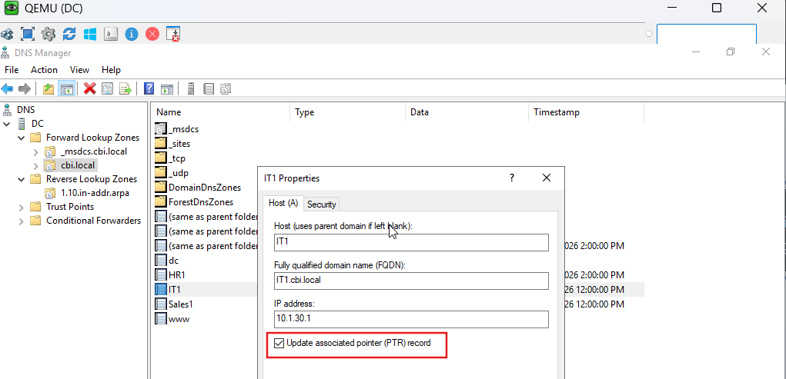

#### Adding an A record for the WebServer
A static ``A record`` is added to the **Forward Lookup zone** with the following settings:
- **Name**: ``www``
- **FQDN**: ``www.cbi.local`` (*this field is populated automatically after you enter the name*)
- **IP address**: ``172.16.10.1``
- **Create associated PTR**: *unchecked*
- **Allow any authenticated to...** : *unchecked*

In the DC's DNS server, ``www`` is the hostname assigned to the WebServer. Since ``cbi.local`` is the domain name, ``www.cbi.local`` becomes by default the **FQDN**. And it's what will be used to access the Webserver via **HTTP**. If an internal host in **VLAN10, 20, or 30** (*since those are the allowed in the policy, see > [VLANs to DMZ policy](../07-dmz-webserver/README.md#vlans-to-dmz-policy)*) wants to access the WebServer, it'll type that **FQDN** in its browser (*or use it in its ping instead of the dst IP ``172.16.10.1``*). PTR is disabled for this specific **A record** since the IP ``172.16.10.1`` (*from the DMZ subnet*) is not part of the **Network ID** configured for the **Reverse Lookup Zone** (*see the Reverse Lookup Zone settings above*).

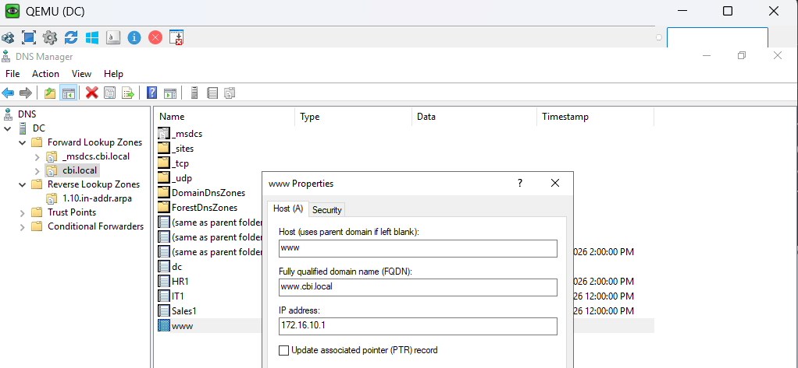

## Firewall-AD integration (LDAP and user groups)

Configured on the primary hub firewall (the secondary receives it through HA).

### Fortigate Active Directory Integration
From the left hand menu, go to **User & Authentication** > **LDAP Servers**, click create new:
- **Name:** `AD-cbi-local`
- **Server IP/Name:** `10.1.40.101`
- **Server Port:** `389`
- **Common Name Identifier:** `sAMAccountName`
- **Distinguished Name:** `DC=cbi,DC=local`
- **Bind Type:** `Regular`
- **Username:** `Administrator@cbi.local` (*domain admin UPN*)
- **Password:** ``<AD_ADMIN_PASSWORD>`` (*domain admin password*)

To test connectivity before saving settings, do the following:
- Click the **Test Connectivity** button (*It should display a green status: ``Successful``*)
- Click the **Test User Credentials** button to verify authentication with a test user.
    - Enter the ``username``(*normal username, not UPN*) & ``password`` of a domain user.
    - It should display a green status: ``Successful``
- Once you make sure all is working, click **OK** to save the LDAP server.

I'll explain some of the configured settings:
- **Common Name Identifier (`sAMAccountName`):** Tells FortiGate to identify users by their Windows logon username (*e.g., `mehdi`, ``abdelilah``, ``houssam``, `Administrator`*).
- **Distinguished Name (`DC=cbi,DC=local`):** The root search base where FortiGate looks for user and group objects.
- **Bind Account:** A service or admin account FortiGate uses to authenticate itself to AD so the DC permits directory lookups (*we used the admin account here*).
- **UPN**(*User Principal Name*) - `Administrator@cbi.local`. Once a user is created in the AD, the DC gives it a special name. The admin's UPN is what should be used as the username when we first try to integrate a Fortigate into an Active Directory domain. That special name is made up of the Windows logon username (*e.g, ``Administrator``*) and the domain name, that special name looks like an email in the following form:  UPN = sAMAccountName + @ + Domain Name
- ``sAMAccountName`` is the normal Windows logon name as explained before, and it can be used to test a user's credentials (*username & password, see the **Test User Credentials** step above*) after we succeed the 1st connectivity test.

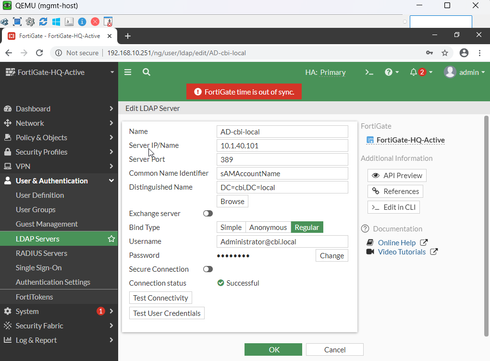

#### Map *AD security groups* to *FGT user groups*
Now that the LDAP server (`AD-cbi-local`) is connected and verified, we map Active Directory **security groups** (`IT` , `HR`, ``Sales``) to **user group objects** on the FortiGate so firewall policies can enforce access based on group membership.

From the left hand menu, go to **User & Authentication** > **User Groups**, click create new:
- **Name:** `FortiGate-IT-Group`
- **Type:** ``Firewall``.
- Under the **Remote Groups** section, click **+ Add**:
	- In the **Remote Server** dropdown, select `AD-cbi-local`
	- A directory tree will appear on the right. Search for the ``IT`` group, right click > **Add**.
- Click **OK** to save settings.

- Then create 2 other groups in the same way, one for HR, and for Sales. Set their names to `FortiGate-HR-Group` & `FortiGate-Sales-Group` and choose their corresponding group.

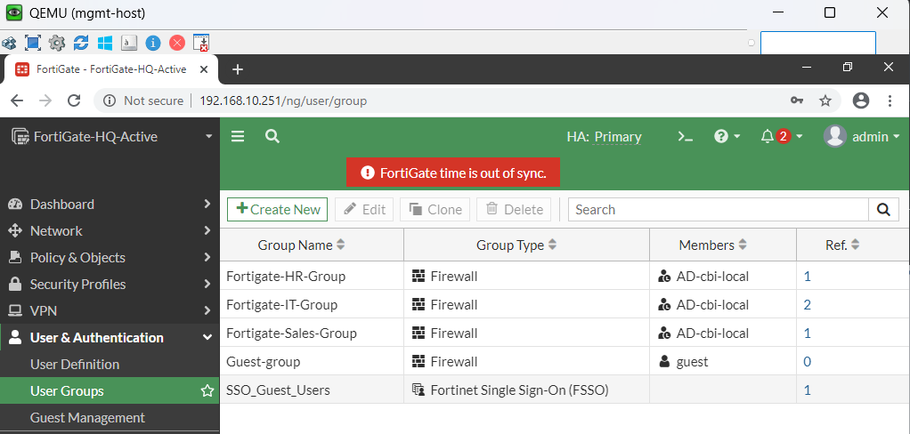

## Verification and tests

### Test 1 - Domain join and login

- **Device:** HR1
- **Commands:** `ipconfig /all` and `whoami`
- **Result:** Domain is cbi.local and the logged-in user is a CBI domain user.

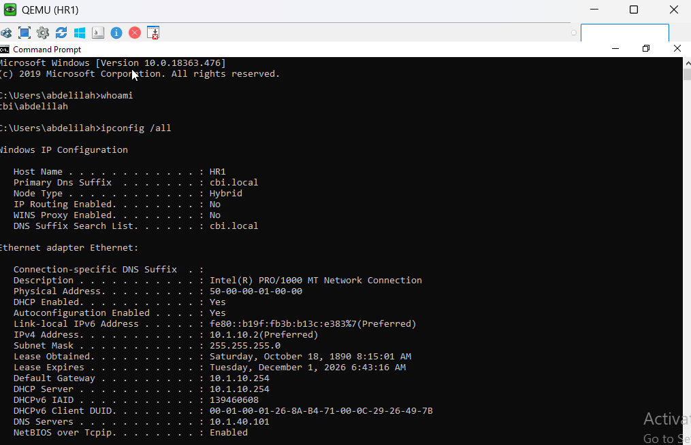

### Test 2 - Forward DNS lookup

- **Device:** IT1
- **Command:** `nslookup Sales1.cbi.local`
- **Result:** Returns the DHCP address of Sales1.

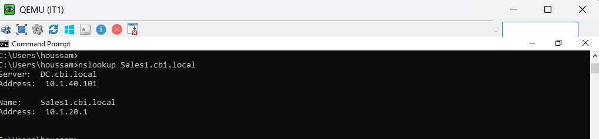

### Test 3 - Reverse DNS lookup

- **Device:** IT1
- **Command:** `nslookup <Sales1 IP>`
- **Result:** Returns Sales1.cbi.local (PTR record).

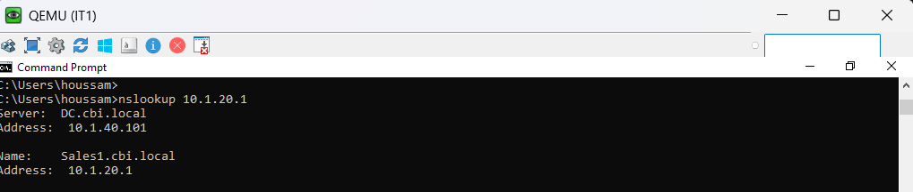

### Test 4 - WebServer record

- **Device:** Any domain host
- **Command:** `nslookup www.cbi.local`
- **Result:** Returns the WebServer address in the DMZ.

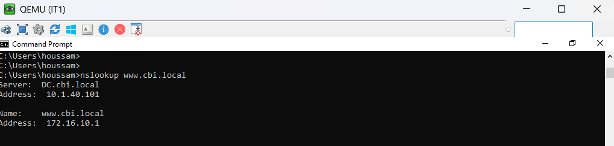

### Test 5 - Time source on the DC

- **Device:** DC
- **Command:** `w32tm /query /status`
- **Result:** Source is the firewall NTP server (VLAN40 interface).

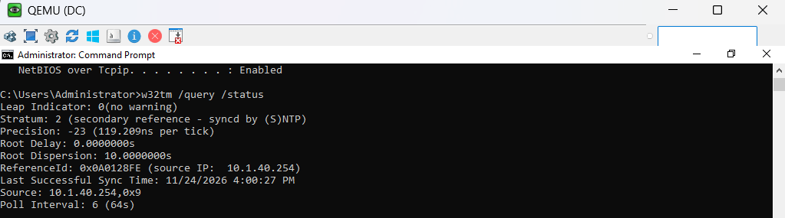

### Test 7 - LDAP connectivity

- **Device:** FortiGate GUI (User & Authentication > LDAP Servers)
- **Action:** Test Connectivity
- **Result:** Status: Successful.

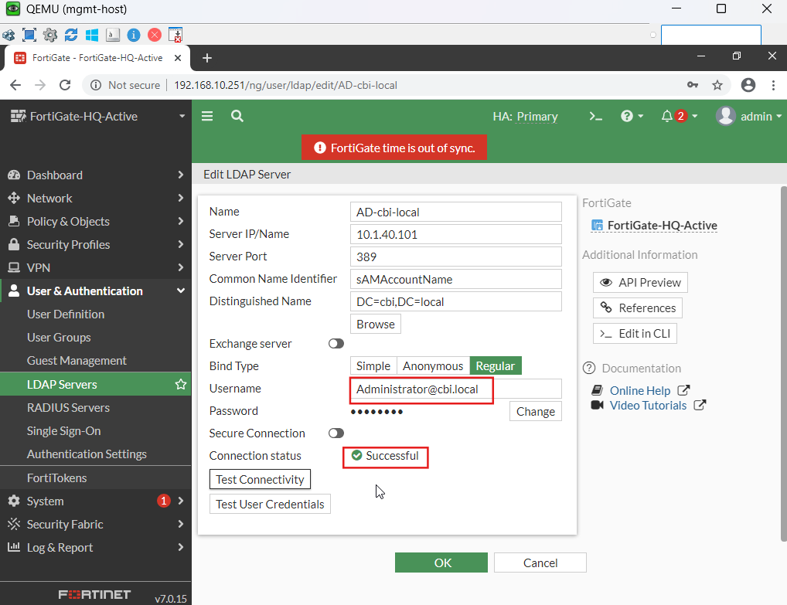

### Test 8 - LDAP user credentials

- **Device:** FortiGate-HQ-Active
- **Action:** Test User Credentials with a domain user
- **Result:** Status: Successful.

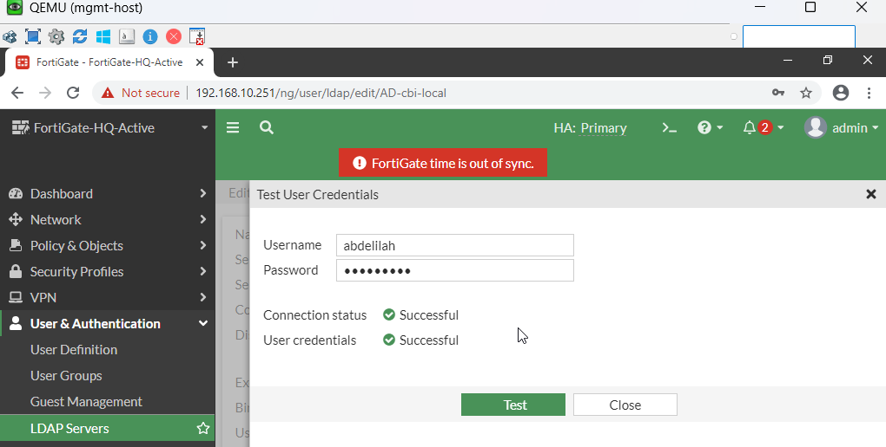

## References

- [Devin Adams setting up AD](https://youtu.be/z1U36W7d-FY)
- [Devin Adams joining PCs to the domainn creating OUs, groups, users](https://youtu.be/vEsDIY91Pz8)
- [Devin Adams configuring DNS for AD](https://youtu.be/vEsDIY91Pz8)
- [Redundant interface config](https://youtu.be/6oaE4Y2QCgs)
- [VLANS & DHCP config / inter-VLAN routing & VLAN s to WAN policies config](https://youtu.be/j_lZI_m6sgU)
