# 07 - DMZ and WebServer

[Previous: 06-active-directory](../06-active-directory/README.md) | [Main README](../README.md) | [Next: 08-zero-trust](../08-zero-trust/README.md)

A TinyCore Linux web server in the DMZ, published to the internet through a virtual IP, protected by WAF and DoS policies with a quarantine for flooding sources, and reachable from the internal VLANs by name.

## WebServer setup

### Find network Interface
To see the network interface name, run:
```bash
ip link show
```
- You'll get something like this:
  
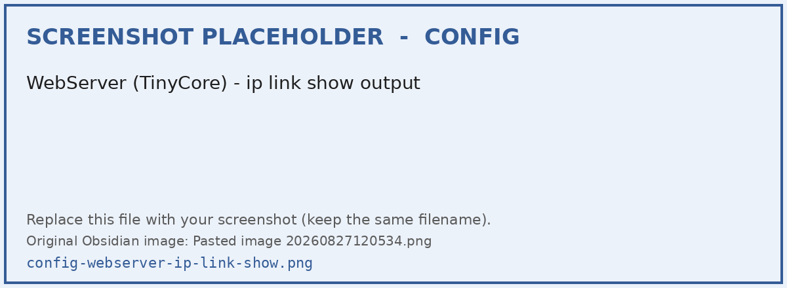

- ``eth0`` is clearly the network interface. It has got a real **MAC** from EVE-NG and it supports **MULTICAST** & **BROADCAST**. It is also **UP** (*the vm was already connected to a switch*).
- **Be aware!!, this command is useless in checking the IP settings of the interface.**

#### Set up Network settings
Edit `/opt/eth0.sh` (the boot-time network script already present in this VM image) so these settings apply automatically whenever the VM boots up:
```bash
# Open the next file
sudo vi /opt/eth0.sh
```

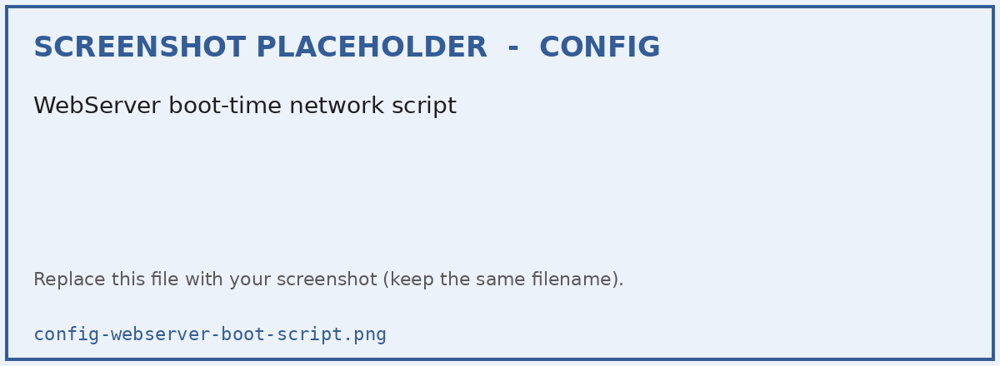

- Once you're in. Press ``a`` to enter the typing mode. Add these lines near the top of the file:
```bash
ifconfig eth0 172.16.10.1 netmask 255.255.255.0 up
route add default gw 172.16.10.254
echo "nameserver 8.8.8.8" > /etc/resolv.conf
```
- Once you're done typing. Press ``Esc`` to go back to the command mode. Then press ``Shift + Z + Z`` to save the config and exit.
- The tutorial showed that these settings should be written to the file at ``/opt/bootlocal.sh``, but the file at ``/opt/eth0.sh``  already existed in the VM set up in this lab.
	- If the ``eth0.sh`` wasn't there there, you should create it and make it executable.
- The WebServer IP is in the lab's DMZ subnet range ``172.16.10.0/24`` and the GW is the **FW**'s DMZ port IP. Google's public DNS (``8.8.8.8``) is used.

#### Set up Webserver
Set a password for the root user to enable privileged CLI and remote access:
```bash
sudo su
passwd
```
- You'll be prompted to enter the new password 2 times (*e.g. enter: ``<WEBSERVER_ROOT_PASSWORD>``*)

Download and install OpenSSH and the BusyBox HTTP daemon:
```bash
# Install OpenSSH (-w: download, -i: install to current session)
tce-load -w -i openssh

# Install Busybox HTTP daemon persistently
tce-load -wi busybox-httpd.tcz
```
- You might find those already installed (*Don't run those commands as root*).

Verify that the services run cleanly in the current session (*make sure you're still root*):
```bash
# Start OpenSSH
cd /usr/local/etc/init.d/
./openssh start

# Start TFTP
cd /etc/init.d/services/
./tftpd start

# Exit the root session
exit
```

Edit the boot script to start the web server, SSH, and TFTP automatically at boot:
```bash
# Open the next file
sudo vi /opt/bootlocal.sh
```
- Once you're in. Check if these lines already exist;
```bash
# Copy web files to HTTP document root
mkdir -p /usr/local/httpd/bin
cp /mnt/vda1/wwwsite/index.html /usr/local/httpd/bin/index.html

# Start Busybox HTTP daemon on Port 80
cd /usr/local/httpd/bin
busybox httpd -p 80 -h /usr/local/httpd/bin/

# Start SSH daemon
/usr/local/etc/init.d/openssh start

# Start TFTP service
/etc/init.d/services/tftpd start
```
- If the lines are already there. Make sure all lines are correct. If the lines were not there or if any line is missing something, press ``a`` to enter the typing mode and do your fixes. Then press ``Shift + Z + Z`` to save and exit.
- The VM used in **CBI's lab** had some lines there already but:
	- The ``mkdir`` line was missing but when I checked, I found that the directory exists already.
	- The line "``cd /usr/local/httpd/bin``" had the start slash "``/``" missing.
	- ``vda1`` is called ``sda1`` in a normal tinycore linux machine. But since this was a VM set up in EVE-NG from a **virtioa image**, we should change the name to ``vda1``

Persist all changes in `/opt/` and `/home/tc/` to the disk archive (`mydata.tgz`), then reboot:
```bash
# Commit backup
filetool.sh -b                           # make sure you get "Done" in the output

# Reboot to verify persistence
sudo reboot
```

After the reboot, run this to check the IP settings of the interface:
```bash
ifconfig eth0
```


---
> **Note on TinyCore Architecture:**
> TinyCore runs completely in RAM. All filesystem modifications outside `/mnt/sda1` (*persistent disk*) or those not included in `/opt/bootlocal.sh` and backed up via `filetool.sh -b` will be lost upon reboot.

## DMZ zone, policies and protection

### WebServer config
For the WebServer config, a Linux Tiny Core VM is placed in the DMZ zone, The server is connected to the DMZ-Switch. From the other side, the DMZ switch is connected to the DMZ ports (``port3``) of both the primary and secondary firewall (*both using the IP; ``172.16.10.254``*).
See > [Set up WebServer (Linux-tiny)](#webserver-setup) for the WebServer's OS-level setup (IP, services, boot persistence).
---

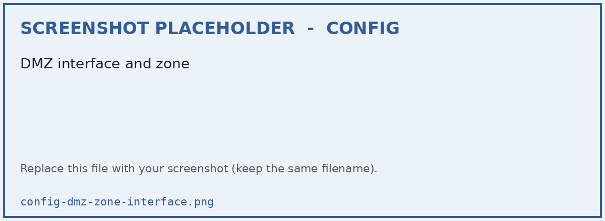

#### vIP config
On the primary hub FW, set up a vIP with the following settings:
- **VIP Type**: ``IPv4``.
- **Name**: ``WAN1-WebServer``
- **Interface**: ``any``
	- Even though the vIP will rely on WAN1's public IP, you have to omit selecting the interface here as this is the only way you can use this vIP as a dst IP in the policy below.
- **Type**: ``static NAT``
- **External IP Address/Range**: ``196.200.10.17`` (*WAN1's IP*)
- **Mapped IP Address/Range**: ``172.16.10.1`` (*WebServer's IP*)
- **Port Forwarding**: *enabled*
	- **Protocol**: ``TCP``
	- **Port Mapping Type**: ``One to one``
	- **External Service Port**: ``80`` (*port 80 on the FW*)
	- **Map to IPv4 port**: ``80`` (*port 80 on the WebServer*)

That is the virtual IP that will be used to access the WebServer from any location on the outside WAN. Then, any host (*located somewhere in the WAN*) can use the URL; ``http://196.200.10.17`` on its browser's URL bar to access  the WebServer (*port is 80 by default*).

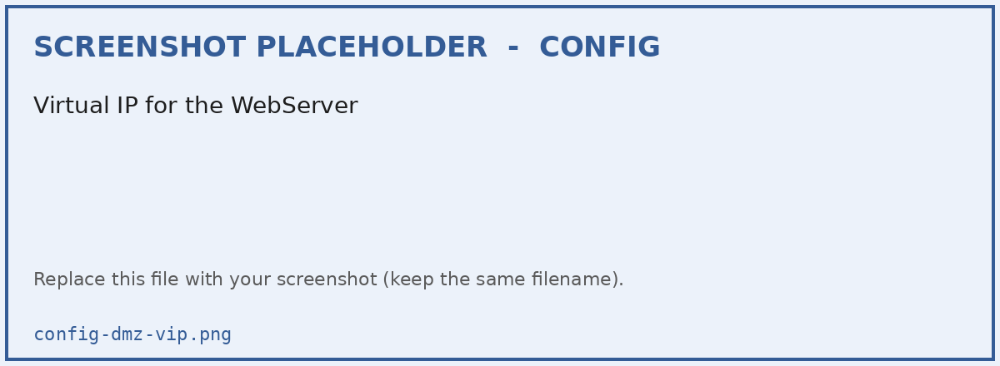


#### SD-ZONE to DMZ(WebServer) policy
Make sure you have **Web Application Firewall** turned on from **Feature Visibility**.

On the primary hub FW, configure a policy with the following settings:
- **Name**: ``SDzone-to-DMZ``
- **Incoming Interface** (*zone*): ``SD-ZONE``
- **Outgoing Interface** (*zone*): ``DMZ``
- **Source**: ``all``
- **Destination**(*vIP*): ``WAN1-WebServer``
- **Service**: ``ALL_ICMP`` & ``HTTP`` & ``HTTPS``
- **Schedule**: ``always`` / **Action**: ``ACCEPT``
- **Inspection Mode**: ``Proxy-based``
- **NAT**: *disabled*
- **Security Profiles** > **Web Application Firewall**: *enabled*
- **Security Profiles** > **SSL Inspection**: ``certificate-inspection``
- **Logging Options** > **Log Allowed Traffic**: *enabled* - ``All Sessions``

NAT (*src NAT*) is disabled since we don't want to change the src IP address of the outside host that is trying to reach our WebServer (*that is gonna be useful later on If we wanna block a malicious src IP address*). Instead, dst NAT will be applied to the incoming packets (*packets going to the WebServer*). At first, the dst of the packet will be ``196.200.10.17``(*the public IP of WAN1*), then it changes to ``172.16.10.1``(*the WebServer's private IP*). Even though ``HTTPS`` is allowed, it is not configured on the WebServer itself. So, access is be possible only via ``HTTP``. Even though **SSL Inspection** is set to ``certificate-inspection``, no inspection is applied to the incoming packets since none of them is encrypted (*HTTPs not used*). ``WAF`` is turned on, this protects the WebServer from known malicious web attacks (*XSS, SQLi, etc..*).

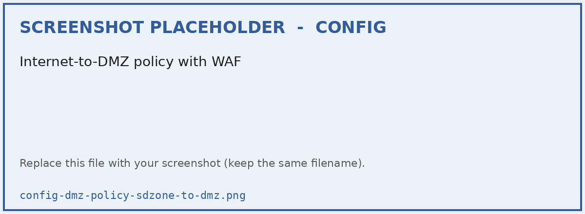


#### DOS policy
On the primary hub FW, configure a DOS policy with the following settings:
- **Name**: ``ICMP-DOS``
- **Incoming Interface**: ``WAN1(port5)``
- **Source Address**: ``all``
- **Destination Address**: ``WebServer-vIP`` (*an IP object configured with the IP ``196.200.10.17/32``*)
- **Service**: ``ALL_ICMP`` & ``HTTP`` & ``HTTPS``
- **L3 Anomalies**: ``ip_src_session`` & ``ip_dst_session``
	- **Logging**: *turned on*
	- **Action**: ``Block``
	- **Threshold**: ``5000`` (*default*)
- **L4 Anomalies**: ``tcp_syn_flood`` & ``tcp_src_session`` & ``tcp_dst_session`` & ``icmp_src_session`` & ``icmp_dst_session`` & ``icmp_sweep`` & ``icmp_flood``
	- **Logging**: *turned on*
	- **Action**: ``Block``
	- **Threshold**: ``2000`` & ``5000`` & ``5000`` & ``300`` & ``1000`` & ``100`` & ``250`` (*default*)

That is the firewall DOS policy that will protect the WebServer from DOS attacks. If an attacker exceeds one of the mentioned thresholds (*you might wanna decrease a certain threshold to test a certain attack easily*) for a specific anomaly, from that moment, packets considering that anomaly are dropped. If the traffic load goes back below the threshold, packets are allowed to get in (*even if it's from the same src (IP or TCP) or to the same dst (IP or TCP) that triggered the anamoly in 1st place*). To block malicious IPs (*e.g. an attacker's IP that is the source of an ICMP_FLOOD attack*), a quarantine blocklist (*specific to the attack type*) has to be set up.

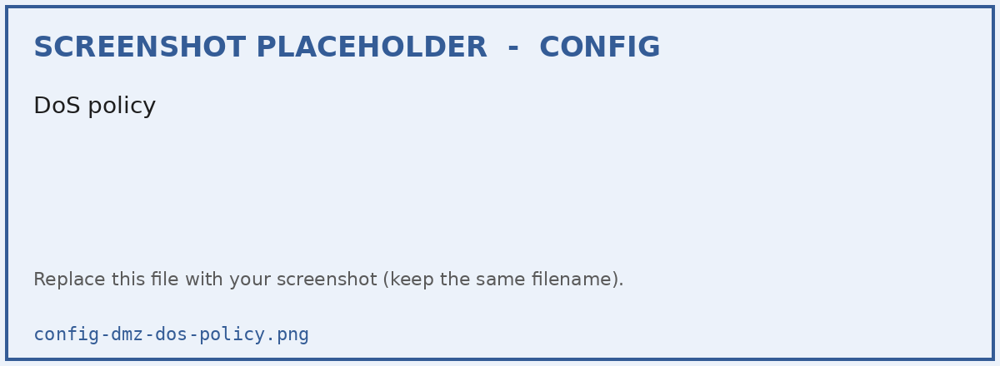


#### Blocklist for ICMP_FLOOD attacks
On the primary hub FW. Go to the configured [DOS policy](#dos-policy), right click on it, choose Edit in CLI:
```bash
# Run on the CLI
config anomaly
  edit icmp_flood
    set quarantine attacker
    set quarantine-expiry 364d23h59m
    set quarantine-log en
    end
  end
```
- A quarantine blocklist can be set only after configuring a **DOS policy** and including the ``ICMP_FLOOD`` anomaly in it.
- If an attacker exceeds the threshold set for the ``ICMP_FLOOD`` anomaly set in the [DOS policy](#dos-policy). Their IP address will automatically be blocked for a year, unless you manually delete it from the quarantine blocklist. You can do this by going to **Dashboard** > **Users & Devices** > look for the **Quarantine** widget, locate the blocked IP in the list, right click it and choose **Delete**.

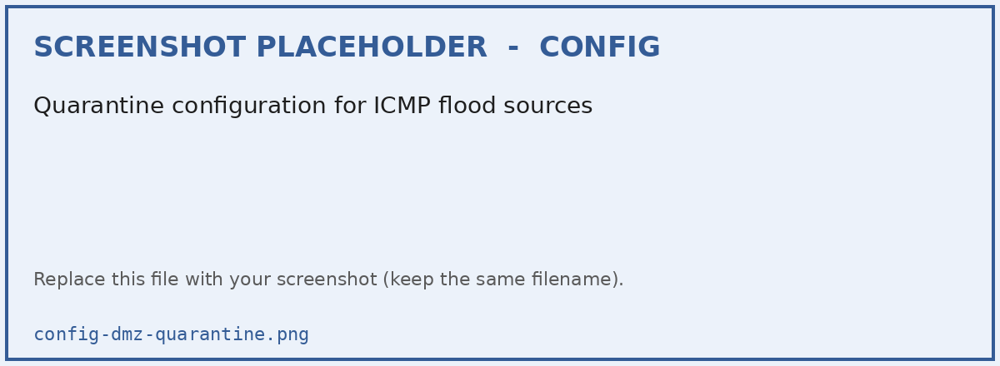


#### VLANs to DMZ policy
On the primary hub FW, configure a policy with the following settings:
- **Name**: ``VLANs-to-DMZ``
- **Incoming Interface** (*multiple*): ``VLAN10`` & ``VLAN20`` & ``VLAN30``
- **Outgoing Interface** (*port*): ``DMZ(port3)``
- **Source** (*multi IP objects*):VLAN10,20,30, subnets *``10.1.10.0/24``-``10.1.20.0/24``- ``10.1.30.0/24``*
- **Destination**(*IP object*): the WebServer's private IP object (*``172.16.10.1/32``*)
- **Service**: ``ALL_ICMP`` & ``HTTP`` & ``HTTPS``
- **Schedule**: ``always`` / **Action**: ``ACCEPT``
- **Inspection Mode**: ``Proxy-based``
- **NAT**: *disabled*
- **Security Profiles** > **Web Application Firewall**: *enabled*
- **Security Profiles** > **SSL Inspection**: ``no-inspection``
- **Logging Options** > **Log Allowed Traffic**: *enabled* - ``All Sessions``

This policy works the same way as the [SD-ZONE to DMZ(WebServer) policy](#sd-zone-to-dmzwebserver-policy). This one is customized to match **HTTP**/**HTTPS**/**ICMP** traffic coming from any host in **VLAN10** or **VLAN20** or **VLAN30**. The [DOS policy](#dos-policy) won't take part here, since it uses the vIP as a dst IP to match traffic coming to the WebServer from the outside world and not the internal VLANs.

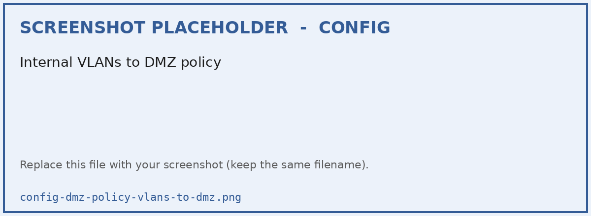


#### Internet access from DMZ
On the hub FW. The DMZ port (``port3``) is added to the policy that allows access to the internet for VLANs, the DMZ subnet IP range (``172.16.10.0/24``) is also added to the src IP field of that policy.
The original policy is [the VLANs-to-SDzone policy](../03-ha-sdwan/README.md#config). You might wanna change the policy's name to something like "**Internet-Access**".

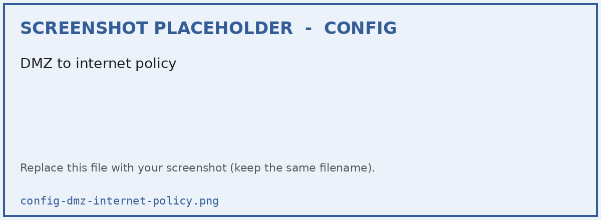

## Verification and tests

Each test lists where to run it, the command and the expected result, followed by a screenshot placeholder. Replace the placeholder images in `img/` with your own screenshots (same filename) and adjust any test to what you actually ran.

### Test 1 - Web access from the internet

- **Run on:** External host
- **Command / action:** Browse to `http://<WebServer public IP>`
- **Expected result:** The web page loads through the virtual IP.

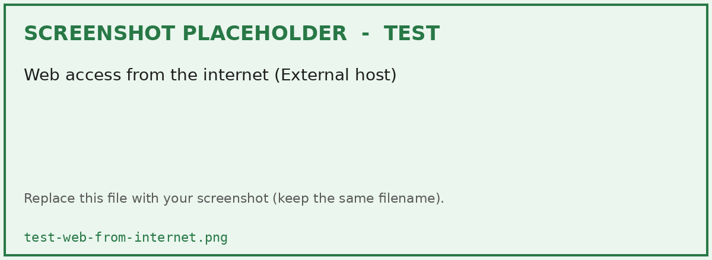

### Test 2 - Web access from an internal VLAN

- **Run on:** HR1
- **Command / action:** Browse to `http://www.cbi.local` and `ping <DMZ IP>`
- **Expected result:** Page loads and ping answers.

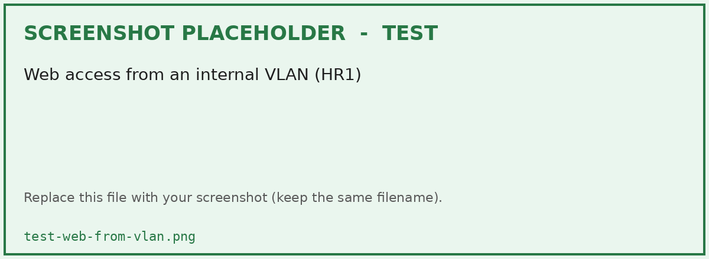

### Test 3 - Blocked VLAN (optional)

- **Run on:** DC (VLAN 40)
- **Command / action:** Browse to `http://www.cbi.local`
- **Expected result:** Timeout, since VLAN 40 is not allowed to the DMZ.

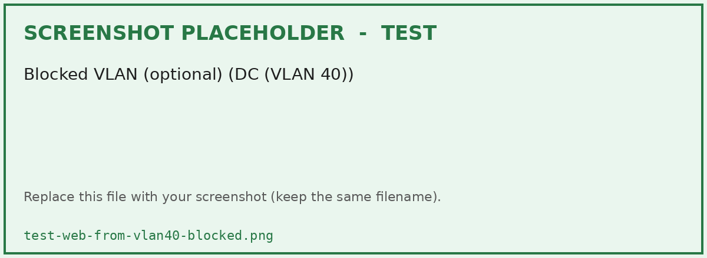

### Test 4 - DMZ to internet

- **Run on:** WebServer
- **Command / action:** `ping 8.8.8.8`
- **Expected result:** Replies received.

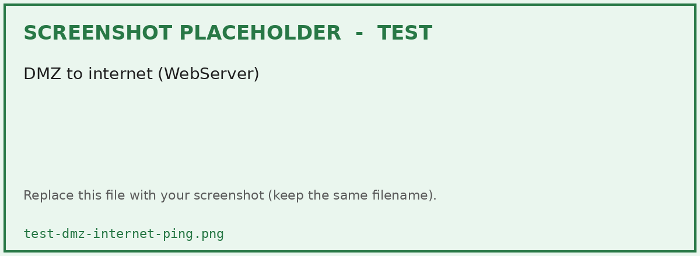

### Test 5 - Traffic log

- **Run on:** FortiGate GUI (Log & Report > Forward Traffic)
- **Command / action:** Filter on the web session
- **Expected result:** Session logged with the expected policy.

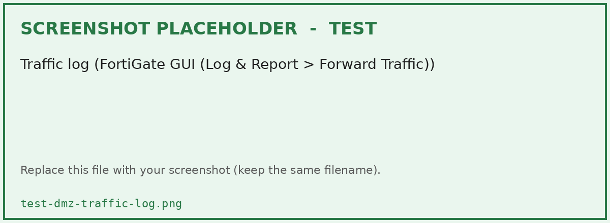

### Test 6 - ICMP flood detection

- **Run on:** External host (for example Kali)
- **Command / action:** `hping3 --icmp --flood <WebServer public IP>`
- **Expected result:** DoS anomaly logged for icmp_flood.

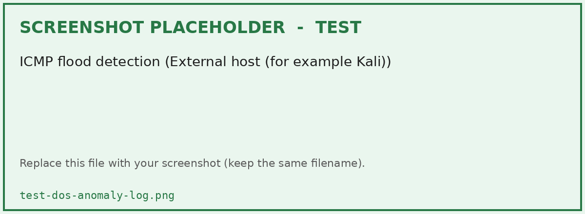

### Test 7 - Quarantine

- **Run on:** FortiGate GUI (Dashboard > Quarantine monitor)
- **Command / action:** Check after the flood
- **Expected result:** The attacker IP is quarantined.

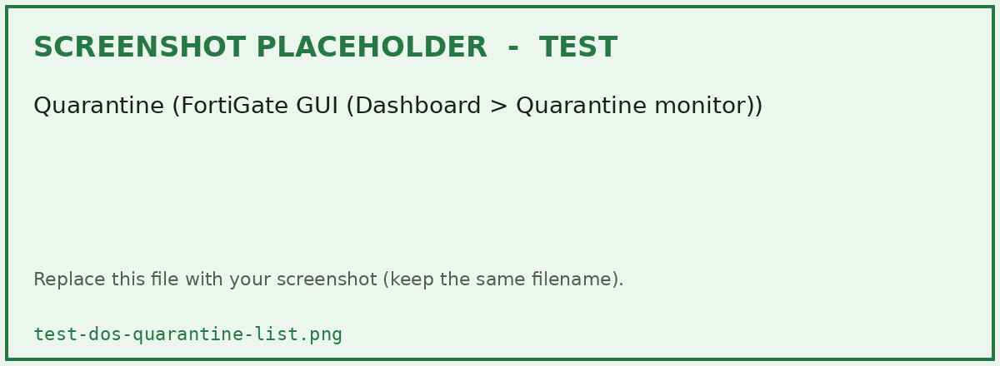

### Test 8 - WAF event (optional)

- **Run on:** External host
- **Command / action:** `curl "http://<WebServer public IP>/?id=1%27%20OR%20%271%27=%271"`
- **Expected result:** Request is logged (and blocked if the WAF action is block).

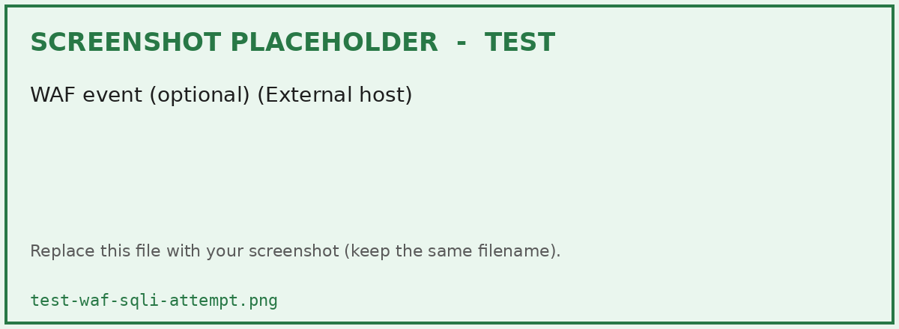

## References

- [Linux-tinycore QEMU image in the bio drive link](https://youtu.be/XRNwNw88TPs)
- [The drive link itself (in case the video was deleted)](https://drive.google.com/drive/folders/1jsbcc3SKRidAYVCkzct3Lo7VcQzFZDMz)
- [The scribd.com PDF guide to set up the WebServer](https://www.scribd.com/document/506763982/How-to-Convert-Tiny-Core-in-Web-Server) (not really accurate)
- [Devin Adams setting up the DMZ zone](https://youtu.be/-EhygoAjLXE)
