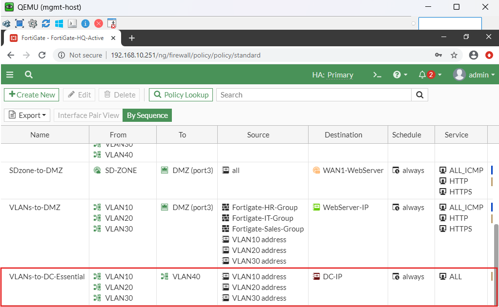
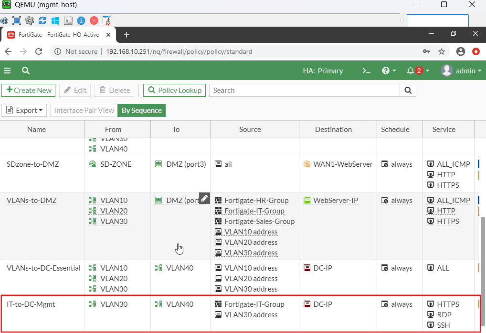
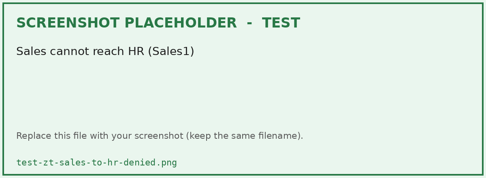

# 08 - Zero Trust segmentation

[Previous: 07-dmz-webserver](../07-dmz-webserver/README.md) | [Main README](../README.md) | [Next: 09-operations-hardening](../09-operations-hardening/README.md)

Default-deny between segments with identity-aware policies: only the services needed for domain operation reach the DC, only IT can manage it, and HR and Sales are isolated from each other.

## Firewall policies (micro-segmentation)

### Policies
Before the config, make sure you have the **Multiple Interface Policies** feature enabled.

A domain services policy is configured with the following settings:
- **Name**: ``VLANs-to-DC-Essential``
- **Incoming Interface** (*multiple): ``VLAN10`` & ``VLAN20`` & ``VLAN30``
- **Outgoing Interface** (*Interface*): ``VLAN40``
- **Source** (*multiple IP objects*): VLAN10,20,30's subnet IP objects.
- **Destination** (*IP object*): The DC's IP address object (``10.1.40.101``)
- **Service**: ``DNS`` & ``KERBEROS`` & ``LDAP`` & ``LDAP_UDP`` & ``SMB`` & ``NTP`` & ``ALL_ICMP``
- **Schedule**: ``always`` / **Action**: ``ACCEPT`` / **NAT**: *disabled*

The policy above ensures that all services needed for AD traffic are allowed. ``NTP`` is for continuous time sync with the domain-joined end hosts. ``ALL_ICMP`` is for test pings. ``DNS`` & ``KERBEROS`` & ``LDAP`` & ``LDAP_UDP``(*same as ``CLDAP``*) & ``SMB``(*``RPC`` runs inside it*) are for so many things, among them is ensuring that a new end host can join the domain.

A policy that allows the IT VLAN to access the DC for management is configured with:
- **Name**: ``IT-to-DC-Mgmt``
- **Incoming Interface** (*Interface*): ``VLAN30``
- **Outgoing Interface** (*Interface*): ``VLAN40``
- **Source**: ``VLAN30's IP`` & `FortiGate-IT-Group`
- **Destination** (*IP object*): DC's IP object (``10.1.40.101``)
- **Service**: ``RDP`` & ``HTTPS`` & ``SSH``
- **Schedule**: ``always`` / **Action**: ``ACCEPT`` / **NAT**: *disabled*

A policy that isolates the HR & Sales departments is configured with the following settings:
- **Name**: ``Sales-HR-Isolation``
- **Incoming Interface** (*multiple interfaces*): ``VLAN10`` & ``VLAN20``
- **Outgoing Interface** (*multiple interfaces*): ``VLAN10`` & ``VLAN20``
- **Source**: ``VLAN10,20's IPs`` & `FortiGate-HR-Group` & `FortiGate-Sales-Group`
- **Destination**: ``VLAN10,20's IPs`` & `FortiGate-HR-Group` & `FortiGate-Sales-Group`
- **Service**: ``ALL`` / **Schedule**: ``always`` / **Action**: ``DENY``

Traffic would be implicitly dropped by the implicit deny policy at the end even if we don't use this last policy, so, practically, there is no need for the policy, but, better to be explicit for ZT principles

## Verification and tests

Each test lists where to run it, the command and the expected result, followed by a screenshot placeholder. Replace the placeholder images in `img/` with your own screenshots (same filename) and adjust any test to what you actually ran.

### Test 1 - HR cannot reach Sales

- **Device:** HR1
- **Command:** `ping <Sales1 IP>`
- **Result:** Request timed out.

### Test 2 - Sales cannot reach HR

- **Device:** Sales1
- **Command:** `ping <HR1 IP>`
- **Result:** Request timed out.

## References

- [Redundant interface config](https://youtu.be/6oaE4Y2QCgs)
- [VLANS & DHCP config / inter-VLAN routing & VLAN s to WAN policies config](https://youtu.be/j_lZI_m6sgU)
