# 08 - Zero Trust segmentation

[Previous: 07-dmz-webserver](../07-dmz-webserver/README.md) | [Main README](../README.md) | [Next: 09-operations-hardening](../09-operations-hardening/README.md)

Default-deny between segments with identity-aware policies: only the services needed for domain operation reach the DC, only IT can manage it, and HR and Sales are isolated from each other. Pillar 3 intentionally introduces weak Kerberos settings for red-team tests.

## Zero Trust design

> **Lab only:** Pillar 3 deliberately creates weak settings (a weak service-account password and pre-authentication disabled) so Kerberos attacks can be demonstrated. Never replicate them in production.

### Pillar 1: Identity & Least Privilege Micro-segmentation
1. **Implement explicit, least-privilege East-West policies on FortiGate-HQ:**
    - **Domain Services Access (VLAN 10, 20, 30 $\to$ VLAN 40 DC):**
        - _Allowed Services:_ DNS, Kerberos (TCP/UDP 88), LDAP/LDAP_UDP, SMB (TCP 445), and NTP. Everything else dropped.
    - **Sales & HR Isolation (VLAN 10 $\leftrightarrow$ VLAN 20):**
        - Explicit `DENY` policy. An HR workstation has no legitimate operational need to initiate connections to a Sales workstation.
    - **IT Admin Bastion / Jump Access (VLAN 30 $\to$ VLAN 40 / Network Devices):**
        - Restrict management protocols (SSH, RDP, HTTPS) so they are only accepted if initiated from the IT VLAN towards the DC (`10.1.40.101`).
See > [Policies](#policies)
#### Pillar 2: Integrate Active Directory with FortiGate
Zero Trust enforces policies based on **who** is communicating, not just IP addresses.
1. **Configure LDAP on the Hub FortiGate:**
    - Go to **User & Authentication** > **LDAP Servers**.
    - Point to DC IP `10.1.40.101`, Base DN `DC=cbi,DC=local`, and bind using an administrative/service account.
2. **Create User Groups mapped to AD Security Groups:**
    - Map `FortiGate-IT-Group` $\to$ `CN=IT,OU=IT,DC=cbi,DC=local`.
    - Map `FortiGate-HR-Group` $\to$ `CN=HR,OU=HR,DC=cbi,DC=local`.
3. **Bind Firewall Policies to Identity:**
    - Update the DMZ WebServer access policy (`VLANs-to-DMZ`) or management access policies to require AD group membership in the source field, turning the firewall from a dumb L3 router into an identity-based enforcement point.

#### Pillar 3: Active Directory & Kerberos Attack Surface (Red-Team Test Setup)
To simulate realistic Kerberos attacks against the DC (`cbi.local`) before and after applying Zero Trust hardening:
##### 1. Kerberoasting Setup (The Attack Vector)
- **What it does:** Allows standard domain users to request a Kerberos service ticket (TGS) encrypted with a service account's NTLM hash, which the attacker cracks offline.
- Rapid Config on DC (`10.1.40.101`):
    - Create a service account named `svc_sql` in the **IT** **OU**, and add it the **IT group**.
    - Set a crackable password (e.g., `Password123!`).
    - Register a Service Principal Name (SPN) for it using PowerShell:
```bash
setspn -a HTTP/webserver.cbi.local svc_sql
```

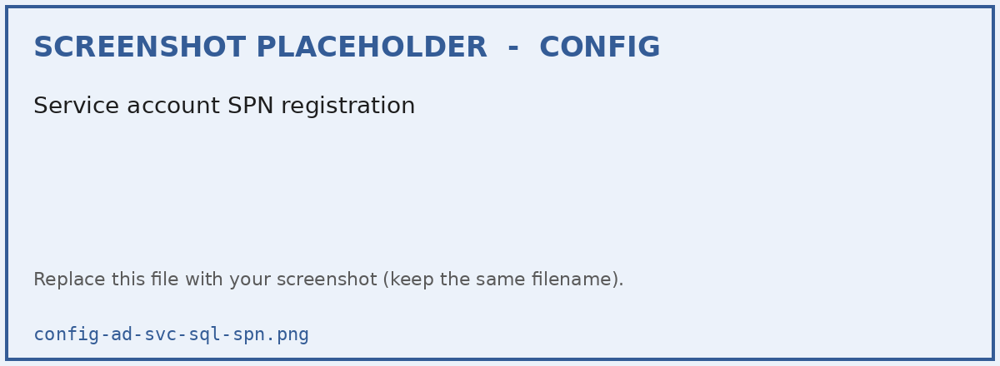

- _Test:_ Run `GetUserSPNs.py` or `Rubeus.exe kerberoast` from a domain PC (`HR1` or `Sales1`) to extract and crack the ticket.
- **The Zero Trust Defense:**
    - Enforce AES-256 Kerberos encryption types and place service accounts into the **Protected Users** group or document migration to **gMSAs** (Group Managed Service Accounts).

##### 2. AS-REP Roasting Setup (The Attack Vector)
- **What it does:** Exploits accounts that do not require Kerberos pre-authentication, allowing an attacker to request an AS-REP response containing encrypted credentials without authentication.
- **Rapid Config on DC:**
    - Open `Active Directory Users and Computers` (`dsa.msc`).
    - Select a test account (e.g., `mehdi` in Sales).
    - Under **Account** tab > **Account options**, check the box:
        `"Do not require Kerberos preauthentication"`.
    - _Test:_ Query the DC using `GetNPUsers.py` to pull the AS-REP ticket without credentials and crack the hash.
- **The Zero Trust Defense:**
    - Disable that flag, enforce pre-authentication, and implement fine-grained password policies.

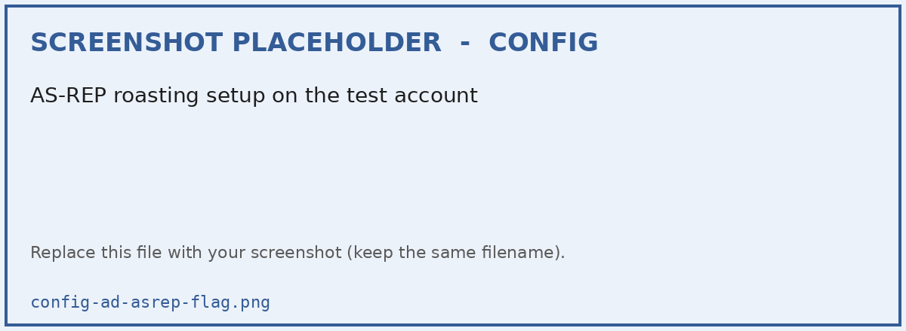

## Firewall policies (micro-segmentation)

### Policies
Before the config, make sure you have the **Multiple Interface Policies** feature enabled.

A domain services policy is configured with the following settings:
- **Name**: ``VLANs-to-DC-Essential``
- **Incoming Interface** (*multiple): ``VLAN10`` & ``VLAN20`` & ``VLAN30``
- **Outgoing Interface** (*Interface*): ``VLAN40``
- **Source** (*multiple IP objects*): VLAN10,20,30's subnet IP objects.
- **Destination** (*IP object*): The DC's IP address object (``10.1.40.101``)
- **Service**: ``DNS`` & ``KERBEROS`` & ``LDAP`` & ``LDAP_UDP`` & ``SMB`` & ``NTP`` & ``ALL_ICMP``
- **Schedule**: ``always`` / **Action**: ``ACCEPT`` / **NAT**: *disabled*


The policy above ensures that all services needed for AD traffic are allowed. ``NTP`` is for continuous time sync with the domain-joined end hosts. ``ALL_ICMP`` is for test pings. ``DNS`` & ``KERBEROS`` & ``LDAP`` & ``LDAP_UDP``(*same as ``CLDAP``*) & ``SMB``(*``RPC`` runs inside it*) are for so many things, among them is ensuring that a new end host can join the domain.

A policy that allows the IT VLAN to access the DC for management is configured with:
- **Name**: ``IT-to-DC-Mgmt``
- **Incoming Interface** (*Interface*): ``VLAN30``
- **Outgoing Interface** (*Interface*): ``VLAN40``
- **Source**: ``VLAN30's IP`` & `FortiGate-IT-Group`
- **Destination** (*IP object*): DC's IP object (``10.1.40.101``)
- **Service**: ``RDP`` & ``HTTPS`` & ``SSH``
- **Schedule**: ``always`` / **Action**: ``ACCEPT`` / **NAT**: *disabled*


A policy that isolates the HR & Sales departments is configured with the following settings:
- **Name**: ``Sales-HR-Isolation``
- **Incoming Interface** (*multiple interfaces*): ``VLAN10`` & ``VLAN20``
- **Outgoing Interface** (*multiple interfaces*): ``VLAN10`` & ``VLAN20``
- **Source**: ``VLAN10,20's IPs`` & `FortiGate-HR-Group` & `FortiGate-Sales-Group`
- **Destination**: ``VLAN10,20's IPs`` & `FortiGate-HR-Group` & `FortiGate-Sales-Group`
- **Service**: ``ALL`` / **Schedule**: ``always`` / **Action**: ``DENY``

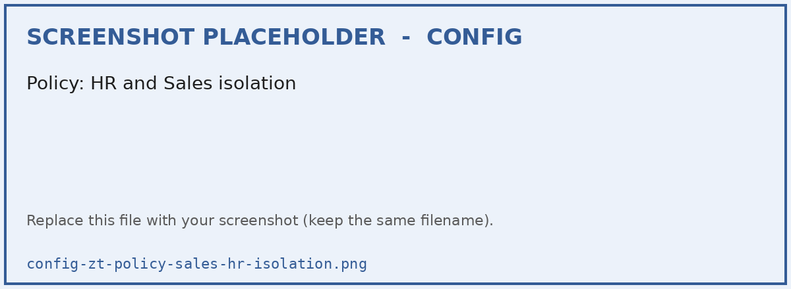


Traffic would be implicitly dropped by the implicit deny policy at the end even if we don't use this last policy, so, practically, there is no need for the policy, but, better to be explicit for ZT principles

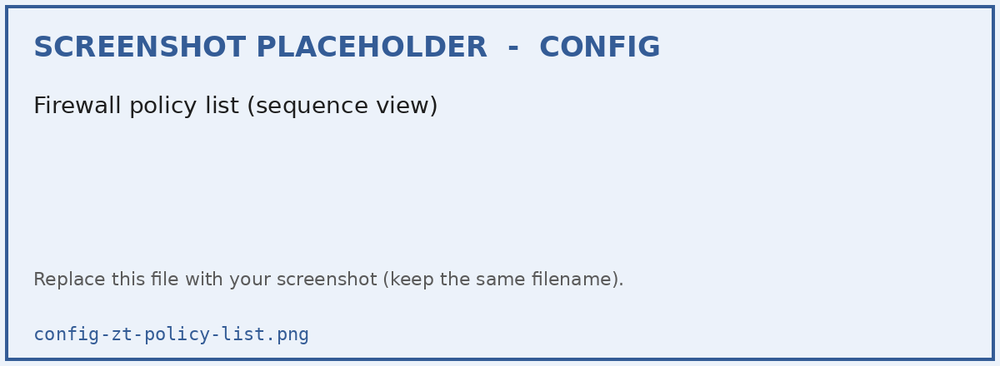

## Verification and tests

Each test lists where to run it, the command and the expected result, followed by a screenshot placeholder. Replace the placeholder images in `img/` with your own screenshots (same filename) and adjust any test to what you actually ran.

### Test 1 - HR cannot reach Sales

- **Run on:** HR1
- **Command / action:** `ping <Sales1 IP>`
- **Expected result:** Request timed out.

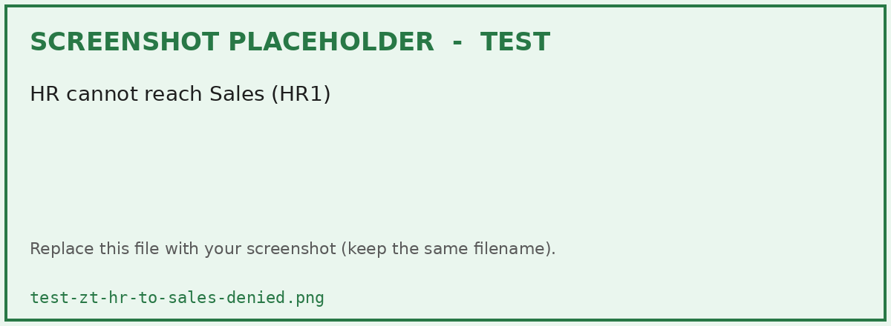

### Test 2 - Sales cannot reach HR

- **Run on:** Sales1
- **Command / action:** `ping <HR1 IP>`
- **Expected result:** Request timed out.


### Test 3 - Denied traffic is logged

- **Run on:** FortiGate GUI (Forward Traffic)
- **Command / action:** Filter on the isolation policy
- **Expected result:** Deny entries for the HR/Sales attempts.

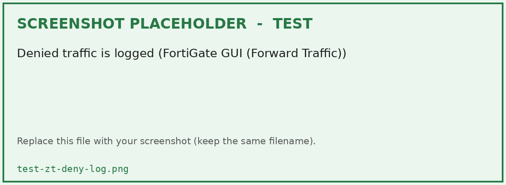

### Test 4 - IT can manage the DC

- **Run on:** IT1
- **Command / action:** `Test-NetConnection <DC IP> -Port 3389`
- **Expected result:** TcpTestSucceeded : True.

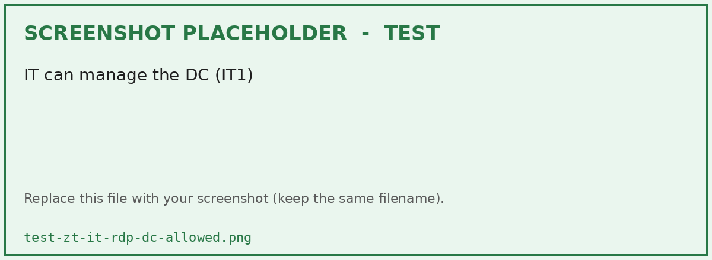

### Test 5 - HR cannot manage the DC

- **Run on:** HR1
- **Command / action:** `Test-NetConnection <DC IP> -Port 3389`
- **Expected result:** TcpTestSucceeded : False.

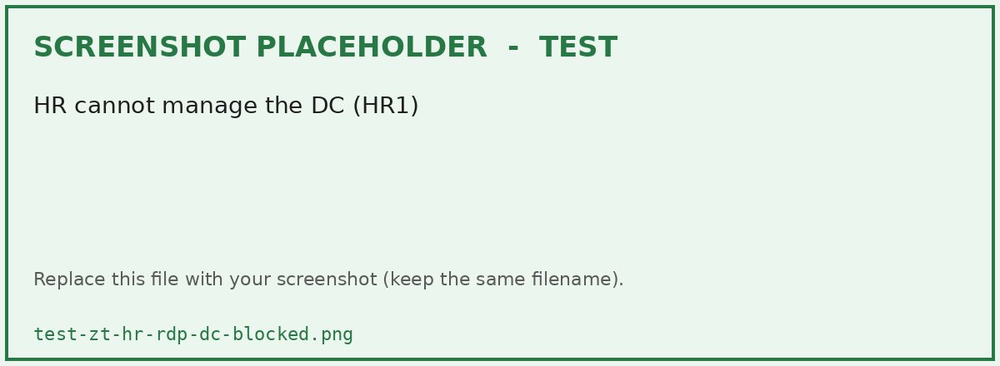

### Test 6 - Domain services still work

- **Run on:** HR1
- **Command / action:** `Test-NetConnection <DC IP> -Port 389`
- **Expected result:** TcpTestSucceeded : True.

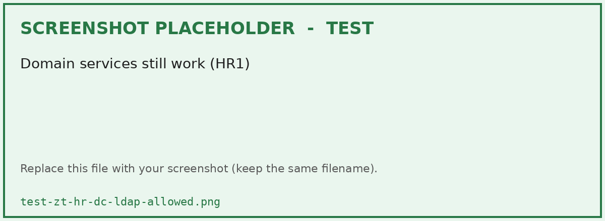

### Test 7 - Policy hit counters

- **Run on:** FortiGate GUI (Policy & Objects)
- **Command / action:** Policy list with hit counts
- **Expected result:** Counters increment on the policies exercised above.

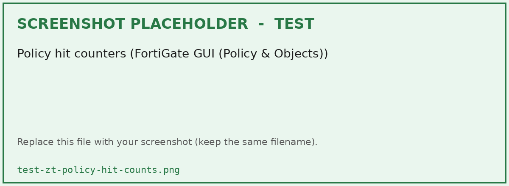

### Test 8 - Kerberoasting (optional)

- **Run on:** Domain PC
- **Command / action:** `Rubeus.exe kerberoast` or `GetUserSPNs.py`
- **Expected result:** A service ticket for the SPN account is returned.

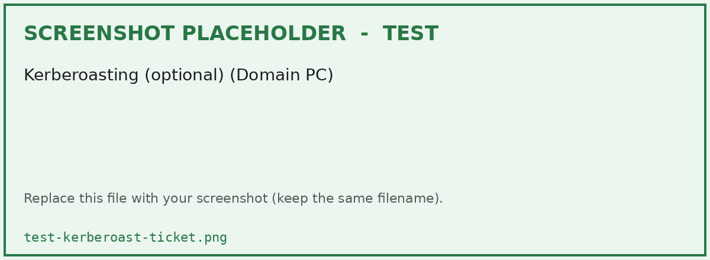

### Test 9 - AS-REP roasting (optional)

- **Run on:** Domain PC or attacker host
- **Command / action:** `GetNPUsers.py cbi.local/ -usersfile users.txt -dc-ip <DC IP> -no-pass`
- **Expected result:** An AS-REP hash is returned for the account without pre-auth.

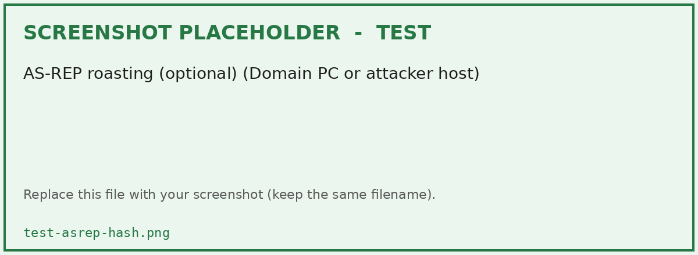

## References

- [Redundant interface config](https://youtu.be/6oaE4Y2QCgs)
- [VLANS & DHCP config / inter-VLAN routing & VLAN s to WAN policies config](https://youtu.be/j_lZI_m6sgU)
