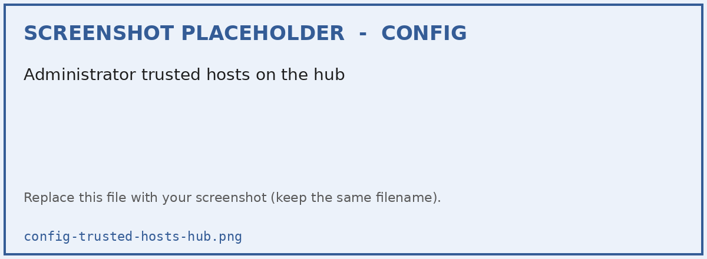
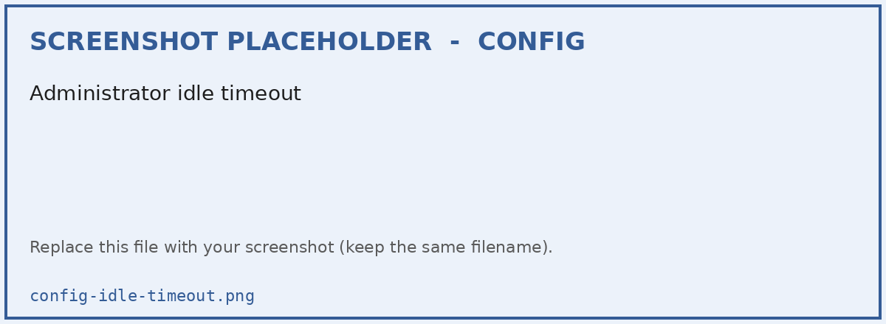
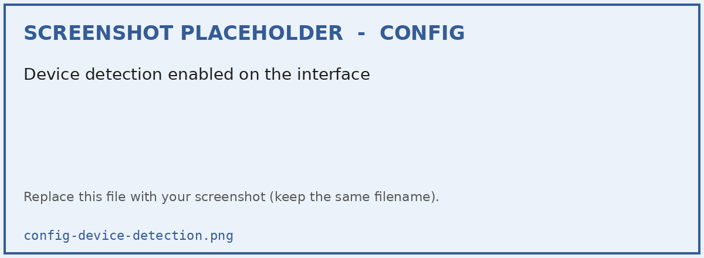
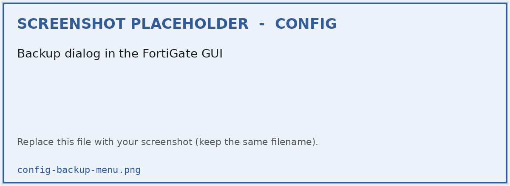
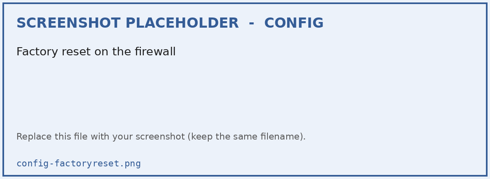
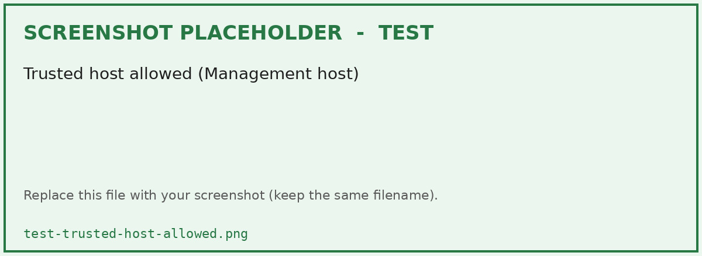
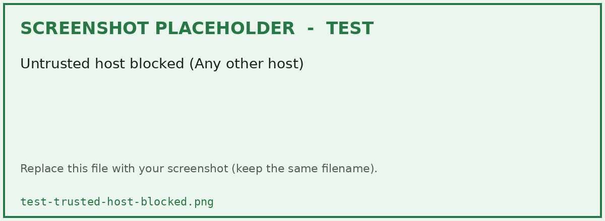
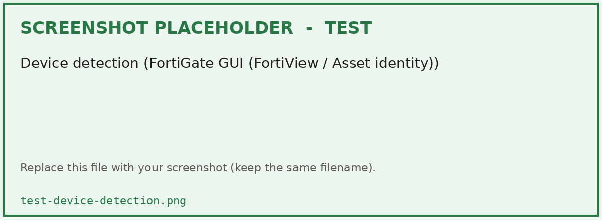
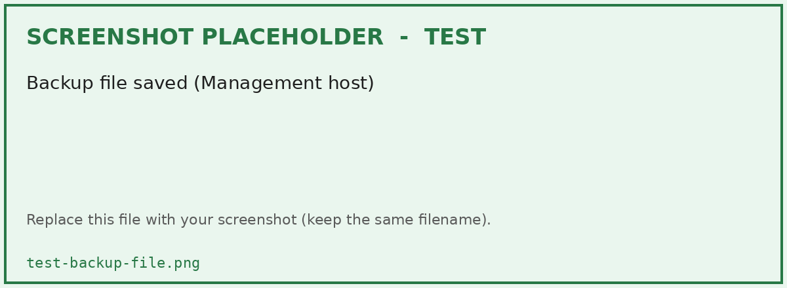
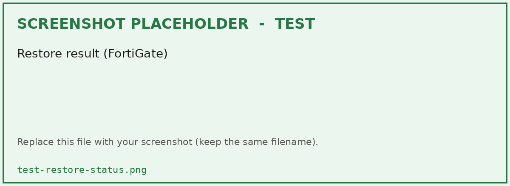

# 09 - Operations and hardening

[Previous: 08-zero-trust](../08-zero-trust/README.md) | [Main README](../README.md)

Restricting administrative access with trusted hosts, device detection and session timeouts, and backing up / restoring a FortiGate configuration.

## Restrict management access

### Hub Firewalls
On the Primary Firewall. Go to **System** on the left sidebar > Edit the default ``admin`` account. Under the **Trusted Hosts** section, Enter the exact IP and prefix length of the mgmt host (*e.g. ``192.168.10.60/32`` for one specific mgmt host*). The Secondary Firewall will sync its mgmt access settings automatically through the HA heartbeat interfaces.




### Branch Firewalls
On each branch FW. Go to **System** on the left sidebar > Edit the default ``admin`` account. Under the **Trusted Hosts** section, Enter the exact IP and prefix length of the mgmt host (*e.g. ``192.168.10.60/32`` for one specific mgmt host*).


## Device detection and idle timeout

### Idle Timeout
On all firewalls. From the lefthand panel, Go to **System** > **Settings** > **Idle timeout** > Set it to ``1440``. This extends your session to 1440s (*480m*), so that you have more time before you get logged out.




#### Device Detection
On the hub primary FW. Turn on **Device detection** for the **VLAN subinterfaces** & **DMZ port** & **MGMT port**. Do the same on each branch FW, but just for the **LAN port**.
- This makes the MAC addresses appear in the log files in FortiView.


<!-- TODO(verify): the idle timeout unit - FortiGate takes minutes, but the text says 1440s (480m); check which value you set -->



## Backup and restore

When using a Fortigate firewall with an **evaluation license** that ends after a period of time (*usually 15 days*), you have to save the firewall config as a **backup** right before the period ends, and then restore it later after you **factoryreset** your firewall. The factoryreset allows you to use the firewall for the same period of time again, you'll have to redo this **backup-reset-restore** cycle again and again as long as you're still using the firewall.

First, to save the backup file to your mgmt host, head to the firewall's GUI and:
- Go to the top right corner where your username (*admin*) is displayed next to an icon
- Click on it. Go to **Configuration** > click on **Backup**. Choose **Local PC** to backup to and click **Ok**.
- A ``.conf`` file will be automatically saved in your mgmt host.




Then, run a factory-reset on your firewall:
```bash
execute factoryreset2   # Type "y" to confirm
```



- `factoryreset2` is used instead of ``factoryreset`` because it leaves your interfaces config as it is. This makes sure you don't loose your mgmt interface config as well as the other interfaces.
- By this, your evaluation license time will reset and you can use the FW for another 15 days.

Then, to restore your configuration, head to the firewall's GUI again and:
- Go to the top right corner where your username (admin) is displayed next to an icon.
- Click on it. Go to **Configuration** > click on **Restore**. Select **Local PC**
- Upload the ``.conf`` backup file  and click **OK**

Your firewall will then **reboot** and allow you to log in with the same old credentials you used (*the default ``admin`` username & the password you've configured before*). All your previous config will be backed up by this time.

### Note - HA cluster
If you have HA configured between 2  or more firewalls. You only need to backup the primary firewall and then configure the secondary firewall(s) (*after you factory reset it*) to be in the same **HA group** with the same **heartbeat interfaces** and same **HA password**. Then reboot all HA firewalls and wait until they're synced again (*the mgmt IP of each firewall also needs to be configured separately*). Once they're synced again, change the hostname of the secondary firewall.

## Verification and tests

Each test lists where to run it, the command and the expected result, followed by a screenshot placeholder. Replace the placeholder images in `img/` with your own screenshots (same filename) and adjust any test to what you actually ran.

### Test 1 - Trusted host allowed

- **Run on:** Management host
- **Command / action:** Log in to the FortiGate GUI
- **Expected result:** Login succeeds.



### Test 2 - Untrusted host blocked

- **Run on:** Any other host
- **Command / action:** Try to log in to the FortiGate GUI/SSH
- **Expected result:** Connection refused or login fails.



### Test 3 - Device detection

- **Run on:** FortiGate GUI (FortiView / Asset identity)
- **Command / action:** Open the device list
- **Expected result:** End hosts show with MAC and hostname.



### Test 4 - Backup file saved

- **Run on:** Management host
- **Command / action:** Show the downloaded .conf backup in the file manager
- **Expected result:** Backup file present (do not commit it).



### Test 5 - Restore result

- **Run on:** FortiGate
- **Command / action:** After restore, `get system status`
- **Expected result:** Configuration restored and unit back in the cluster.


