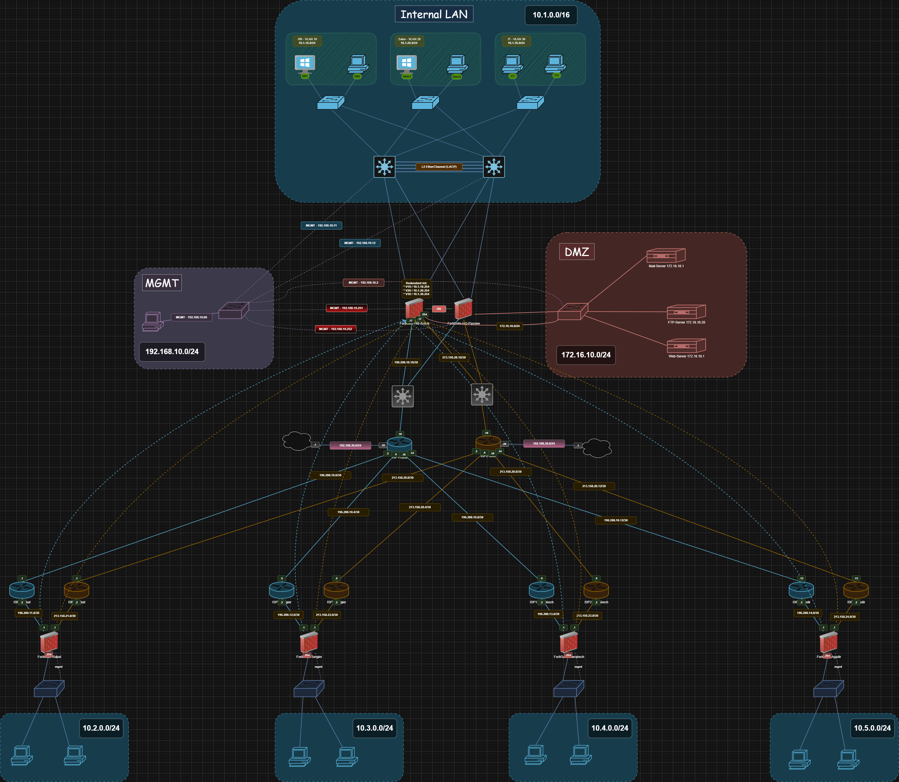

# Enterprise SD-WAN & Network Security Lab

A multi-site enterprise network built on **EVE-NG**: a Casablanca headquarters with a **FortiGate active-passive HA cluster**, a redundant campus LAN, a DMZ and a central **Active Directory** domain (`cbi.local`), connected to **Rabat** and **Tangier** branch offices over a **dual-ISP BGP underlay** with **IPsec VPN tunnels steered by SD-WAN**. Traffic between segments follows **Zero Trust** principles.

## 🌐 Topology

## 🛠️ Technical Stack
* **Platform**: EVE-NG
* **Firewalls**: FortiGate (HA, SD-WAN, IPsec VPN, security policies, WAF, DoS protection, virtual IPs)
* **Routing**: BGP (eBGP + iBGP with simulated ISPs), static routing, inter-VLAN routing
* **Layer 2**: Rapid-PVST+, LACP EtherChannel, VTP, VLAN segmentation
* **Identity & Services**: Active Directory, DNS, DHCP, LDAP integration with the firewall
* **DMZ**: Tiny Core Linux web server
* **Switches & ISP routers**: Cisco IOS

## 📂 Project Structure
Every phase folder has its own README with the configuration (and screenshots), followed by the tests that prove it works.

| # | Phase | What it covers |
|---|-------|----------------|
| 01 | [Campus LAN](./01-campus-lan/) | VLANs, VTP, Rapid-PVST roots, LACP EtherChannels, SSH management |
| 02 | [Firewall base](./02-firewall-base/) | DNS/NTP, redundant LAN interface, VLAN interfaces and DHCP, management access |
| 03 | [HA and dual-ISP SD-WAN](./03-ha-sdwan/) | Active-passive HA, SD-WAN zone with SLA, default route, internet access for EVE-NG |
| 04 | [BGP underlay](./04-bgp-underlay/) | eBGP/iBGP between the firewalls and the simulated ISPs |
| 05 | [IPsec VPN over SD-WAN](./05-ipsec-vpn-sdwan/) | Hub-and-spoke tunnels, SLAs, SD-WAN rules, fail-closed blackhole, troubleshooting |
| 06 | [Active Directory](./06-active-directory/) | Domain, DNS, domain join, LDAP integration and user groups on the FortiGate |
| 07 | [DMZ and WebServer](./07-dmz-webserver/) | Virtual IP, WAF, DoS policy, quarantine, internal access by name |
| 08 | [Zero Trust](./08-zero-trust/) | Default-deny micro-segmentation, identity-aware policies, Kerberos attack surface |

* [**Topology**](./topology/) - Network diagram
* [**Documentation**](./documentation/) - IP addressing plan

## 🚀 Key Features
* **Hub-and-spoke WAN**: HQ plus two branches, each connected by two IPsec tunnels (one per ISP path).
* **High availability**: FortiGate active-passive HA, plus a redundant interface towards the core switches and LACP between switches.
* **Dual-ISP SD-WAN**: SLA health checks and rules for failover, at the internet edge and across the VPN.
* **Fail-closed VPN**: a blackhole route stops branch traffic leaking out in clear when no tunnel is up.
* **BGP underlay**: eBGP to the ISPs and iBGP between them, using simulated ISP ASNs.
* **Active Directory integration**: domain, DNS with reverse zone, and AD groups mapped to FortiGate user groups over LDAP.
* **Protected DMZ**: virtual IP, WAF, DoS policy and quarantine for ICMP flood sources.
* **Zero Trust segmentation**: default deny, only essential services to the DC, IT-only DC management, HR/Sales isolation.

## 🔧 Troubleshooting Highlights
The VPN phase documents three real issues and their fixes: [Troubleshooting VPN issues](./05-ipsec-vpn-sdwan/README.md#troubleshooting-vpn-issues).

## 🔐 About Credentials
All passwords and pre-shared keys in this repository are replaced by placeholders such as `<IPSEC_PSK>`, `<AD_ADMIN_PASSWORD>`, `<HA_PASSWORD>`, `<SWITCH_ADMIN_PASSWORD>` and `<WEBSERVER_ROOT_PASSWORD>`. Use your own strong values.

## 📺 Demonstration
<!-- TODO(add): demo link (LinkedIn) -->

## 📄 License
MIT, see [LICENSE](./LICENSE).
